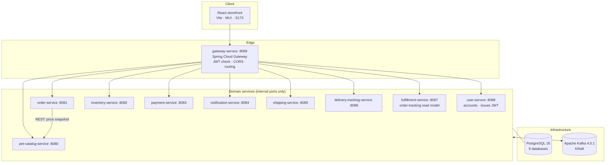

# 01 · Overview and tech stack

## What Pet Planet is

Pet Planet is an online pet shop. Customers browse a catalog, add pets to a cart, check out, and watch their order move from *created* to *delivered* on a live timeline. Admins manage pets, users and inventory, and advance deliveries.

It is a **learning project for microservices and event-driven architecture**. Standard, explainable patterns are preferred over shortcuts. Two features are deliberately simulated: **payment** (charged automatically, no card) and **notifications** (stored and marked sent, no e-mail).

**Why it is interesting:** every pet is a unique item with stock of one. Two customers can try to buy the same pet at the same moment, a payment can succeed after a reservation has expired, and a customer can cancel while a charge is in flight. The checkout is therefore a **choreographed saga** across inventory, payment and order, with compensation (release and refund) for every failure path.

## The system at a glance



| Service | Port | Owns (source of truth) |
|---|---:|---|
| gateway-service | 8089 (published) | Nothing. Edge only: token validation, coarse role rules, CORS, routing |
| user-service | 8088 | Accounts, BCrypt credentials, roles, **JWT issuance** |
| pet-catalog-service | 8080 | Pet descriptions and prices; a read-only copy of availability |
| order-service | 8081 | Orders, item snapshots, the **order state machine** |
| inventory-service | 8082 | **Availability** of each pet: reservations, expiry, sales |
| payment-service | 8083 | Payments (simulated), refunds |
| notification-service | 8084 | Typed customer notifications (simulated sending) |
| shipping-service | 8085 | Shipments and tracking numbers; mirrors delivery status |
| delivery-tracking-service | 8086 | Carrier progress and timeline; the one "advance delivery" action |
| fulfillment-service | 8087 | **Order-tracking projection** (CQRS read model) built from events |

Only the gateway (`:8089`) and the storefront (`:5173`) are published to your machine. All backend ports stay inside the Docker network. Details: [02 Architecture](02-architecture.md).

## Tech stack

### Backend

| Technology | Version | Used for |
|---|---|---|
| Java | 17 | All services |
| Spring Boot | 3.5.5 | Every service (`spring-boot-starter-parent`) |
| Spring Cloud Gateway (WebFlux) | 2025.0.0 | `gateway-service`: reactive routing |
| Spring Web MVC | Boot 3.5.5 | REST controllers in the 9 domain services |
| Spring Security + OAuth2 Resource Server | Boot 3.5.5 | JWT validation in all 10 services |
| Nimbus `JwtEncoder` | via Spring Security | RS256 token signing in user-service |
| BCrypt | via Spring Security | Password hashing |
| Spring Data JPA / Hibernate 6 | Boot 3.5.5 | Persistence (`ddl-auto: validate`) |
| Flyway | Boot-managed | Schema migrations per service |
| Spring Kafka | Boot-managed | Producers (outbox relay) and `@KafkaListener` consumers |
| Bean Validation | Boot 3.5.5 | Request DTO validation |
| springdoc-openapi | 2.8.13 | `/api-docs` and `/swagger-ui.html` on each domain service (internal ports) |
| Spring Boot Actuator | Boot 3.5.5 | `/actuator/health` for Docker health checks |
| Lombok | Boot-managed | Boilerplate reduction in 8 services |
| Maven (wrapper) | 3.9.x | Build; root aggregator `pom.xml` with 11 modules |
| `platform-commons` | in-repo | Shared infrastructure library: Kafka conventions, outbox relay, security, error body |

### Data and messaging

| Technology | Version | Used for |
|---|---|---|
| PostgreSQL | 16 (`postgres:16-alpine`) | One container, nine databases (one per domain service) |
| Apache Kafka | 4.0.1 (`apache/kafka`, KRaft, no ZooKeeper) | Event backbone, one topic per event type, `<topic>.DLT` dead-letter topics |
| Kafka UI | `ghcr.io/kafbat/kafka-ui:v1.2.0` (optional) | Browsing topics, messages and DLTs |

### Frontend

| Technology | Version | Used for |
|---|---|---|
| React | 18.3.1 | UI |
| React Router | 6.28.0 | Routing and route guards |
| Vite | 5.4.10 | Dev server and production build |
| Material UI (MUI) + Emotion | 5.16.x | Components and theme |
| Axios | 1.7.x | The single HTTP client |
| puppeteer-core | 23.11.1 (dev) | Headless UI walkthrough (`make ui-check`) using local Chrome |
| Playwright (`@playwright/test`) | 1.65.1 (dev) | Browser end-to-end tests (`make e2e`) with its own Chromium |

### Testing and tooling

| Technology | Used for |
|---|---|
| JUnit 5, Mockito, AssertJ (`spring-boot-starter-test`) | Unit and slice tests |
| `@WebMvcTest`, `@SpringBootTest` | Controller and gateway tests with real RS256 tokens |
| ArchUnit 1.4.1 | 11 package-boundary rules per service |
| Testcontainers 1.21 | Real Kafka (platform-commons) and real PostgreSQL (fulfillment) tests |
| Bash + curl (`scripts/smoke-test.sh`) | 82 end-to-end checks against the running stack |
| Playwright 1.65.1 (`frontend/e2e/`) | 25 browser end-to-end tests against the running stack ([13](13-playwright-e2e.md)) |
| Docker Compose, BuildKit, Make | Local stack, image builds, everyday commands |

## Repository layout

```
pet-planet/
├── pom.xml, mvnw, mvnw.cmd, .mvn/   Maven aggregator + wrapper (no global Maven needed)
├── Makefile                         Everyday commands (make help)
├── docker-compose.yml               The whole local stack
├── .env.example                     Template; make up creates .env with fresh secrets
├── CLAUDE.md                        Instructions for AI coding assistants
├── docs/                            This documentation
├── platform-commons/                Shared infrastructure-only library (not deployable)
├── gateway-service/                 ┐
├── user-service/                    │
├── pet-catalog-service/             │
├── order-service/                   │
├── inventory-service/               │ 10 deployable Spring Boot services,
├── payment-service/                 │ each with pom.xml, Dockerfile, src/, Flyway migrations
├── notification-service/            │
├── shipping-service/                │
├── delivery-tracking-service/       │
├── fulfillment-service/             ┘
├── frontend/                        React storefront (Vite)
├── infrastructure/postgres/init/    Creates the 9 databases and roles on a fresh volume
└── scripts/                         generate-dev-keys.sh, smoke-test.sh, seed-demo.sh
```

Inside each service and the frontend, the folder a file lives in defines its job. See [09 Code structure and design patterns](09-code-structure-and-patterns.md).

## Quickstart

**Prerequisites:** Docker Desktop with at least 4 GB of memory (6 GB recommended) and `make`. For tests: JDK 17 (no Maven install needed). For the UI check: Node 20 and Chrome. For the Playwright tests: Node 20 (Playwright downloads its own Chromium).

```sh
make up      # first run: creates .env with fresh secrets, builds every image, starts, waits until healthy
make seed    # optional: 8 more pets, a second customer and 3 orders at different delivery stages
```

Open **http://localhost:5173** and sign in:

| Account | Email | Password |
|---|---|---|
| Customer | `customer@petplanet.com` | `password123` |
| Admin | `admin@petplanet.com` | `password123` |
| Second customer (after `make seed`) | `john@petplanet.com` | `password123` |

Try it: as the customer, add a pet to the cart and check out, then watch the order page update until it is confirmed and shipped. As the admin, open **Admin → Deliveries** and mark the order delivered. The customer's order page then shows the full timeline and every notification.

| What | Where |
|---|---|
| Storefront | http://localhost:5173 |
| API gateway (the only published API) | http://localhost:8089/api/v1/... |
| Kafka UI | `make kafka-ui`, then http://localhost:8090 |

All commands, environment variables and troubleshooting: [10 Infrastructure and operations](10-infrastructure-and-operations.md).

## Glossary

| Term | Meaning here |
|---|---|
| **Saga** | A business transaction split into local transactions in several services, linked by events, with compensating steps on failure |
| **Choreography** | Each service reacts to events and emits its own; there is no central coordinator |
| **Compensation** | Undoing an earlier step: releasing a reserved pet, refunding a payment |
| **Transactional outbox** | Writing the event to a table in the same DB transaction as the state change; a relay publishes it to Kafka later |
| **Idempotent consumer** | Handling the same event twice has the same effect as handling it once |
| **DLT** | Dead-letter topic (`<topic>.DLT`) for messages that still fail after retries |
| **Projection / read model (CQRS)** | A view built only from events, optimized for reading (fulfillment-service) |
| **Correlation ID** | An ID carried through HTTP headers, Kafka headers and log lines to follow one request or saga |
