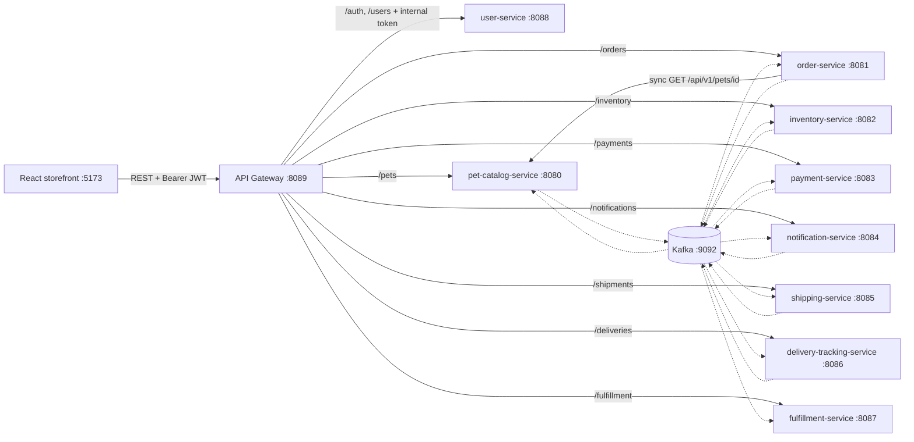
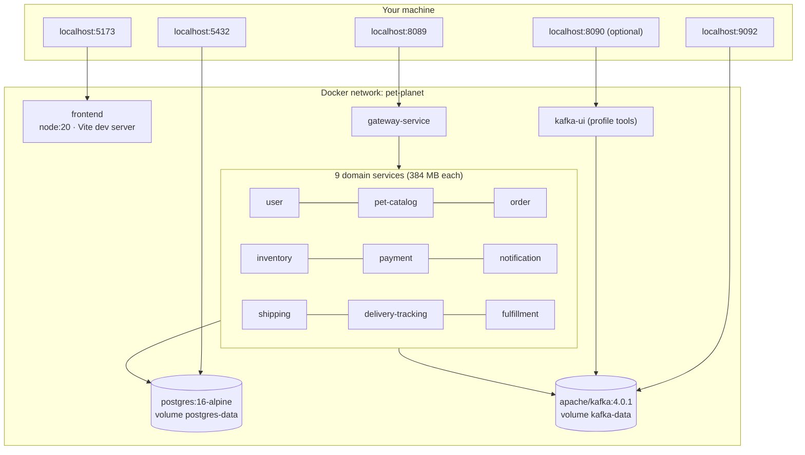
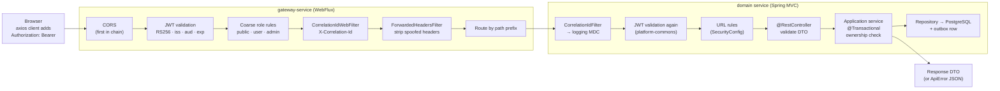
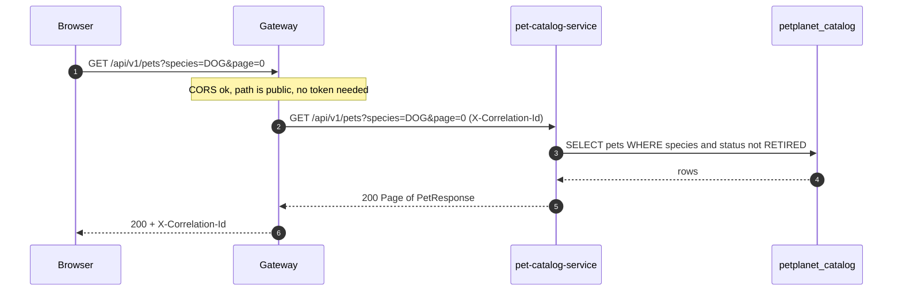
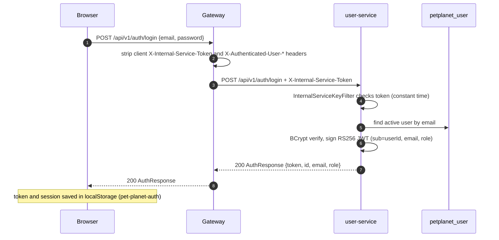
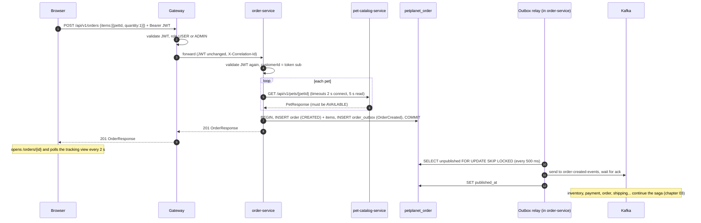
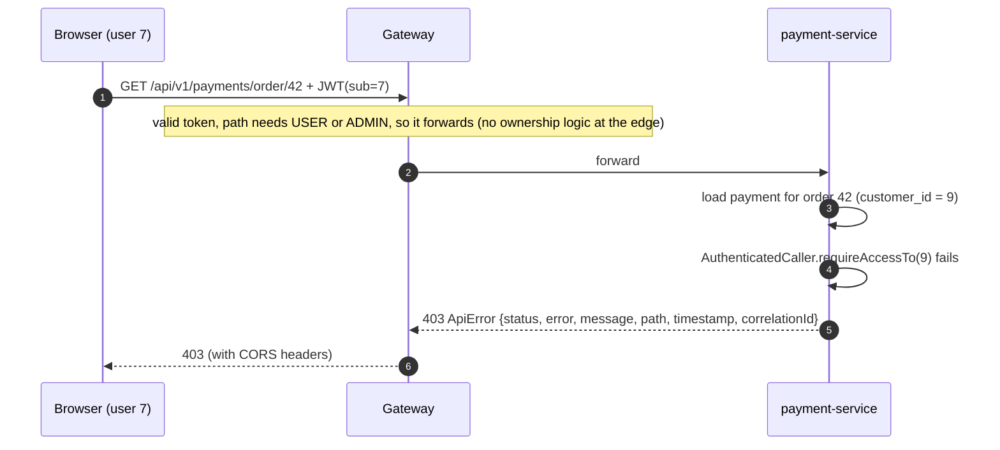

# 02 · Architecture

## Architectural style

| Principle | How Pet Planet applies it |
|---|---|
| **Microservices** | 10 independently deployable Spring Boot services, each with one clear responsibility |
| **Database per service** | Each domain service owns a private PostgreSQL database. No service reads another's tables |
| **API gateway** | One public entry point (`gateway-service`) for the browser. Backend ports are not published |
| **Event-driven, choreographed saga** | Services communicate state changes through Kafka events. There is no central orchestrator |
| **Transactional outbox** | Events are written to a table in the same transaction as the state change, then relayed to Kafka |
| **CQRS read model** | `fulfillment-service` builds a per-order tracking view purely from events |
| **Zero-trust between hops** | The gateway validates the JWT, and every service validates it again and enforces ownership itself |
| **Shared infrastructure, not shared domain** | `platform-commons` holds Kafka, outbox, security and error conventions. Services never share domain or event classes |

## System context and communication

Solid arrows are synchronous HTTP; dotted arrows are asynchronous Kafka events. The full producer → topic → consumer map is in [03 Events and the checkout saga](03-events-and-saga.md#topic-map).

There is exactly **one synchronous service-to-service call**: order-service asks pet-catalog-service for each pet at checkout, to check that it is `AVAILABLE` and to snapshot its name, breed and price into the order. Everything else between services is an event.

## Service responsibilities

| Service | Owns | Does **not** own | Talks to |
|---|---|---|---|
| gateway-service | CORS, JWT validation, coarse role rules, routing, correlation IDs | Users, passwords, tokens, per-record ownership | All services over HTTP |
| user-service | Accounts, BCrypt hashes, roles, active flag, token issuance | — | Gateway only (internal token required) |
| pet-catalog-service | Pet name, species, breed, age, gender, price, description, archive | Availability (keeps a read-only copy) | Emits `pet-catalog-events`; consumes `inventory-status-events` |
| order-service | Orders, item snapshots, order state machine | Shipping or delivery progress | Calls catalog; saga events |
| inventory-service | Availability of each unique pet: reserve, expire, sell, release, retire | Prices, descriptions | Saga events, catalog events |
| payment-service | Payment attempts, outcomes, refunds, closed-order markers | Order state | Saga events |
| notification-service | Typed customer notifications (8 types) | — | Consumes outcome events, emits `notification-sent-events` |
| shipping-service | Shipment, tracking number, mirrored shipment status | The "delivered" action | Consumes order-confirmed and delivery events |
| delivery-tracking-service | Carrier progress, delivery timeline, the admin status action | Shipment creation | Consumes shipment events, emits delivery events |
| fulfillment-service | Order-tracking projection + timeline + escalation flag | Any other service's data | Consumes 12 topics, emits nothing |

## Deployment view (local Docker Compose)

13 containers start with `make up` (Postgres, Kafka, 10 Spring services, frontend). Every Spring service has a health check, and `depends_on` waits for real readiness. Sizing, ports and variables: [10 Infrastructure and operations](10-infrastructure-and-operations.md).

## How a request travels (request/response flow)

### Layers a request passes through

### Example 1: browsing the catalog (public)

### Example 2: signing in

### Example 3: checkout (HTTP part, then the saga takes over)

The HTTP request returns as soon as the order is saved. Everything afterwards is asynchronous, which is why the order page polls `GET /api/v1/fulfillment/orders/{id}` until the order reaches a stable state. See [03 Events and the checkout saga](03-events-and-saga.md).

### Example 4: a customer opens another customer's order

## Cross-cutting concerns

| Concern | Implementation | Chapter |
|---|---|---|
| Authentication | RS256 JWT issued by user-service, validated by all 10 services | [08](08-security.md) |
| Authorization | Coarse role rules at the gateway, ownership checks in each service | [08](08-security.md) |
| Error format | One `ApiError` JSON body from every service and the gateway | [05](05-api-reference.md#errors) |
| Correlation / tracing | `X-Correlation-Id` header → MDC `[corr=...]` in logs; `correlationId` Kafka header per saga | [03](03-events-and-saga.md) |
| Reliable messaging | Transactional outbox, broker-ack relay, retries, DLT, idempotent consumers | [03](03-events-and-saga.md) |
| Schema management | Flyway per service, Hibernate `validate` | [06](06-database.md) |
| Health | `/actuator/health` used by Docker health checks | [10](10-infrastructure-and-operations.md) |
| Code boundaries | ArchUnit (backend) and `check:boundaries` (frontend) | [09](09-code-structure-and-patterns.md) |
