# 03 · Events and the checkout saga

All asynchronous communication goes through Apache Kafka 4.0.1. The conventions are implemented once in `platform-commons` (`com.petcommerce.platform.kafka` and `.outbox`) and switched on by Spring Boot auto-configuration in every event-driven service.

## Event lifecycle in one picture

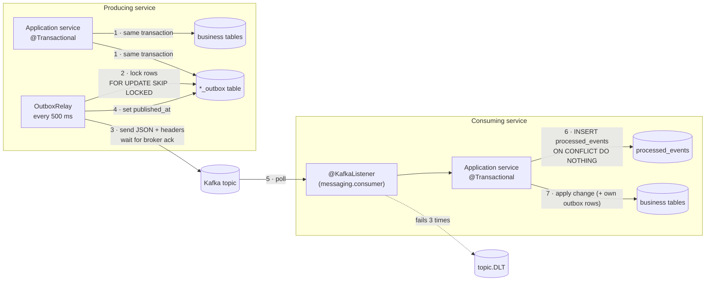

## Wire format

- **Values are plain JSON strings.** Producers use `StringSerializer`, consumers `StringDeserializer`. No Java class name travels with a message, so services never share event classes. Each service keeps its own copy of the payload records it needs, in `messaging/event`.
- **Typed consumption:** `platform-commons` registers a `StringJsonMessageConverter`, which converts the JSON into the `@KafkaListener` method's parameter type. Unknown JSON fields are ignored, so a producer may add fields without breaking consumers (additive evolution).
- **Headers** (written by the relay): `eventId`, `eventType`, `correlationId`. Consumers copy `correlationId` into the logging MDC, so each log line shows `[corr=<id>]`.
- **Keys:** order-scoped events are keyed by `orderId`, pet-scoped events (inventory, catalog) by `petId`. Every topic has 1 partition locally.
- **Legacy messages:** messages from before the restructuring carry a `__TypeId__` header. It is ignored, so they are still consumed.
- **Topic ownership:** each producer declares the topics it owns in its `config/KafkaConfig`. Consumers only subscribe.

## Publishing: the transactional outbox

**Problem it solves:** if a service commits its database change and then sends to Kafka, a crash in between loses the event. If it sends first, a rollback publishes an event for a change that never happened. The outbox makes the state change and the event atomic.

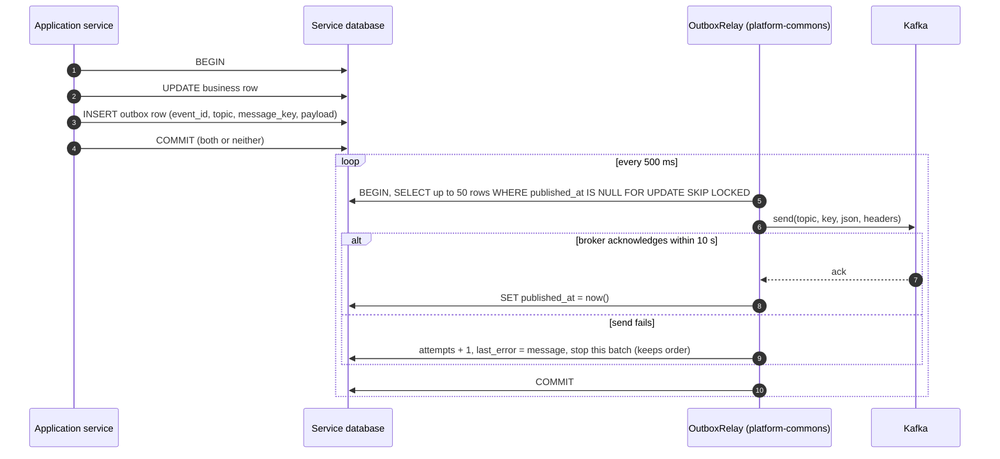

- Business code calls its `*EventPublisher` (`messaging.publisher`), which only inserts an outbox row. The outbox row's `event_id` is the payload's `eventId`.
- Each service exposes its table to the relay through an `*OutboxStore` that implements `platform-commons` `OutboxStore`. Interval: `platform.outbox.relay-interval-ms` (500 ms).
- **Delivery is at-least-once.** A crash after the send but before the commit can resend a row. That is why consumers must be idempotent.
- Outbox tables: `catalog_outbox`, `order_outbox`, `inventory_outbox`, `payment_outbox`, `notification_outbox`, `shipment_outbox`, `delivery_outbox`. fulfillment emits nothing, so it has none.

## Consuming: retries, dead-letter topics, idempotency

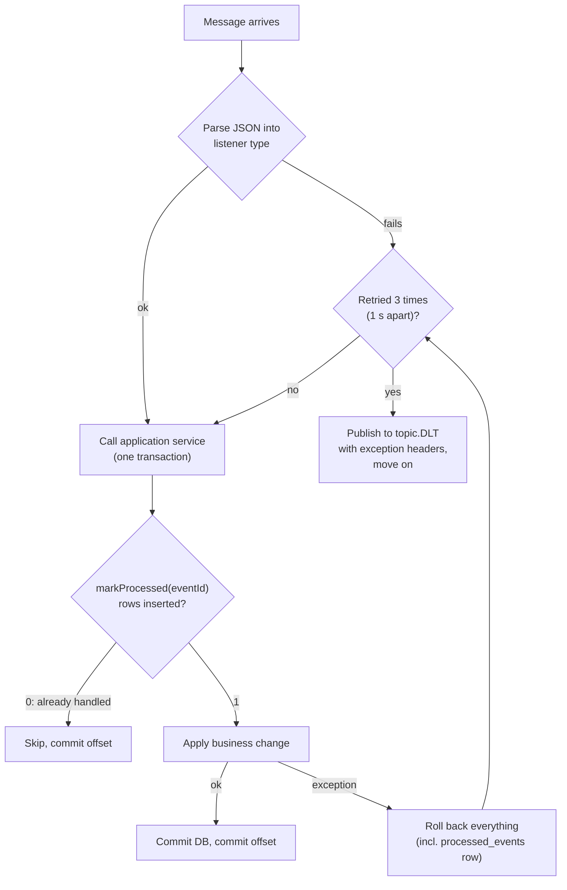

- **Retries:** 3 attempts, 1 s apart (`platform.kafka.retry.*`), then the record goes to **`<topic>.DLT`** with the original value and exception headers. One bad message never blocks a partition. Unparseable JSON follows the same path.
- **Idempotency, three strategies:**
  - `processed_events` table (inventory, payment, notification, shipping, delivery-tracking): `INSERT … ON CONFLICT (event_id) DO NOTHING` inside the business transaction. `0` rows means "already handled". On failure the insert rolls back together with the business change.
  - Timeline key (fulfillment): `order_tracking_events.event_id` is the source event's ID, inserted with `ON CONFLICT DO NOTHING`.
  - State checks (order, catalog): a transition is applied only from the expected state, so a repeated event changes nothing.
- **No guessing of required fields:** an event missing a required value (for example `customerId`) fails and lands in the DLT.
- Inspect topics and DLTs with Kafka UI: `make kafka-ui` → http://localhost:8090.

## The checkout saga

### Happy path

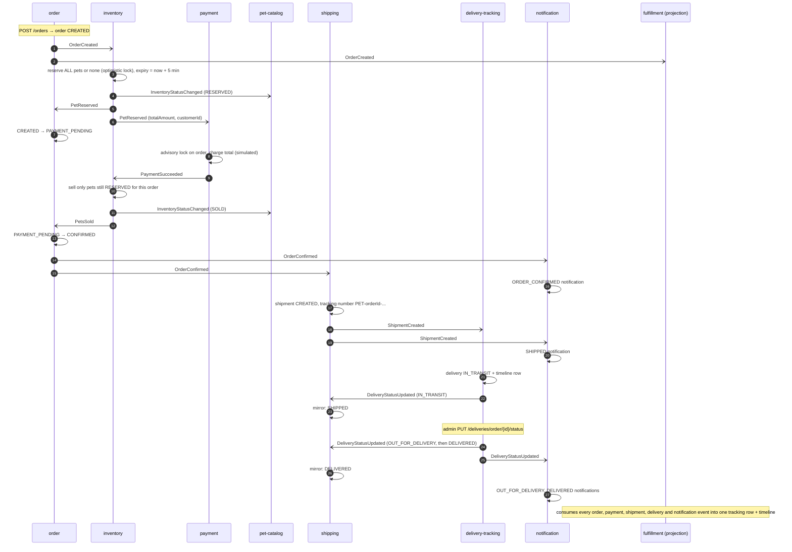

**Key rule:** the order is confirmed **only after inventory has sold the pets**. A pet whose reservation expired can never be sold to two orders, and shipping never sees an order that could still fail.

### Compensation paths

Every unsuccessful end publishes an event. Inventory releases the order's reservations (pets still `RESERVED` for that order become `AVAILABLE`). Payment records the order in `closed_orders` and refunds a successful charge, or makes sure a later charge never happens.

| Trigger | Order becomes | Event | Inventory | Payment |
|---|---|---|---|---|
| Pet unknown / reserved / sold / retired | `FAILED` | `OrderFailed` (`RESERVATION_FAILED:<reason>`) | nothing was reserved | closed; never charges |
| Payment declined | `FAILED` | `OrderFailed` (`PAYMENT_FAILED:<reason>`) | releases | already `FAILED` |
| Customer cancels (`PATCH /orders/{id}/cancel` while `CREATED`/`PAYMENT_PENDING`) | `CANCELLED` | `OrderCancelled` (`CUSTOMER_CANCELLED`) | releases | refunds if charged, otherwise blocks the charge |
| Reservation expires (scheduler) | `CANCELLED` | `OrderCancelled` (`RESERVATION_EXPIRED`) | already released | refunds if charged, otherwise blocks |
| Payment succeeded after the reservation was lost | `FAILED` (if still open) | `InventorySaleConflict` → `OrderFailed` (`SALE_CONFLICT:<reason>`) | sells nothing | refunds |

#### Example: customer cancels while the charge is still running

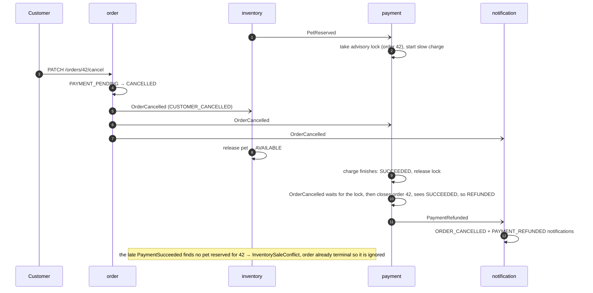

The per-order PostgreSQL **advisory lock** (`pg_advisory_xact_lock`) serializes "charge" and "close" for the same order: whichever runs second sees the other's result.

#### Example: two customers race for the same pet

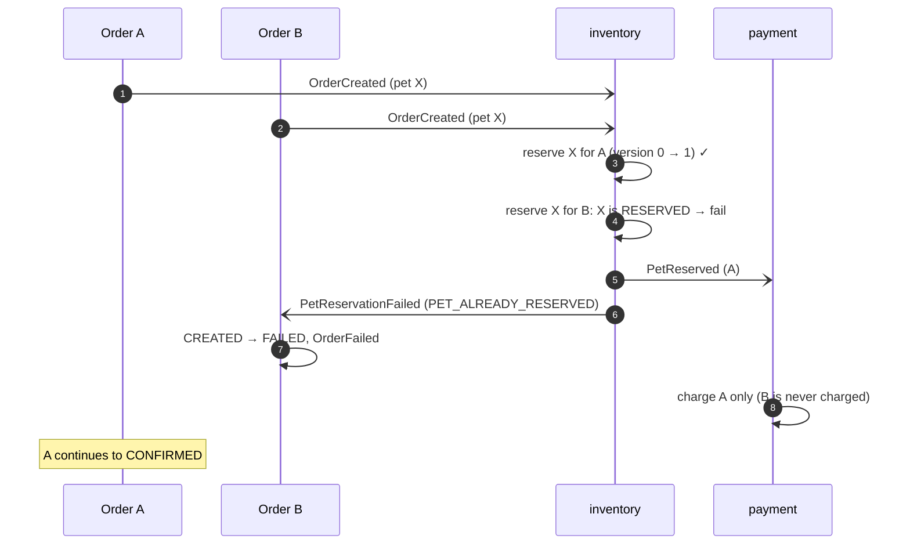

Optimistic locking (`@Version` on `pet_inventory`) guarantees that only one reservation of a pet can commit.

## State machines

### Order (`order-service`, `domain/policy/OrderStateMachine`)

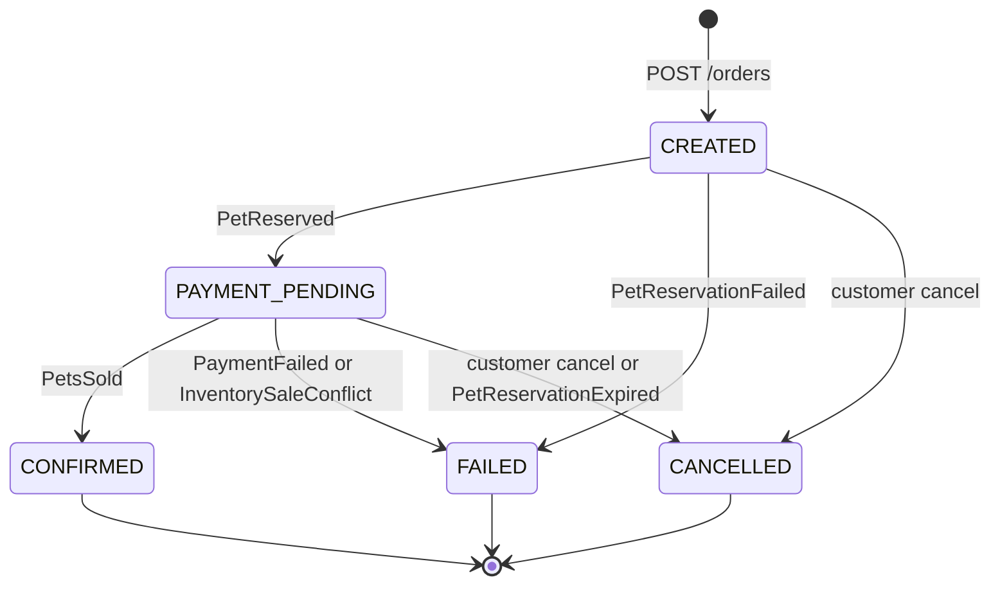

Terminal states never change. Illegal or repeated transitions are ignored, which makes every saga handler idempotent.

### Pet inventory (`inventory-service`)

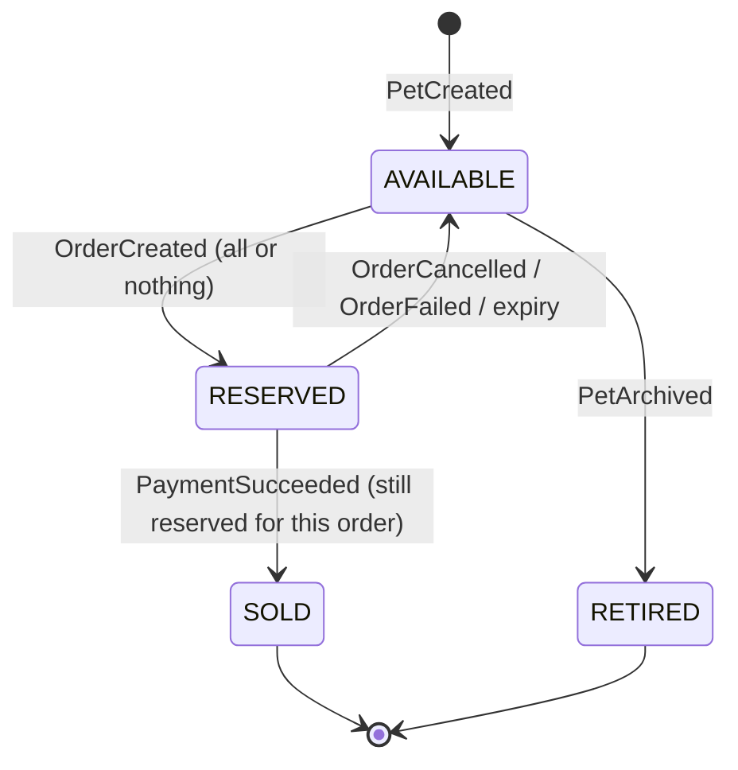

### Payment (`payment-service`)

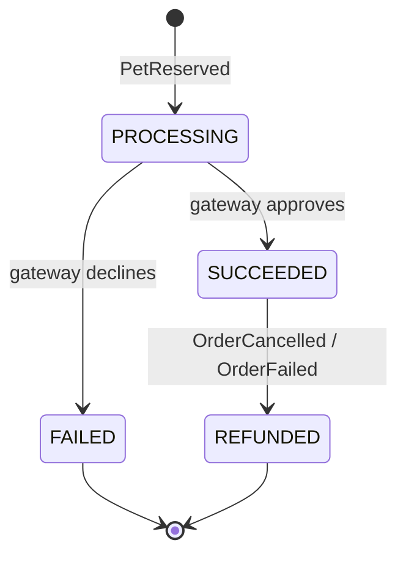

### Delivery (`delivery-tracking-service`) and the mirrored shipment (`shipping-service`)

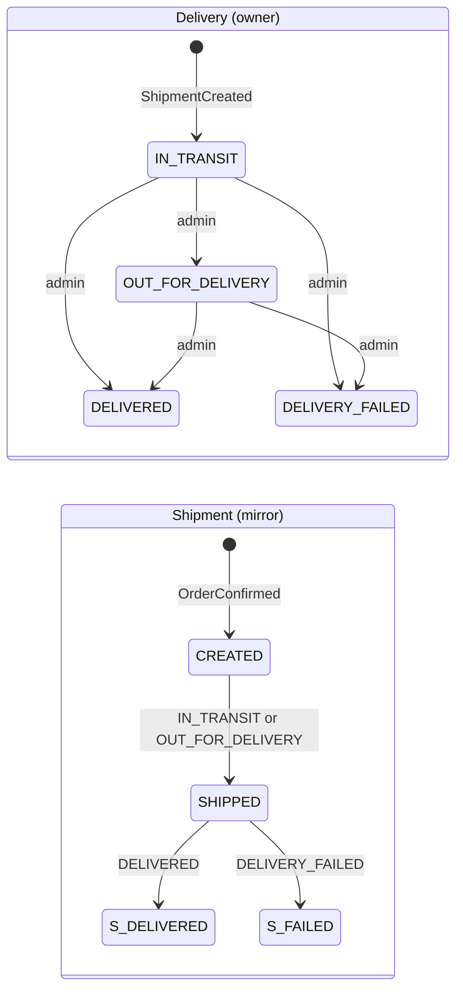

(`S_DELIVERED` / `S_FAILED` are the shipment statuses `DELIVERED` / `DELIVERY_FAILED`.) Any other delivery move returns **409**. Terminal states never change.

## Topic map

Three small diagrams, one per stage. Arrows go from producer to consumer and are labelled with the event; each event has its own topic (`OrderCreated` → `order-created-events`). **fulfillment-service consumes 12 of these topics** to build the tracking view; its arrows are left out to keep the pictures readable (the list is in the table below).

**1 · Catalog ↔ inventory sync**

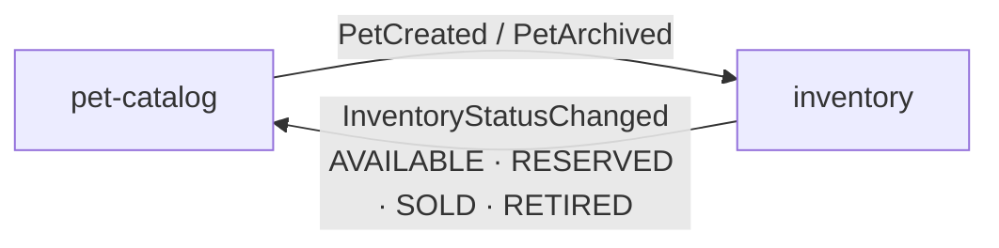

**2 · Checkout saga (order, inventory, payment)**

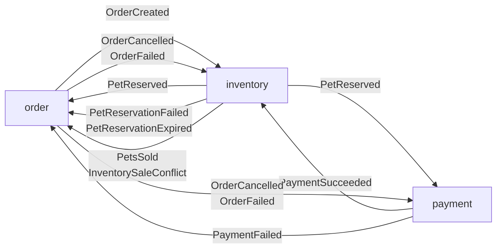

**3 · After the outcome (shipping, delivery, notifications)**

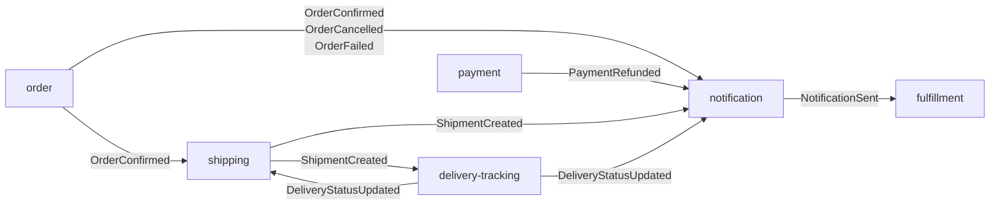

### Topic table

| Topic | Payload record | Producer | Consumers |
|---|---|---|---|
| `pet-catalog-events` | `PetCatalogEvent` (`eventType` `PetCreatedEvent` / `PetArchivedEvent`) | pet-catalog | inventory |
| `inventory-status-events` | `InventoryStatusChangedEvent` | inventory | pet-catalog |
| `order-created-events` | `OrderCreatedEvent` | order | inventory, fulfillment |
| `pet-reserved-events` | `PetReservedEvent` | inventory | order, payment, fulfillment |
| `pet-reservation-failed-events` | `PetReservationFailedEvent` | inventory | order, fulfillment |
| `pet-reservation-expired-events` | `PetReservationExpiredEvent` | inventory | order |
| `payment-succeeded-events` | `PaymentSucceededEvent` | payment | inventory, fulfillment |
| `payment-failed-events` | `PaymentFailedEvent` | payment | order, fulfillment |
| `payment-refunded-events` | `PaymentRefundedEvent` | payment | notification, fulfillment |
| `pets-sold-events` | `PetsSoldEvent` | inventory | order |
| `inventory-sale-conflict-events` | `InventorySaleConflictEvent` | inventory | order |
| `order-confirmed-events` | `OrderConfirmedEvent` | order | notification, shipping, fulfillment |
| `order-cancelled-events` | `OrderCancelledEvent` | order | inventory, payment, notification, fulfillment |
| `order-failed-events` | `OrderFailedEvent` | order | inventory, payment, notification, fulfillment |
| `shipment-created-events` | `ShipmentCreatedEvent` | shipping | delivery-tracking, notification, fulfillment |
| `delivery-status-updated-events` | `DeliveryStatusUpdatedEvent` | delivery-tracking | shipping (mirror), notification, fulfillment |
| `notification-sent-events` | `NotificationSentEvent` | notification | fulfillment (timeline) |
| `fulfillment-updated-events` | — | retired | — |
| `pet-reservation-released-events` | — | retired (releases are announced on `inventory-status-events`) | — |

The two retired topics are no longer produced or declared, but still exist in an old local Kafka volume with their old messages until removed manually.

### Payloads

Most events share these envelope fields: `eventId` (UUID), `eventType`, `eventVersion`, `aggregateId` (UUID), `timestamp` (ISO-8601 instant), `correlationId` (UUID). A fuller envelope (`causationId`, `producer`, `aggregateId` = order ID) is **not implemented**; `aggregateId` is often a random UUID, and the two pet-scoped events have no `correlationId`.

| Record | Fields beyond the envelope |
|---|---|
| `OrderCreatedEvent` | `Long orderId`, `Long customerId`, `List<UUID> petIds`, `BigDecimal totalAmount` |
| `OrderConfirmedEvent` | `orderId`, `customerId`, `petIds`, `totalAmount` |
| `OrderCancelledEvent` | `orderId`, `customerId`, `petIds`, `String reason` (`CUSTOMER_CANCELLED` / `RESERVATION_EXPIRED`) |
| `OrderFailedEvent` | `orderId`, `customerId`, `petIds`, `String reason` (`RESERVATION_FAILED:…` / `PAYMENT_FAILED:…` / `SALE_CONFLICT:…`) |
| `PetReservedEvent` | `orderId`, `UUID reservationId`, `UUID petId`, `BigDecimal totalAmount`, `Long customerId` |
| `PetReservationFailedEvent` | `orderId`, `petId`, `String reason` (`PET_NOT_FOUND`, `PET_ALREADY_RESERVED`, `PET_ALREADY_SOLD`, `PET_RETIRED`) |
| `PetReservationExpiredEvent` | `orderId`, `petId` |
| `PetsSoldEvent` | `orderId`, `List<UUID> petIds` |
| `InventorySaleConflictEvent` | `orderId`, `String reason` |
| `InventoryStatusChangedEvent` | `UUID petId`, `String status`, `Long orderId`, `Instant timestamp` (no `aggregateId`/`correlationId`) |
| `PetCatalogEvent` | `UUID petId`, `String availabilityStatus`, `Instant timestamp` (no `aggregateId`/`correlationId`) |
| `PaymentSucceededEvent` | `orderId`, `UUID paymentId`, `BigDecimal amount`, `Long customerId` |
| `PaymentFailedEvent` | `orderId`, `paymentId`, `amount`, `String reason`, `customerId` |
| `PaymentRefundedEvent` | `orderId`, `paymentId`, `amount`, `String reason`, `customerId` |
| `ShipmentCreatedEvent` | `orderId`, `customerId`, `UUID shipmentId`, `String trackingNumber`, `String status` |
| `DeliveryStatusUpdatedEvent` | `orderId`, `customerId`, `UUID deliveryId`, `trackingNumber`, `status`, `previousStatus` (null for the first `IN_TRANSIT`), `note` |
| `NotificationSentEvent` | `orderId`, `UUID notificationId`, `String message`, `customerId`, `String notificationType` |

`customerId` on payment events is `null` for payments created before payment migration `V4` (old local data only).

### Contract safety

Each consuming service has an `EventContractTest` with fixtures in `src/test/resources/contracts/<topic>.json`: the **exact JSON a producer wrote to Kafka**, captured from the running stack. A renamed or retyped producer field fails the consumer's build. Topics without fixtures: `pet-reservation-expired-events`, `pet-catalog-events`. See [11 Testing](11-testing.md).
