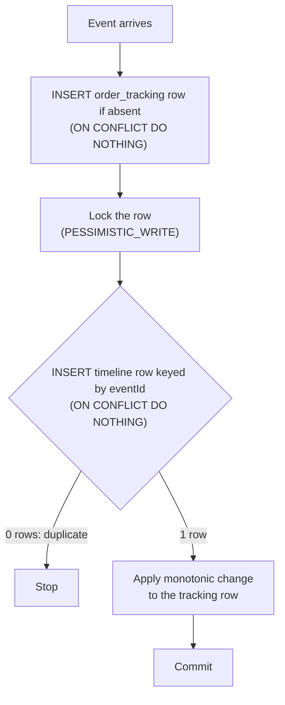

# 04 · Backend services

All modules use Java 17 and Spring Boot 3.5.5, share one package layout ([09](09-code-structure-and-patterns.md)), and build from the repository root with `./mvnw`. Endpoints are summarized here and specified in [05 API reference](05-api-reference.md). Tables are in [06 Database](06-database.md).

| Service | Package root | Database | Port |
|---|---|---|---:|
| [platform-commons](#platform-commons-shared-library) | `com.petcommerce.platform` | — (library) | — |
| [gateway-service](#gateway-service) | `com.petcommerce.gateway` | — | 8089 |
| [user-service](#user-service) | `com.petcommerce.user` | `petplanet_user` | 8088 |
| [pet-catalog-service](#pet-catalog-service) | `com.petcommerce.catalog` | `petplanet_catalog` | 8080 |
| [order-service](#order-service) | `com.petcommerce.order` | `petplanet_order` | 8081 |
| [inventory-service](#inventory-service) | `com.petcommerce.inventory` | `petplanet_inventory` | 8082 |
| [payment-service](#payment-service) | `com.petcommerce.payment` | `petplanet_payment` | 8083 |
| [notification-service](#notification-service) | `com.petcommerce.notification` | `petplanet_notification` | 8084 |
| [shipping-service](#shipping-service) | `com.petcommerce.shipping` | `petplanet_shipping` | 8085 |
| [delivery-tracking-service](#delivery-tracking-service) | `com.petcommerce.delivery` | `petplanet_delivery` | 8086 |
| [fulfillment-service](#fulfillment-service) | `com.petcommerce.fulfillment` | `petplanet_fulfillment` | 8087 |

---

## platform-commons (shared library)

An **infrastructure-only** library: no domain classes and no event classes. Applied through Spring Boot auto-configuration. Its framework dependencies are optional, so each part switches on only where the service has the matching library (Kafka, Spring MVC, Spring Security).

| Package | Classes | What it gives every service |
|---|---|---|
| `kafka` | `KafkaPlatformAutoConfiguration`, `EventHeaders` | JSON message converter (typed listeners from plain JSON), 3 retries then `<topic>.DLT`, `correlationId` header → MDC |
| `outbox` | `OutboxMessage`, `OutboxStore`, `OutboxRelay`, `OutboxPayloads`, `OutboxAutoConfiguration` | The generic outbox relay (every 500 ms, `FOR UPDATE SKIP LOCKED`, mark published after broker ack) |
| `security` | `PlatformJwt`, `PlatformHttpSecurity`, `PlatformSecurityAutoConfiguration`, `AuthenticatedCaller` (+ argument resolver) | The token contract, the resource-server setup (stateless, JSON 401/403), and the caller object for ownership checks |
| `web` | `ApiError`, `PlatformExceptionHandler`, `CorrelationIdFilter`, `PlatformWebAutoConfiguration` | The shared error body, generic exception mapping, `X-Correlation-Id` handling |

Its **test-jar** provides `TestJwtIssuer` (throwaway RSA key, same claims as user-service), used by every service's controller tests. Services may depend on `com.petcommerce.platform`, never on each other.

---

## gateway-service

The only published API entry point. Spring Cloud Gateway on WebFlux (reactive).

- **Routing** (`routing/GatewayConfig`): `/api/v1/auth/**` and `/api/v1/users/**` → user-service, `/pets` → catalog, `/orders` → order, `/inventory` → inventory, `/payments` → payment, `/notifications` → notification, `/shipments` → shipping, `/deliveries` → delivery-tracking, `/fulfillment` → fulfillment.
- **Does not issue tokens.** Login and registration are routed publicly to user-service.
- **Validates the JWT** as a WebFlux OAuth2 resource server (`security/SecurityConfig`) using the shared `PlatformJwt` rules: RS256 with the public key only, expiry, issuer, audience, numeric `sub`, known `role`.
- **Coarse rules only:** catalog reads, login and registration are public; user administration, catalog writes, inventory and `PUT /api/v1/deliveries/order/*/status` need `ADMIN`; `/internal/**` is denied; everything else under `/api/v1/**` needs a valid token. **No per-record ownership checks** at the edge.
- `security/ForwardedHeadersFilter` strips client-supplied `X-Internal-Service-Token` and `X-Authenticated-User-*` headers, forwards the JWT unchanged, and adds `X-Internal-Service-Token` on user-service routes (503 if it is not configured).
- `security/CorrelationIdWebFilter` assigns an `X-Correlation-Id` to every request (keeps a short, safe client value), forwards it and echoes it.
- `security/CorsConfig` is the platform's **only** CORS policy, applied first in the security chain so 401/403 responses also carry CORS headers. Origins from `FRONTEND_ORIGIN`.
- `routing/UpstreamDnsConfig` caps the HTTP client's DNS cache (`gateway.upstream-dns-cache-ttl`, default `PT5S`), so a backend restarted on a new container IP is reached within seconds.
- Tests: `GatewaySecurityTest` (real tokens, real routes, stub backend echoing headers), `CorsConfigTest`.

---

## user-service

Identity provider. Reachable only through the gateway.

- Owns users with generated integer IDs, BCrypt password hashes, `USER`/`ADMIN` roles, an `active` flag, and timestamps.
- **Issues access tokens:** `POST /api/v1/auth/register` and `/login` (`api/controller/AuthController` → `application/AuthService`) return an `AuthResponse` with an RS256 JWT signed by `security/token/TokenIssuer` (Nimbus `JwtEncoder`; claims `sub` = user ID, `email`, `role`, `iss`, `aud`, `iat`, `exp`). It is the only service holding `JWT_PRIVATE_KEY`.
- Registration always creates a `USER`; only admins can create admins.
- Profile (`/me`) and admin account management live in `application/UserService`: paging, create, lookup, partial update, **soft deactivation**, and a **last-admin guard** (409 when the last active admin would be demoted or deactivated).
- `security/InternalServiceKeyFilter` requires the gateway's `X-Internal-Service-Token` on every request except health checks (constant-time comparison), before JWT validation.
- Emails are normalized (`domain/policy/EmailPolicy`).
- Tests: `UserControllerTest`, `TokenIssuerTest`, `AuthServiceTest`, `UserServiceTest`, `SeedAccountPasswordTest`.

---

## pet-catalog-service

The storefront's catalog: descriptive pet data.

- `GET /api/v1/pets` (filter by `species`, `breed`, `minPrice`, `maxPrice`, `availabilityStatus`; pageable) and `GET /api/v1/pets/{id}` are public. Create, update and archive need `ADMIN`.
- `availabilityStatus` (`AVAILABLE`, `RESERVED`, `SOLD`, `RETIRED`) is a **read-only copy** of inventory's state, updated by consuming `inventory-status-events`. `PUT` cannot change it.
- `DELETE` **archives** an `AVAILABLE` pet: status `RETIRED`, `PetArchivedEvent`, hidden from the default listing, no longer orderable. `RESERVED`/`SOLD` pets return 409. Rows are never hard-deleted, so order snapshots stay valid.
- Creating a pet emits `PetCreatedEvent`. Both events go through `catalog_outbox` on topic `pet-catalog-events`.
- 6 sample pets are seeded by migration `V2`.
- Tests: `PetServiceTest`.

---

## order-service

Owns orders and the commercial order state machine. Start of the saga.

- `POST /api/v1/orders` validates each pet synchronously via `client/PetCatalogClient` (Spring `RestClient`; `PET_CATALOG_CONNECT_TIMEOUT` default `PT2S`, `PET_CATALOG_READ_TIMEOUT` default `PT5S`). Mapping: catalog 404 → pet not found (404); not `AVAILABLE` → 409; any other error, timeout or connection failure → catalog unavailable (503).
- Saves `Order` (`CREATED`) with `OrderItem` **snapshots** (name, species, breed, unit price) and writes `OrderCreatedEvent` to `order_outbox`. `customerId` is the token's user ID.
- Application layer split by responsibility: `OrderCommandService` (create, cancel), `OrderQueryService` (lookups, lists), `OrderSagaService` (event handlers).
- All status changes go through `domain/policy/OrderStateMachine`. Illegal or repeated transitions are ignored.
- Consumes `pet-reserved` (→ `PAYMENT_PENDING`), `pets-sold` (→ `CONFIRMED`, emits `OrderConfirmed`), `pet-reservation-failed`, `payment-failed`, `inventory-sale-conflict` (→ `FAILED`, emits `OrderFailed` with a reason), `pet-reservation-expired` (→ `CANCELLED`, emits `OrderCancelled` `RESERVATION_EXPIRED`).
- `PATCH /api/v1/orders/{id}/cancel` works while `CREATED`/`PAYMENT_PENDING` (409 otherwise) and emits `OrderCancelled` (`CUSTOMER_CANCELLED`).
- `security/OrderAccessPolicy`: users see and cancel only their own orders; lists are scoped to the caller; admins see all.
- Tests: `OrderCommandServiceTest`, `OrderQueryServiceTest`, `OrderSagaServiceTest`, `OrderStateMachineTest`, `OrderControllerTest`, `PetCatalogClientTest`.

---

## inventory-service

Source of truth for the availability of each unique pet.

- `order-created-events`: reserves **all** pets of the order or none, using optimistic locking (`@Version`). Records `order_id`, a `reservation_id` and an expiry time. Emits `PetReservedEvent` (with `totalAmount` and `customerId`) or `PetReservationFailedEvent` (`PET_NOT_FOUND`, `PET_ALREADY_RESERVED`, `PET_ALREADY_SOLD`, `PET_RETIRED`). Unknown pets are never created implicitly.
- `payment-succeeded-events`: completes the sale. Pets still `RESERVED` **for that order** become `SOLD` → `PetsSoldEvent`. If none are still reserved, nothing is sold → `InventorySaleConflictEvent`.
- `order-cancelled-events` / `order-failed-events`: release pets still `RESERVED` for that order. Pets sold or reserved by another order are untouched.
- `pet-catalog-events`: `PetCreatedEvent` creates the inventory row; `PetArchivedEvent` retires an `AVAILABLE` pet.
- `@Scheduled expireReservations()` (every `INVENTORY_EXPIRATION_CHECK_DELAY_MS`, default 30 s) releases reservations older than `INVENTORY_RESERVATION_TIMEOUT` (default `PT5M`) and emits `PetReservationExpiredEvent`.
- Every status change is mirrored to the catalog on `inventory-status-events`.
- **Why optimistic locking:** a pet has a stock of one. When two orders try to reserve it at once, both read version *n*, the first commit moves it to *n+1*, and the second fails and rolls back. No table locks are needed.
- HTTP is **read-only and admin-only**: `GET /api/v1/inventory/pets` (paged, optional `status`) and `GET /api/v1/inventory/pets/{petId}` (404 if unknown). Reservations, releases and sales happen only through the saga.
- Tests: `InventoryServiceTest`, `InventoryControllerTest`.

---

## payment-service

Simulated payments with refunds.

- `pet-reserved-events`: charges the order's `totalAmount` through the `application/PaymentGateway` interface. A missing or non-positive amount is rejected (retried, then dead-lettered); there is no fallback amount. Emits `PaymentSucceededEvent` or `PaymentFailedEvent`.
- `order-cancelled-events` / `order-failed-events`: records the order in `closed_orders`, and refunds a `SUCCEEDED` payment (`REFUNDED`, `refunded_at`, `refund_reason`, `PaymentRefundedEvent`). A `PetReserved` handled after the order is closed is never charged.
- **Race safety:** a charge and the closing of the same order are serialized with a PostgreSQL advisory lock (`PaymentRepository.lockOrder`, `pg_advisory_xact_lock`).
- `client/SimulatedPaymentGateway` implements `PaymentGateway`: `PAYMENT_SIMULATION_RESULT` = `SUCCESS` (default) or `FAILURE`; `PAYMENT_SIMULATION_DELAY` (default `PT0S`) makes charges slow so tests can reproduce races. A real provider would be another implementation of the same interface.
- Payment events carry the order's `customerId` so notification and fulfillment know the owner.
- `GET /api/v1/payments/order/{orderId}`: owner or admin (`payments.customer_id`). Payments created before migration `V4` have no owner and are admin-only.
- Tests: `PaymentServiceTest` (stub gateway), `PaymentServiceOwnershipTest`, `PaymentControllerTest`.

---

## notification-service

Typed customer notifications. Sending is simulated: each notification is stored and marked `SENT` in the same transaction.

| Consumed topic | Type | Wording (`domain/policy/NotificationWording`) |
|---|---|---|
| `order-confirmed-events` | `ORDER_CONFIRMED` | Confirmed and paid; "we will let you know when it ships" |
| `order-cancelled-events` | `ORDER_CANCELLED` | As requested, or "could not be completed in time" (expiry); any payment will be refunded |
| `order-failed-events` | `ORDER_FAILED` | Cause from the reason: payment declined / pet no longer available / no longer reserved |
| `payment-refunded-events` | `PAYMENT_REFUNDED` | Refunded amount |
| `shipment-created-events` | `SHIPPED` | Tracking number |
| `delivery-status-updated-events` | `OUT_FOR_DELIVERY`, `DELIVERED`, `DELIVERY_FAILED` | `IN_TRANSIT` sends nothing (already covered by `SHIPPED`) |

- At most one notification per order and type (unique index `uq_notifications_order_type`), plus `processed_events` deduplication.
- A missing `customerId` (for example a refund of a pre-`V4` payment) is taken from an earlier notification of the same order. If none exists, the event is dead-lettered.
- Each notification emits `NotificationSentEvent` (with `customerId` and `notificationType`), consumed by fulfillment for the timeline.
- HTTP: `GET /api/v1/notifications/order/{orderId}` (oldest first, `[]` if none), `/customer/{customerId}` (newest first), `/me`.
- Tests: `NotificationServiceTest`, `NotificationWordingTest`, ownership and controller tests.

---

## shipping-service

Creates shipments and mirrors carrier progress. **No mutation API.**

- `order-confirmed-events`: creates a `CREATED` shipment with tracking number `PET-{orderId}-…` and emits `ShipmentCreatedEvent`.
- `delivery-status-updated-events`: `IN_TRANSIT`/`OUT_FOR_DELIVERY` → `SHIPPED` (sets `shipped_at`), `DELIVERED` → `DELIVERED` (sets `delivered_at`), `DELIVERY_FAILED` → `DELIVERY_FAILED`. Idempotent and monotonic (`Shipment.mirrorDelivery`): a terminal shipment never changes. An event for an unknown shipment is logged and skipped.
- HTTP (read-only): `GET /api/v1/shipments/order/{orderId}`, `/customer/{customerId}`.
- Tests: `ShippingServiceTest`, ownership and controller tests.

---

## delivery-tracking-service

Owns carrier progress and the **only** "advance delivery" action in the system.

- `shipment-created-events`: creates an `IN_TRANSIT` delivery record, stores the saga `correlationId`, writes the first timeline row and emits `DeliveryStatusUpdatedEvent`.
- Transition rules in `domain/model/DeliveryStatus`: `IN_TRANSIT → OUT_FOR_DELIVERY → DELIVERED | DELIVERY_FAILED`; `IN_TRANSIT` may also go straight to `DELIVERED` or `DELIVERY_FAILED`. Terminal statuses never change. `DeliveryRecord.advanceTo` rejects other moves with `InvalidDeliveryTransitionException` (409) and sets `delivered_at`.
- Every status reached is a row in `delivery_events` (status, optional note, time). Every change emits `DeliveryStatusUpdatedEvent` with `previousStatus` and `note`, reusing the stored saga `correlationId`.
- HTTP: `GET /api/v1/deliveries/order/{orderId}`, `/customer/{customerId}` (owner or admin, with `timeline`); `PUT /api/v1/deliveries/order/{orderId}/status` (admin; 404 unknown order, 409 illegal transition, 400 bad status).
- Tests: `DeliveryStatusTest`, `DeliveryTrackingServiceTest`, ownership and controller tests.

---

## fulfillment-service

The **order-tracking read model** (CQRS). Builds one denormalized row per order plus a timeline, purely from events. Writes no other service's data and **emits no events**.

- **Consumes 12 topics** in consumer group `fulfillment-tracking-projection`: `order-created`, `pet-reserved`, `pet-reservation-failed`, `payment-succeeded`, `payment-failed`, `payment-refunded`, `order-confirmed`, `order-cancelled`, `order-failed`, `shipment-created`, `delivery-status-updated`, `notification-sent` (`messaging/consumer/OrderTrackingEventConsumer` → `application/OrderTrackingProjector`).

- **Monotonic state** (`domain/model/OrderTracking`), so events may arrive in any order: order status only moves forward; payment goes `PENDING` → outcome and `REFUNDED` always wins; shipment and delivery never move backwards (delivery also drives shipment); `customerId` and `totalAmount` come from the first event that carries them.
- **Customer-facing timeline text:** descriptions are written as plain text, for example amounts as `$1,250.00`, reason codes as words ("customer cancelled"), delivery statuses as "In transit" / "Out for delivery", notifications as "Customer notified: <message>". Rows already stored keep the text they were written with. (Changed 2026-11-22; `OrderTrackingTextTest`.)
- **Escalation:** `DELIVERY_FAILED` escalates immediately. `application/EscalationService` (`@Scheduled`, every `FULFILLMENT_ESCALATION_CHECK_MS`, default 60 s) escalates orders still `CREATED`/`PAYMENT_PENDING` longer than `FULFILLMENT_STUCK_AFTER` (default `PT10M`) and adds an "Escalated" timeline row. The stuck flag is cleared when the order closes.
- **Rebuild by replay:** with `auto-offset-reset: earliest`, a new consumer group replays all retained messages. To rebuild, empty both tables and change the group ID.
- HTTP (read-only): `GET /api/v1/fulfillment/orders/{orderId}` (summary + timeline; owner or admin; 404 if not seen yet), `/orders/me`, `/orders?customerId=&escalated=` (admin).
- Tests: `OrderTrackingTest`, `OrderTrackingProjectorTest`, `OrderTrackingTextTest`, `EscalationServiceTest`, `OrderTrackingQueryServiceTest`, `OrderTrackingProjectionPostgresTest` (Testcontainers).
