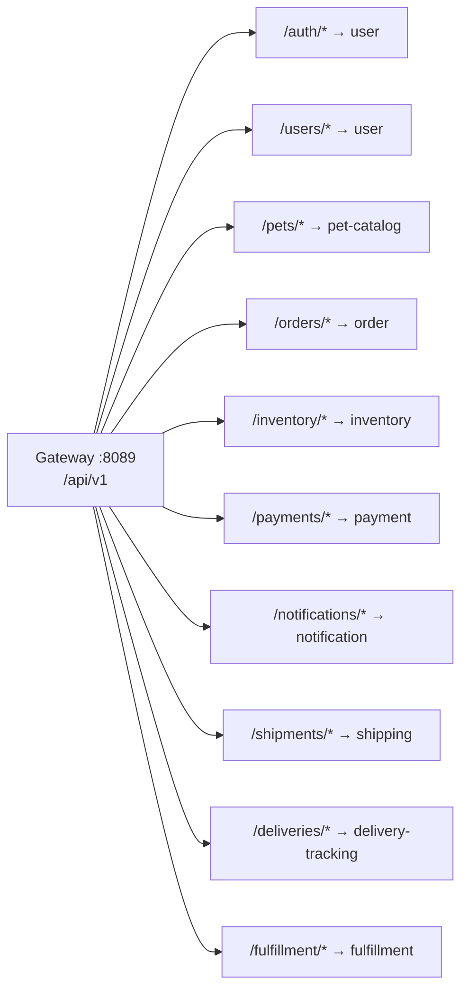

# 05 · API reference

All application APIs are reached through the gateway at **`http://localhost:8089`**. Backend ports are private to Docker. Every path below starts with `/api/v1`.

## Conventions

| Topic | Rule |
|---|---|
| Authentication | `Authorization: Bearer <JWT>` from login or registration. Public: catalog `GET`s, login, register, CORS preflight |
| Roles | `USER` (customer) and `ADMIN`. "Owner" means the record's `customerId` equals the token's user ID |
| IDs | Users and orders: integers. Pets, payments' `paymentId`, shipments, deliveries, notifications: UUIDs |
| Paging | Spring `Page`: query `page` (0-based), `size`, `sort=field,asc|desc`; response has `content`, `totalElements`, `totalPages`, `number`, `size` |
| Timestamps | ISO-8601 UTC instants (`2026-11-15T10:00:00Z`) |
| Money | JSON numbers (`BigDecimal`), currency USD |
| Correlation | Every response carries `X-Correlation-Id`; send your own (short, safe value) to trace a request |
| DTOs | Responses are DTOs, never JPA entities |

## Errors

Every error, from the gateway or any service, has the same body (`platform-commons` `ApiError`):

```json
{
  "status": 403,
  "error": "Forbidden",
  "message": "Access denied",
  "path": "/api/v1/payments/order/7",
  "timestamp": "2026-11-14T10:00:00Z",
  "correlationId": "5f0c2a1e-..."
}
```

| Status | Meaning |
|---|---|
| 400 | Validation failed or malformed JSON |
| 401 | Missing, invalid, forged or expired token; wrong credentials; missing internal token (user-service) |
| 403 | Wrong role, or another customer's record |
| 404 | Record or path not found |
| 405 | Method not supported |
| 409 | Invalid state (e.g. cancel a confirmed order, archive a sold pet, illegal delivery move, last admin, duplicate email, pet unavailable) |
| 503 | A dependency is unavailable (catalog for order-service; internal token not configured) |

## Endpoint map



---

## Authentication (user-service)

| Method & path | Request | Response | Access |
|---|---|---|---|
| `POST /auth/register` | `{ email, password (min 8), firstName, lastName }`. Always creates a `USER` | `201` `AuthResponse` | Public |
| `POST /auth/login` | `{ email, password }` | `200` `AuthResponse`; `401` bad credentials or inactive | Public |

`AuthResponse`: `{ "token": "eyJ...", "tokenType": "Bearer", "id": 2, "email": "customer@petplanet.com", "role": "USER" }`

```sh
curl -s -X POST http://localhost:8089/api/v1/auth/login \
  -H 'Content-Type: application/json' \
  -d '{"email":"customer@petplanet.com","password":"password123"}'
```

## Users (user-service)

`/me` endpoints use the user ID from the token. Administration needs `ADMIN` (checked at the gateway and again in the service).

| Method & path | Request | Response | Access |
|---|---|---|---|
| `GET /users/me` | — | `200` `UserResponse` | Signed in |
| `PATCH /users/me` | `{ email, firstName, lastName }` | `200` `UserResponse` | Signed in |
| `PUT /users/me/password` | `{ currentPassword, newPassword (min 8) }` | `204`; `401` wrong current password | Signed in |
| `GET /users` | `page`, `size`, `sort`; includes inactive users | `200` `Page<UserResponse>` | `ADMIN` |
| `POST /users` | `{ email, password, firstName, lastName, role }` | `201` `UserResponse` | `ADMIN` |
| `GET /users/{id}` | — | `200`; `404` | `ADMIN` |
| `PATCH /users/{id}` | optional `email`, `firstName`, `lastName`, `role`, `active` | `200`; `409` last active admin | `ADMIN` |
| `DELETE /users/{id}` | soft-deactivates (row and email kept) | `204`; `409` last active admin | `ADMIN` |

`UserResponse`: `id`, `email`, `firstName`, `lastName`, `role`, `active`, `createdAt`, `updatedAt`. Password hashes are never returned.

## Pets (pet-catalog-service)

| Method & path | Request | Response | Access |
|---|---|---|---|
| `GET /pets` | optional `species`, `breed`, `minPrice`, `maxPrice`, `availabilityStatus`; pageable. `RETIRED` pets are excluded unless requested | `200` `Page<PetResponse>` | Public |
| `GET /pets/{petId}` | UUID | `200`; `404` | Public |
| `POST /pets` | `{ name, species, breed, age, gender, price, description }` | `201` `PetResponse`; emits `PetCreated` | `ADMIN` |
| `PUT /pets/{petId}` | same fields; `availabilityStatus` is **not** accepted | `200` | `ADMIN` |
| `DELETE /pets/{petId}` | archives: `RETIRED`, hidden, not orderable; repeat is a no-op | `204`; `409` if `RESERVED`/`SOLD` | `ADMIN` |

`PetResponse`: `id`, `name`, `species` (`DOG` or `CAT`), `breed`, `age`, `gender` (`MALE` or `FEMALE`), `price`, `description`, `availabilityStatus` (`AVAILABLE`, `RESERVED`, `SOLD`, `RETIRED`), `createdAt`, `updatedAt`.

## Orders (order-service)

| Method & path | Request | Response | Access |
|---|---|---|---|
| `POST /orders` | `{ "items": [ { "petId": "UUID", "quantity": 1 } ] }` | `201` `OrderResponse` (`CREATED`); `404` unknown pet; `409` pet unavailable; `503` catalog down | Signed in |
| `GET /orders/{orderId}` | — | `200`; `403` foreign; `404` | Owner or `ADMIN` |
| `GET /orders` | optional `customerId`, `status`; pageable. Users are scoped to themselves | `200` `Page<OrderResponse>` | Signed in |
| `PATCH /orders/{orderId}/cancel` | — (allowed while `CREATED`/`PAYMENT_PENDING`) | `200`; `409` otherwise | Owner or `ADMIN` |

`OrderResponse`: `id`, `customerId`, `status` (`CREATED`, `PAYMENT_PENDING`, `CONFIRMED`, `CANCELLED`, `FAILED`), `totalAmount`, `items[]` (`id`, `petId`, `petName`, `petSpecies`, `petBreed`, `unitPrice`, `quantity`, `subtotal`), `createdAt`, `updatedAt`.

```sh
curl -s -X POST http://localhost:8089/api/v1/orders \
  -H "Authorization: Bearer $TOKEN" -H 'Content-Type: application/json' \
  -d '{"items":[{"petId":"11111111-1111-1111-1111-111111111101","quantity":1}]}'
```

## Inventory (inventory-service)

Read-only, admin-only. Reservations, releases and sales happen only through the saga.

| Method & path | Request | Response |
|---|---|---|
| `GET /inventory/pets` | optional `status` (`AVAILABLE`, `RESERVED`, `SOLD`, `RETIRED`); `page`, `size` (default 20), `sort` (default `updatedAt,desc`) | `200` `Page<InventoryResponse>` |
| `GET /inventory/pets/{petId}` | — | `200`; `404` if unknown |

`InventoryResponse`: `petId`, `status`, `orderId` (reserving or buying order, kept after the sale), `reservationId`, `reservedAt`, `reservationExpiresAt`, `soldAt`, `version`, `updatedAt`.

## Payments, notifications, shipments, deliveries, tracking

All need a valid token. Each service checks ownership itself: `…/order/{orderId}` returns the record only to the order's owner or an admin (403 otherwise, 404 if none); `…/customer/{customerId}` only for the caller's own ID or an admin.

| Method & path | Response (`200`) | Access |
|---|---|---|
| `GET /payments/order/{orderId}` | `PaymentResponse`: `paymentId`, `orderId`, `customerId`, `amount`, `currency`, `status` (`PROCESSING`, `SUCCEEDED`, `FAILED`, `REFUNDED`), `transactionReference`, `createdAt`, `updatedAt`, `refundedAt`, `refundReason` | Owner or `ADMIN` (pre-`V4` payments: admin only) |
| `GET /notifications/order/{orderId}` | `NotificationResponse[]`, oldest first, `[]` if none: `id`, `orderId`, `customerId`, `type`, `message`, `status`, `createdAt`, `sentAt` | Owner or `ADMIN` |
| `GET /notifications/customer/{customerId}` | `NotificationResponse[]`, newest first | Self or `ADMIN` |
| `GET /notifications/me` | the caller's `NotificationResponse[]` | Signed in |
| `GET /shipments/order/{orderId}` | `ShipmentResponse`: `id`, `orderId`, `customerId`, `status` (`CREATED`, `SHIPPED`, `DELIVERED`, `DELIVERY_FAILED`), `trackingNumber`, `createdAt`, `shippedAt`, `deliveredAt` | Owner or `ADMIN` |
| `GET /shipments/customer/{customerId}` | `ShipmentResponse[]` | Self or `ADMIN` |
| `GET /deliveries/order/{orderId}` | `DeliveryResponse`: `id`, `orderId`, `customerId`, `trackingNumber`, `status` (`IN_TRANSIT`, `OUT_FOR_DELIVERY`, `DELIVERED`, `DELIVERY_FAILED`), `createdAt`, `updatedAt`, `deliveredAt`, `timeline[]` (`status`, `note`, `occurredAt`) | Owner or `ADMIN` |
| `GET /deliveries/customer/{customerId}` | `DeliveryResponse[]` | Self or `ADMIN` |
| `PUT /deliveries/order/{orderId}/status` | body `{ "status": "OUT_FOR_DELIVERY" \| "DELIVERED" \| "DELIVERY_FAILED", "note"?: "≤ 500 chars" }` → `DeliveryResponse`; `404` unknown order, `409` illegal transition, `400` missing/unknown status | `ADMIN` |
| `GET /fulfillment/orders/{orderId}` | `TrackingResponse` (below); `404` if the projection has not seen the order yet | Owner or `ADMIN` |
| `GET /fulfillment/orders/me` | `Page<TrackingSummaryResponse>` (`size` 20, newest `updatedAt` first) | Signed in |
| `GET /fulfillment/orders?customerId=&escalated=` | `Page<TrackingSummaryResponse>`, both filters optional | `ADMIN` |

`PUT /deliveries/order/{orderId}/status` is the **only** delivery action in the system. Shipping mirrors it from events and has no mutation endpoint.

`TrackingResponse` example:

```json
{
  "summary": {
    "orderId": 1, "customerId": 2,
    "orderStatus": "CONFIRMED", "paymentStatus": "SUCCEEDED",
    "shipmentStatus": "DELIVERED", "trackingNumber": "PET-1-8F3A2B1C",
    "deliveryStatus": "DELIVERED", "totalAmount": 1250.00,
    "escalated": false, "escalationReason": null,
    "createdAt": "2026-11-22T09:00:00Z", "updatedAt": "2026-11-22T09:05:00Z"
  },
  "timeline": [
    { "eventType": "OrderCreated", "source": "order-service", "description": "...", "occurredAt": "..." },
    { "eventType": "PetReserved", "source": "inventory-service", "description": "Pet reserved for you; simulated payment started", "occurredAt": "..." }
  ]
}
```

Statuses in `summary` are `null` until the projection has seen the corresponding event.

## OpenAPI

Each domain service serves `/api-docs` and `/swagger-ui.html` (springdoc) on its **internal** port. They are not routed through the gateway. To browse one, run the service from your IDE (`make infra`, see [10](10-infrastructure-and-operations.md#running-a-service-from-your-ide)) and open `http://localhost:<port>/swagger-ui.html`.

## Try it

- Shell: `scripts/seed-demo.sh` and `scripts/smoke-test.sh` show every call with curl.
