# 06 · Database

## Database per service

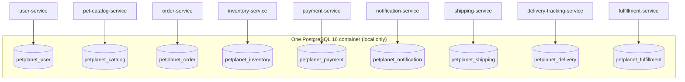

- Each domain service owns **one database with its own role and password**. No service reads another's tables. Data that crosses boundaries travels in events, and each service keeps the copy it needs (for example `customer_id` on payments, shipments and notifications).
- The databases and roles are created by `infrastructure/postgres/init/01-create-catalog-database.sh` from the `*_DATABASE_NAME`, `*_DATABASE_USERNAME` and `*_DATABASE_PASSWORD` variables. It runs **only on an empty data volume**; after changing it, run `make reset` (deletes all local data).
- Sharing one container is a local-development convenience. The services would work unchanged against separate servers.
- **Flyway** owns every schema (`classpath:db/migration`), and Hibernate runs with `ddl-auto: validate`, so the entities must match the migrations.
- **Never edit an applied migration.** Add a new `V<n>__description.sql` instead. (Early commits did edit applied migrations; an old local volume that fails Flyway's checksum check needs one `make reset`.)
- All timestamps are `TIMESTAMPTZ`, mapped to `java.time.Instant`.
- Superuser in Compose is `petplanet_admin`: `docker exec -it pet-planet-postgres psql -U petplanet_admin -d petplanet_order`.

## Cross-service references (logical, not foreign keys)

There are no foreign keys between databases. These IDs link records logically and are carried by events:

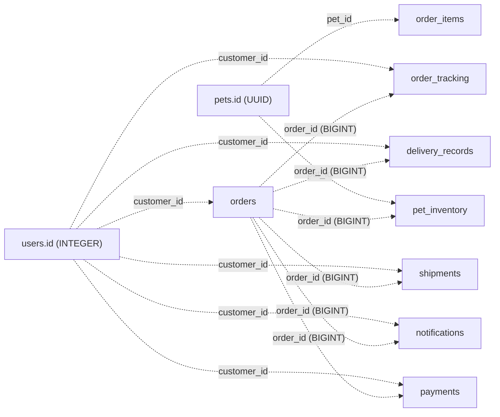

## ER diagrams per service

### user-service (`petplanet_user`)

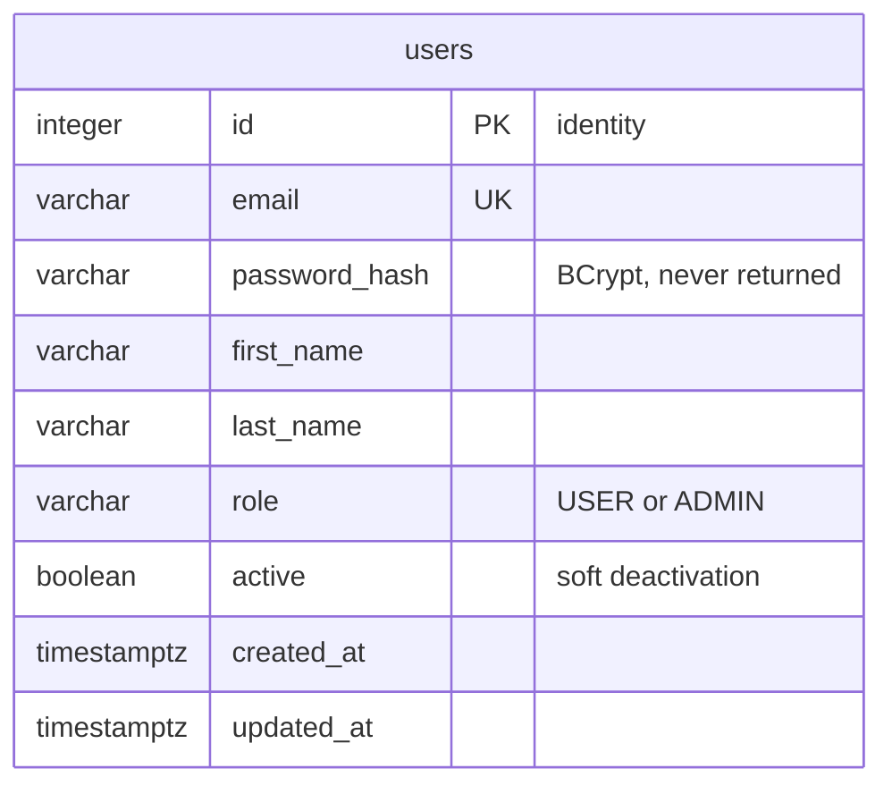

### pet-catalog-service (`petplanet_catalog`)

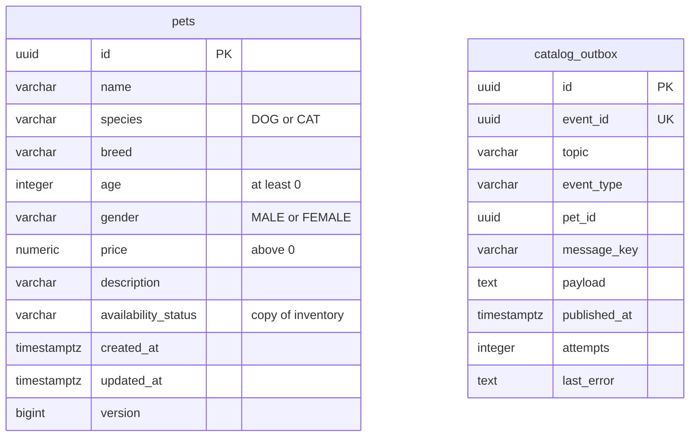

Indexes on `species`, `LOWER(breed)`, `price`, `availability_status`.

### order-service (`petplanet_order`)

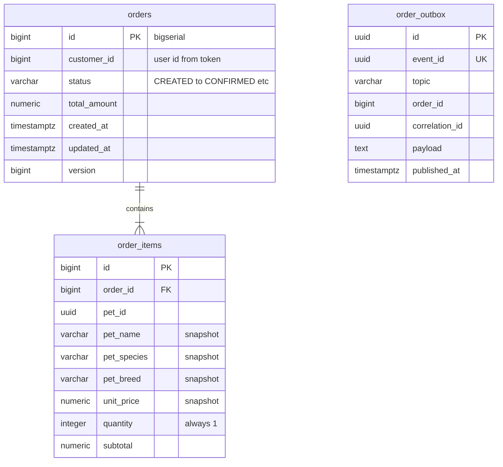

Item snapshots keep an order correct even if the pet's price or description changes later.

### inventory-service (`petplanet_inventory`)

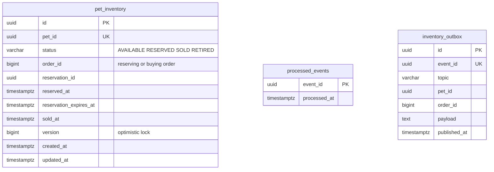

### payment-service (`petplanet_payment`)

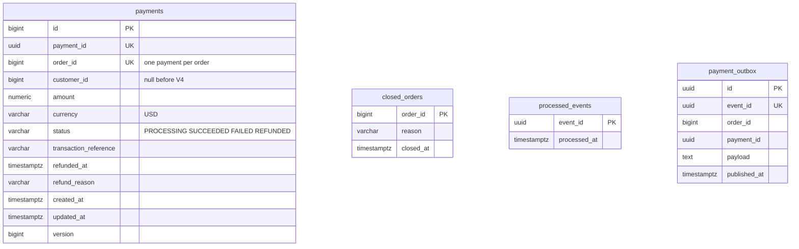

`closed_orders` is a tombstone: once an order is cancelled or failed, a later `PetReserved` for it is never charged.

### notification-service (`petplanet_notification`)

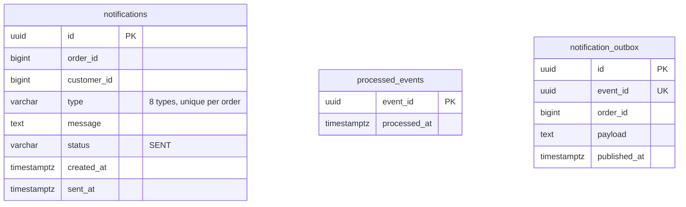

Unique index `uq_notifications_order_type (order_id, type)`; check constraint `chk_notifications_type`.

### shipping-service (`petplanet_shipping`)

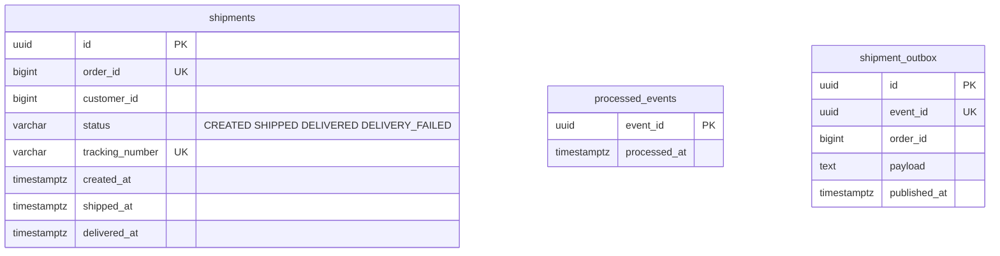

### delivery-tracking-service (`petplanet_delivery`)

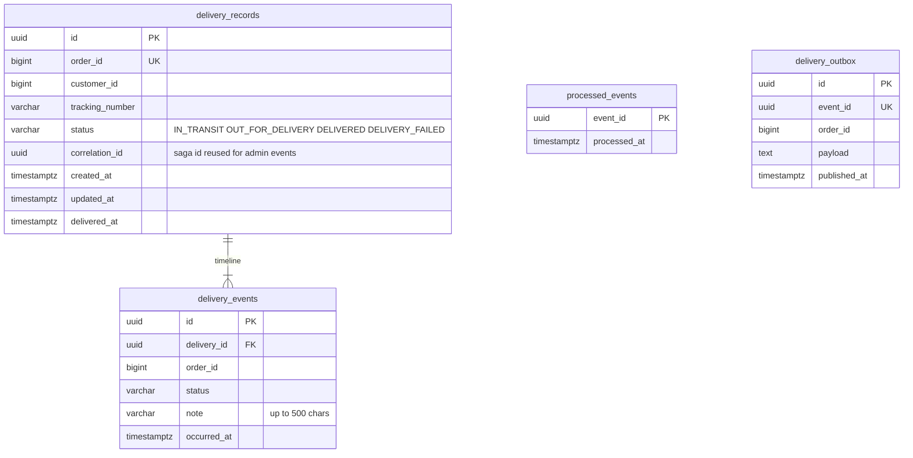

### fulfillment-service (`petplanet_fulfillment`)

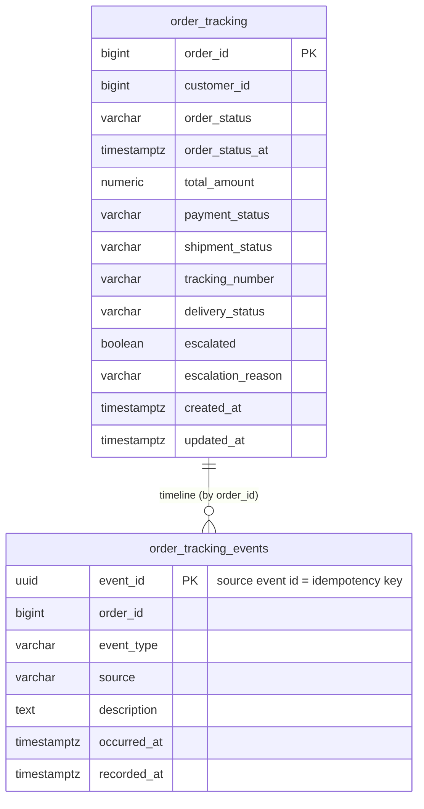

Derived data only: it can be rebuilt by replaying Kafka. Indexes `(customer_id, updated_at DESC)` and a partial `(order_status, order_status_at) WHERE escalated = FALSE` for the stuck-order scan.

## Common technical tables

| Table | Where | Purpose |
|---|---|---|
| `*_outbox` | catalog, order, inventory, payment, notification, shipping, delivery | Transactional outbox. Columns: `id`, `event_id` (unique, = payload `eventId`), `topic`, `event_type`, an aggregate column (`order_id`/`pet_id`/`payment_id`), `correlation_id`, `message_key`, `payload` (JSON text), `created_at`, `published_at` (set after broker ack), `attempts`, `last_error`. Partial index on `created_at WHERE published_at IS NULL` |
| `processed_events` | inventory, payment, notification, shipping, delivery | Idempotency: `event_id` PK, `processed_at`. Written with `INSERT … ON CONFLICT DO NOTHING` in the consumer's transaction |

## Migration history

| Service | Migrations |
|---|---|
| user | `V1` users table · `V2` seed admin + customer · `V3` integer identity IDs, `active` flag, `CUSTOMER` → `USER` · `V4` fix seed password hashes (`password123`) |
| pet-catalog | `V1` pets · `V2` seed 6 pets (`11111111-1111-1111-1111-111111111101`…`106`) · `V3` `catalog_outbox` |
| order | `V1` orders + items · `V2` outbox · `V3` outbox relay columns · `V4` `PAID` → `CONFIRMED` |
| inventory | `V1` `pet_inventory` · `V2` outbox + `processed_events` · `V3` seed 6 inventory rows · `V4` outbox relay columns |
| payment | `V1` payments, outbox, `processed_events` · `V2` outbox relay columns + `correlation_id` · `V3` refunds + `closed_orders` · `V4` `customer_id` |
| notification | `V1` notifications, outbox, `processed_events` · `V2` relay columns · `V3` typed notifications (`type`, check, unique per order) |
| shipping | `V1` shipments, outbox, `processed_events` · `V2` relay columns · `V3` status mirror (check constraint; `PENDING`/`PACKAGED` → `CREATED`) |
| delivery-tracking | `V1` delivery records, outbox, `processed_events` · `V2` relay columns · `V3` `delivery_events` timeline, status check, `correlation_id`, `FAILED` → `DELIVERY_FAILED` |
| fulfillment | `V1` old `fulfillment_records` · `V2` relay columns · `V3` **drops** old tables, creates `order_tracking` + `order_tracking_events` |

## Seed and demo data

| Source | What |
|---|---|
| Flyway (`user` V2/V4) | `admin@petplanet.com` (ADMIN) and `customer@petplanet.com` (USER, "Jane"), password `password123` |
| Flyway (`catalog` V2, `inventory` V3) | 6 sample pets, all `AVAILABLE` |
| `make seed` (`scripts/seed-demo.sh`, through the public API) | 8 more pets (14 total), customer `john@petplanet.com`, 3 orders: one `DELIVERED`, one `OUT_FOR_DELIVERY` (Jane), one `IN_TRANSIT` (John). Safe to re-run: skips pets that exist by name and customers that already have orders |

Using the API for demo data keeps every service's tables and events consistent.
