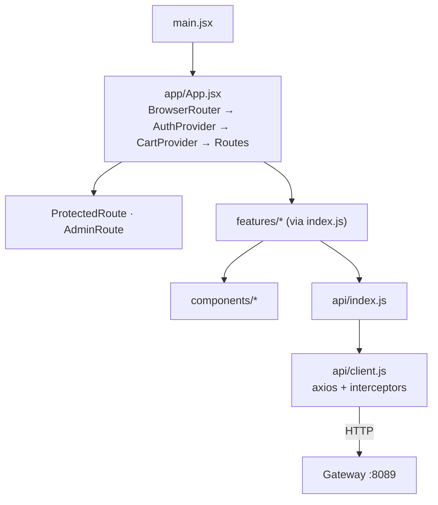
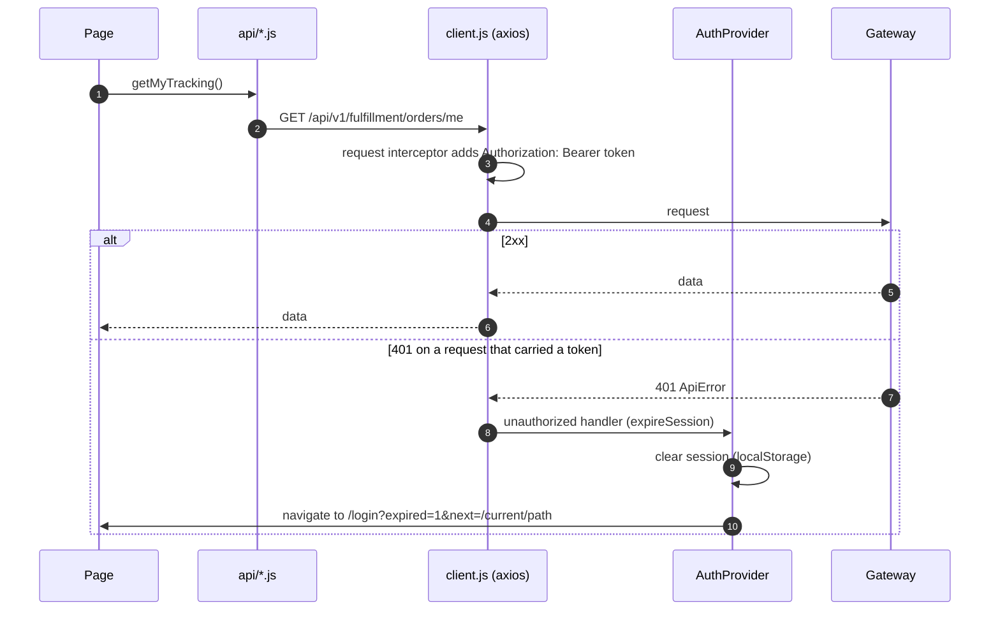
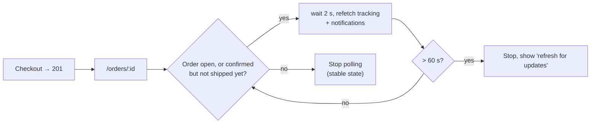

# 07 · Frontend

## Stack

React 18.3.1 · React Router 6.28.0 · Vite 5.4.10 · Material UI 5.16 (Emotion) · Axios 1.7. Every API call goes to `VITE_API_GATEWAY_URL` (default `http://localhost:8089`). There is no frontend unit-test framework; quality checks are `npm run build`, `npm run check:boundaries`, the headless walkthrough `make ui-check` and the Playwright browser tests `make e2e` ([13](13-playwright-e2e.md)).

In Docker Compose, the `frontend` container runs the **Vite dev server** on `:5173` (`node:20-alpine`). The image copies the source, so after a frontend change run `docker compose up -d --build frontend` (or run `npm run dev` locally). There is no production nginx stage.

## Structure (feature-based)

```
frontend/src/
├── main.jsx, index.css          entry point, global styles
├── app/                         App.jsx (router + providers), ProtectedRoute, AdminRoute, NotFoundPage
├── api/                         client.js (the ONE axios instance) + auth, catalog, orders, tracking,
│                                users, inventory, deliveries — all re-exported by api/index.js
├── features/
│   ├── auth/                    AuthContext (AuthProvider, useAuth), LoginPage, RegisterPage
│   ├── catalog/                 HomePage, PetsPage, PetDetailPage
│   ├── cart/                    CartContext (CartProvider, useCart), CartPage
│   ├── checkout/                CheckoutPage
│   ├── orders/                  OrdersPage, OrderDetailPage, TrackingTimeline, useOrderTracking
│   ├── profile/                 ProfilePage, ChangePasswordForm
│   └── admin/                   AdminHomePage, pets/, inventory/, orders/, users/, deliveries/,
│                                usePagedQuery, useUserNames, AdminPageHeader
├── components/                  Layout, StatusChip, PageState, SimulatedPaymentNote, format.js, petImage.js
└── theme/                       MUI theme
```

Each feature exposes a public `index.js`. Boundary rules (checked by `npm run check:boundaries`, script `frontend/scripts/check-boundaries.mjs`):

1. A feature imports another feature only through its `index.js` (`'../cart'`), never its internal files.
2. Backend calls are imported from the `api` index, never from individual `api/*` modules.
3. Features never import from `app/`.



## HTTP client and session



- **One axios instance** for every call. The auth layer hands the token to the client with `setAccessToken` and registers its 401 handler with `setUnauthorizedHandler`, so API functions never take a token argument.
- **401 handling:** a 401 on a request that carried a token (expired, revoked or forged) clears the session and redirects to `/login?expired=1&next=<path>`. The login page shows "Your session has expired" and returns to `next` after sign-in (same-app paths only).
- **Expiry timer:** `AuthProvider` reads the JWT's `exp` claim (it does not verify the token; the backend does). An already-expired stored token is dropped on load, and a timer ends the session when `exp` passes.
- **Storage:** session `{ token, id, email, role }` in `localStorage` key `pet-planet-auth`; cart in `pet-planet-cart`.
- **Errors:** pages show the backend's `message` from the shared error body (`extractApiError`). Loading, error and empty states are separate components (`components/PageState`). A 404 from the tracking view right after checkout means "not available yet", not an error.

## Routes and access

| Route | Access | Page and behavior |
|---|---|---|
| `/` | public | `HomePage`: four featured available pets (mixed species), species cards. Hero button is "Create an account" for guests, "My orders" when signed in |
| `/pets` | public | `PetsPage`: paged catalog, species filter (`?species=`), name search, price sort, status chips |
| `/pets/:id` | public | `PetDetailPage`: details, availability, add to cart |
| `/login`, `/register` | public | Sign in (expired-session and "please sign in" notices); registration signs in automatically |
| `/cart` | public | Browser-local cart |
| `/checkout` | signed in | States that payment is simulated, submits `POST /orders`, clears the cart, opens the new order |
| `/orders` | signed in | The user's orders (`GET /orders`) merged with order, payment and delivery status from **one** call to `GET /fulfillment/orders/me`; escalation marker |
| `/orders/:orderId` | signed in (owner, or admin) | `OrderDetailPage`: items, status card, **timeline** (`GET /fulfillment/orders/{id}`), notifications (`GET /notifications/order/{id}`), cancel button while `CREATED`/`PAYMENT_PENDING`. **Polls every 2 s** while the order is open or a confirmed order has not reached shipping, for at most 60 s, then asks the user to refresh |
| `/profile` | signed in | View and edit name and email, change password |
| `/admin` | `ADMIN` (others see "Admins only") | Links to the admin pages |
| `/admin/pets` | `ADMIN` | Catalog with availability filter (incl. `RETIRED`), create/edit dialog (no availability field), archive (409 messages shown) |
| `/admin/inventory` | `ADMIN` | Read-only inventory with status filter; pet names looked up from the catalog |
| `/admin/orders` | `ADMIN` | All orders with status and customer filters; customer shown as name and email (`useUserNames`, ID as fallback) |
| `/admin/users` | `ADMIN` | Paged users, create (any role), role change, deactivate/reactivate (last-admin 409 shown) |
| `/admin/deliveries` | `ADMIN` | Orders that reached shipping (tracking view, 50 per page, "escalated only" option), customer name and email, buttons for the allowed next delivery statuses, optional failure note |
| anything else | public | `NotFoundPage` |

Route guards only avoid showing pages that would fail. **The backend enforces every rule independently.**

**Navigation** adapts to the role: guests see Home and Browse Pets; signed-in users add Orders and Profile; admins add Admin. Full top navigation from the `lg` breakpoint (1200 px); below it, a cart button and a menu drawer with the same links plus Cart.

## Live order tracking



Implemented in `features/orders/useOrderTracking.js` (`POLL_INTERVAL_MS = 2000`, `POLL_LIMIT_MS = 60000`).

## Pet photos

The catalog API has no image field. `components/petImage.js` picks a stock Unsplash photo: the pet's own `image` if the API ever sends one, otherwise a photo for its breed (all seeded and demo breeds are mapped), otherwise one from a species pool chosen by a hash of the pet ID. The browser tab icon is an inline SVG in `index.html`.

## Layout gotcha

MUI `Stack` resets the margins of its direct children, which breaks a `Grid container` (its negative margins disappear, so the grid shifts right and overflows). Wrap a `Grid container` in a `Box` when it sits directly inside a `Stack`.

## Commands

```sh
cd frontend
npm ci                    # install
npm run dev               # dev server on :5173 (needs the gateway on :8089)
npm run build             # production build into dist/
npm run check:boundaries  # folder-boundary rules
npm run ui-check          # headless walkthrough (stack must be running; same as make ui-check)
npm run e2e               # Playwright browser tests (stack must be running; same as make e2e; more scripts in docs/13)
```
