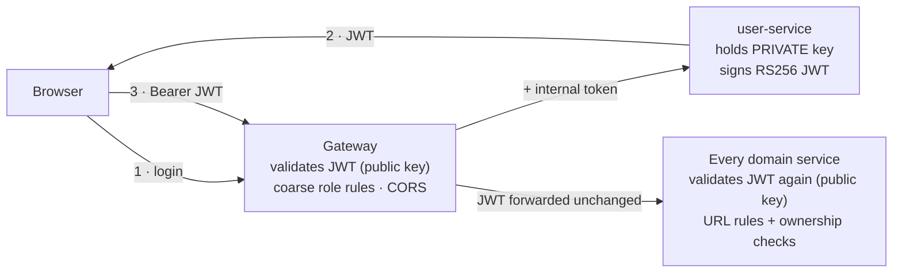
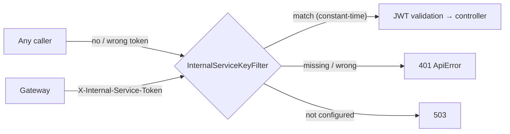

# 08 · Security

One authentication model for the whole platform. The shared pieces live in `platform-commons` (`com.petcommerce.platform.security` and `.web`). Each service keeps only its own URL rules and ownership checks.

## Security model at a glance

| Layer | Decides | Never decides |
|---|---|---|
| Frontend route guards | Which pages to show | Anything security-relevant (UX only) |
| Gateway | Token valid? Public, signed-in or admin path? CORS | Whether a record belongs to the caller |
| Domain service | Token valid (again)? URL role rules. **Does this record belong to the caller?** | — |

This is **defense in depth**: a request that bypassed the gateway inside the network would still need a valid signed token, and still be limited to its own records.

## Tokens: RS256, issued only by user-service

- **Issuer:** user-service `security/token/TokenIssuer` signs with Spring Security's `NimbusJwtEncoder` and the private key `JWT_PRIVATE_KEY`. No other service receives the private key.
- **Claims:** `sub` = integer user ID (as a string), `email`, `role` = `ROLE_USER` or `ROLE_ADMIN`, `iss` = `JWT_ISSUER` (default `pet-planet`), `aud` = `JWT_AUDIENCE` (default `pet-planet`), `iat`, `exp` (`JWT_EXPIRATION_MS`, default 1 hour).
- **Verification in all 10 services** (`spring-boot-starter-oauth2-resource-server`, public key `JWT_PUBLIC_KEY`), contract in `PlatformJwt`:
  - accepted only if RS256-signed by the key pair, not expired, with the expected issuer and audience, a positive numeric `sub` and a known `role`;
  - the authentication's **name is the user ID**; its single authority is the `role` claim, so `hasRole("ADMIN")` works everywhere.
- Servlet services get the decoder from `PlatformSecurityAutoConfiguration`; the gateway builds the reactive equivalent from the same `PlatformJwt` rules.
- **Asymmetric keys** mean a compromised downstream service cannot mint tokens.
- **Stateless:** deactivating a user blocks new logins and `/users/me`, but already-issued tokens stay valid until they expire. Immediate revocation is not implemented.
- **Passwords:** BCrypt hashes, never returned by any API.

## Gateway: coarse rules only

`gateway-service` `security/SecurityConfig` (Spring Security WebFlux):

| Rule | Paths |
|---|---|
| Public | `OPTIONS /**`, `/actuator/health/**`, `POST /api/v1/auth/login`, `POST /api/v1/auth/register`, `GET /api/v1/pets/**` |
| Never reachable | `/internal/**` (denied and not routed) |
| `USER` or `ADMIN` | `/api/v1/users/me/**` and every other `/api/v1/**` path |
| `ADMIN` only | `/api/v1/users/**`, non-GET `/api/v1/pets/**`, `/api/v1/inventory/**`, `PUT /api/v1/deliveries/order/*/status` |
| Denied | anything else |

- **No ownership decisions at the gateway.** Requests for another customer's records are forwarded and rejected by the owning service.
- `ForwardedHeadersFilter` removes client-supplied `X-Internal-Service-Token` and `X-Authenticated-User-*` headers from every routed request (prevents header spoofing) and adds `X-Internal-Service-Token` on user-service routes. Downstream services trust **only the JWT**.
- `CorrelationIdWebFilter` gives every request an `X-Correlation-Id`.

## Services: authentication and ownership

Each servlet service's `security/SecurityConfig` calls `PlatformHttpSecurity.apply(http)` (stateless, CSRF/CORS/basic/form login off, JWT resource server, JSON 401/403), declares its own rules, and ends with `anyRequest().denyAll()`. `PlatformHttpSecurity.PUBLIC_PATHS` (health, `/error`, OpenAPI docs) is open.

| Service | URL rules | Ownership check |
|---|---|---|
| user | login/register public; `/users/me/**` any valid token; `/users/**` `ADMIN` | `/me` uses the token's user ID (`AuthenticatedCaller`), never a header |
| pet-catalog | `GET /pets/**` public; other `/pets/**` `ADMIN` | — |
| order | `/orders/**` `USER`/`ADMIN` | `OrderAccessPolicy`: own orders only; lists scoped to the caller |
| inventory | `/inventory/**` `ADMIN` | — |
| payment | `GET /payments/**` `USER`/`ADMIN` | payment `customer_id` must equal the caller (no owner → admin only) |
| notification | `GET /notifications/**` `USER`/`ADMIN` | every returned notification must be the caller's; `/me` |
| shipping | `GET /shipments/**` `USER`/`ADMIN`; nothing else | per order / per customer |
| delivery-tracking | `GET /deliveries/**` `USER`/`ADMIN`; `PUT …/status` `ADMIN` | per order / per customer |
| fulfillment | `GET /fulfillment/**` `USER`/`ADMIN` | per order; `/me` from the token; search admin-only |

**`AuthenticatedCaller`** is resolved as a controller parameter from the validated token (`userId`, `email`, `admin`). `requireAccessTo(customerId)` passes for admins and the owner, otherwise throws `AccessDeniedException` → **403**. Missing records return **404**. Foreign records return 403, which reveals whether an order ID exists; that is accepted for this project.

## user-service internal token

- user-service accepts only gateway traffic: `InternalServiceKeyFilter` requires the shared `X-Internal-Service-Token` on every request except health checks, before JWT validation.
- `USER_SERVICE_INTERNAL_TOKEN` is generated into `.env`; Compose has no fallback. In production, use mTLS or workload identity instead (not configured here).

## CORS

- **Only the gateway does CORS.** `CorsConfig` provides the policy: origins from `FRONTEND_ORIGIN` (default `http://localhost:5173,http://127.0.0.1:5173`), credentials allowed, `X-Correlation-Id` exposed. `SecurityConfig` applies it as the **first** filter, so preflights work on every path and 401/403 responses carry CORS headers (the browser can read the error).
- Routes keep `DedupeResponseHeader` for `Access-Control-Allow-Origin`/`-Credentials`. Downstream services disable CORS.

## Error responses

Spring Security (services and gateway) and `InternalServiceKeyFilter` write 401/403 in the shared `ApiError` shape. `PlatformExceptionHandler` (lowest precedence) maps technical errors (validation → 400, `AccessDeniedException` → 403, unknown path → 404, unsupported method → 405, anything else → 500 and logged). Each service's `api/error` advice (`@Order(HIGHEST_PRECEDENCE)`) maps its own domain exceptions. Body format: [05 API reference](05-api-reference.md#errors).

## Secrets

- **Nothing secret is committed.** `.env.example` leaves `JWT_PUBLIC_KEY`, `JWT_PRIVATE_KEY` and `USER_SERVICE_INTERNAL_TOKEN` empty.
- `scripts/generate-dev-keys.sh` (run by `make up`, `make infra`, `make keys`) creates `.env` if needed and fills them: an RSA-2048 pair via `openssl` (PKCS#8 private / X.509 public, base64, one line each) and a random 32-byte hex token. Existing values are kept; `--force` rotates them (everyone signs in again).
- `docker-compose.yml` refuses to start without them (`${VAR:?…}`). `application.yml` files have no key defaults; a service started without `JWT_PUBLIC_KEY` fails at startup with a message pointing to the script.
- A development key pair committed before the restructuring is still in git **history**. It was only ever a local key; if your `.env` still contains it, run `scripts/generate-dev-keys.sh --force`.

## Security checklist (what is verified)

| Threat | Mitigation | Verified by |
|---|---|---|
| Forged, expired, wrong-issuer/audience token | `PlatformJwt` validation everywhere | `PlatformSecurityTest`, `GatewaySecurityTest` |
| Reading another customer's data | Ownership checks in each service | `*OwnershipTest`, `*ControllerTest`, smoke scenario S |
| Spoofed identity headers | Gateway strips them; services trust only the JWT | `GatewaySecurityTest`, `UserControllerTest` |
| Direct calls to user-service | Internal token filter | `UserControllerTest` |
| Privilege escalation via registration | Registration always creates `USER` | `AuthServiceTest` |
| Locking out all admins | Last-admin guard (409) | `UserServiceTest` |
| Cross-origin abuse | Gateway-only CORS allow-list | `CorsConfigTest`, `GatewaySecurityTest` |
| Secrets in git | Generated `.env`, no defaults | review of `.env.example`, Compose `:?` guards |

**Out of scope (learning project):** TLS, rate limiting, token revocation, a secrets manager, mTLS between services, real payment-card handling.
