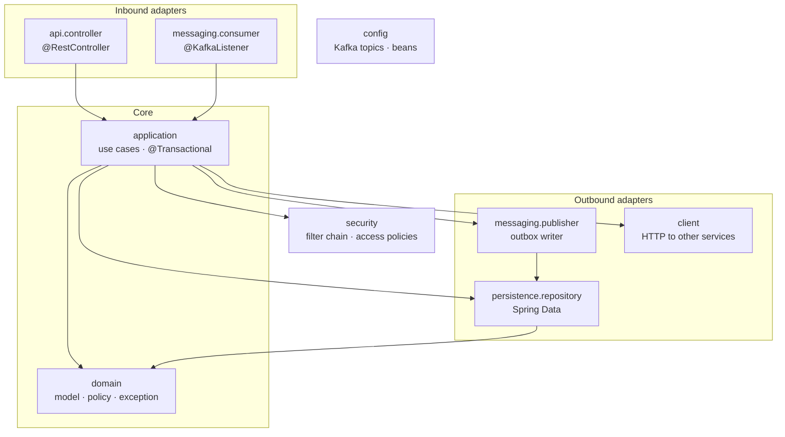
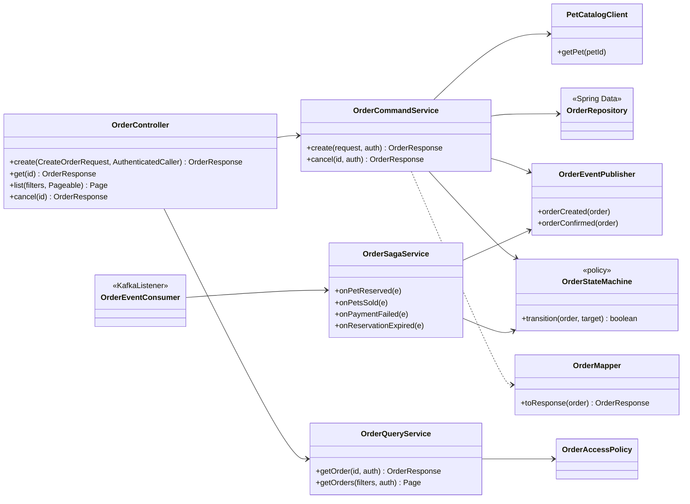

# 09 · Code structure and design patterns

All 10 services are top-level folders at the repository root. Inside each service and inside the frontend, **the folder a file lives in defines its job**. Automated checks enforce the boundaries: an ArchUnit `ArchitectureTest` in every service (`./mvnw test`) and `npm run check:boundaries` in the frontend.

## Inside a service

Package root: `com.petcommerce.<service>`.

| Package | Contains | May depend on |
|---|---|---|
| `api.controller` | Thin `@RestController`s: validate input → call `application` → return DTOs | `application`, `api.dto`, `api.mapper`, `domain.model` (enums) |
| `api.dto` | Request/response records | — |
| `api.mapper` | Entity → response DTO conversion (static methods) | `api.dto`, `domain.model` |
| `api.error` | `@RestControllerAdvice` mapping this service's domain exceptions to `ApiError`; `@Order(HIGHEST_PRECEDENCE)` | `domain.exception`, `platform.web` |
| `application` | Use cases, transactions, idempotency. One class per responsibility (e.g. `OrderCommandService`, `OrderQueryService`, `OrderSagaService`) | `domain`, `persistence`, `messaging.publisher`, `messaging.event`, `security`, `client`, `api.dto` + `api.mapper` |
| `domain.model` | JPA entities, enums, state rules | nothing outside `domain` |
| `domain.policy` | Pure business rules (`OrderStateMachine`, `EmailPolicy`, `NotificationWording`) | `domain` only |
| `domain.exception` | All `RuntimeException` subclasses of the service | `domain` only |
| `security` | `SecurityConfig`, access policies (e.g. `OrderAccessPolicy`) | `domain.model` |
| `messaging.event` | This service's own copies of event payload records | — |
| `messaging.consumer` | `@KafkaListener` adapters: deserialize → call `application` | `application`, `messaging.event` |
| `messaging.publisher` | `*EventPublisher` (writes outbox rows), `*OutboxStore` (exposes the table to the relay) | `persistence`, `messaging.event`, `domain.model`, `platform` |
| `persistence.repository` | Spring Data repositories, query specifications | `domain.model`, `persistence.entity` |
| `persistence.entity` | Technical tables: outbox rows, processed events | `platform` |
| `client` | Outbound HTTP (order → catalog) | `domain` |
| `config` | Non-security wiring (Kafka topics, beans) | — |
| `routing` (gateway only) | Route definitions, DNS cache cap | — |

**Why application services return DTOs:** entities such as `Order` have lazily loaded collections and `open-in-view` is disabled, so mapping happens inside the transaction. Application code still must not depend on controllers, `api.error`, Kafka or Spring Web types.

### The 11 enforced rules

Defined in `<service>/src/test/java/com/petcommerce/<service>/ArchitectureTest.java`:

1. `domain` depends on nothing else in the service.
2. `domain` has no framework plumbing (Spring Web, HTTP, Kafka).
3. Controllers only talk to `application` (never `persistence`, `messaging` or `client`).
4. Consumers only talk to `application` (never `persistence`, `api`, `client`, `messaging.publisher`).
5. `application` is independent of transport (no `api.controller`, `api.error`, `messaging.consumer`, Kafka or Spring Web).
6. Repositories are used only by `application`, `messaging.publisher` and `persistence`.
7. `@RestController` classes live in `api.controller`.
8. `@RestControllerAdvice` classes live in `api.error`.
9. Every `RuntimeException` subclass lives in `domain.exception`.
10. `@KafkaListener` methods live in `messaging.consumer`.
11. No service imports another service's classes; the only shared dependency is `platform-commons`.

A violation fails the build. ArchUnit runs as a plain JUnit test (core `archunit` artifact), because the JUnit 5 engine variant was not discovered by Surefire.

## Example: how order-service classes fit together

(Method names are simplified to show responsibilities; see the source for exact signatures.)

## How code is written: conventions

- **Thin edges, rich core.** Controllers and listeners contain no business logic; they translate and delegate.
- **One transaction per use case** in `application`. The outbox insert and the `processed_events` insert happen in that same transaction.
- **Constructor injection** everywhere; Lombok reduces boilerplate in most services.
- **Records** for DTOs and event payloads.
- **Each service owns its event records.** Consumers declare only the fields they need and ignore the rest (tolerant reader). Contract tests catch producer changes.
- **No guessing:** missing required data raises an exception (→ retry → DLT), never a default value.
- **Domain exceptions** (`*NotFoundException`, `Invalid*Exception`, …) map to HTTP status codes in `api.error`.
- **Configuration through environment variables** with safe local defaults in `application.yml` (except secrets, which have none).
- **Logs** include `[corr=<correlationId>]` from the MDC.
- **Migrations are append-only.**

### Adding a feature (checklist)

1. Domain change in `domain.model` / `domain.policy` (+ exception in `domain.exception`).
2. Flyway migration `V<next>__<what>.sql` if the schema changes.
3. Use case in `application` (transaction, ownership check, outbox write).
4. Endpoint in `api.controller` + DTO in `api.dto` + mapper; or a listener in `messaging.consumer` + event record in `messaging.event`.
5. New topic? Declare it in the producer's `config/KafkaConfig`; add a contract fixture in each consumer.
6. Security rule in the service's `SecurityConfig`, and at the gateway if it is a new path prefix or admin-only.
7. Tests (unit + controller with `TestJwtIssuer`), then `./mvnw -pl <service> -am test` and `make smoke`.
8. Update the matching chapter in `docs/`.

## Design patterns used

### Architecture and integration patterns

| Pattern | Problem it solves | Where |
|---|---|---|
| **Microservices** | Independent deployment and ownership | 10 services at the repo root |
| **Database per service** | Loose coupling of data | 9 databases, own roles ([06](06-database.md)) |
| **API Gateway** | One entry point; edge concerns in one place | `gateway-service` |
| **Saga (choreography)** | A business transaction across services without 2PC | Checkout across order, inventory, payment ([03](03-events-and-saga.md)) |
| **Compensating transaction** | Undo earlier steps on failure | Inventory release, payment refund |
| **Transactional outbox** | Atomic state change + event | `*_outbox` tables + `platform-commons` `OutboxRelay` |
| **Polling publisher** | Move outbox rows to the broker | `OutboxRelay` (500 ms, `SKIP LOCKED`) |
| **Idempotent consumer** | At-least-once delivery without double effects | `processed_events`, timeline `event_id`, state checks |
| **Dead letter channel** | Poison messages don't block a partition | `<topic>.DLT` after 3 retries |
| **CQRS / materialized view** | Fast, joined read model without cross-service queries | `fulfillment-service` projection |
| **Event-carried state transfer** | Consumers keep the data they need | `customerId`, `totalAmount` on events; catalog's availability copy |
| **Tolerant reader / consumer-driven contracts** | Producers can add fields safely | Per-service event records, `EventContractTest` fixtures |
| **Correlation identifier** | Trace one request or saga across services | `X-Correlation-Id`, `correlationId` header, MDC |
| **Shared kernel (infrastructure only)** | No copy-paste of plumbing, no domain coupling | `platform-commons` via auto-configuration |
| **Defense in depth / zero trust** | No single point of authorization | JWT checked at gateway and in every service |

### Code-level patterns

| Pattern | Where |
|---|---|
| **Layered / hexagonal-style packages** (inbound adapters → application → domain ← outbound adapters) | Every service ([above](#inside-a-service)) |
| **State machine** | `OrderStateMachine`, `DeliveryStatus` transition table, monotonic `OrderTracking`, `Shipment.mirrorDelivery` |
| **Strategy / port and adapter** | `PaymentGateway` interface with `SimulatedPaymentGateway`; swap in a real provider without touching `PaymentService` |
| **Repository** | Spring Data repositories in `persistence.repository` |
| **Specification** | `OrderSpecifications` for filtered order queries |
| **DTO + mapper** | `api.dto` records + static `api.mapper` classes; entities never leave the service |
| **Policy object** | `OrderAccessPolicy`, `EmailPolicy`, `NotificationWording` |
| **Snapshot** | Order items copy pet name, breed and price at checkout |
| **Soft delete** | Pet archive (`RETIRED`), user deactivation (`active = false`) |
| **Optimistic locking** | `@Version` on `pet_inventory`, `orders`, `payments`, `pets` |
| **Pessimistic row lock** | Fulfillment locks the tracking row per event (`PESSIMISTIC_WRITE`) |
| **Advisory lock** | Payment serializes charge vs close per order (`pg_advisory_xact_lock`) |
| **Scheduler** | Reservation expiry (inventory), stuck-order escalation (fulfillment) |
| **Auto-configuration** | `platform-commons` `*AutoConfiguration` classes, conditional on available libraries |
| **Argument resolver** | `AuthenticatedCaller` injected into controller methods from the token |
| **Template method / single handler** | `PlatformExceptionHandler` + per-service advice with higher precedence |

### Frontend patterns

| Pattern | Where |
|---|---|
| **Feature folders with public index** | `features/*/index.js` |
| **Context provider** | `AuthProvider`, `CartProvider` |
| **Custom hooks** | `useAuth`, `useCart`, `useOrderTracking`, `usePagedQuery`, `useUserNames` |
| **Route guards** | `ProtectedRoute`, `AdminRoute` (React Router layout routes) |
| **Interceptor** | axios request (token) and response (401) interceptors in `api/client.js` |
| **Facade** | `api/index.js` re-exports every backend call |
| **Polling with a time limit** | `useOrderTracking` (2 s, 60 s cap) |
