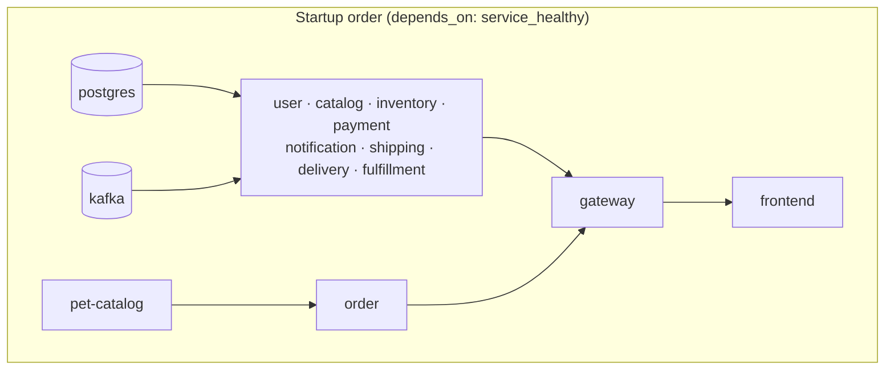

# 10 · Infrastructure and operations

## Docker Compose topology

`docker-compose.yml` runs everything on one bridge network, `pet-planet`.

| Container | Image | Host port | Memory cap | Depends on (healthy) |
|---|---|---|---|---|
| `postgres` | `postgres:16-alpine` | 5432 | 256 MB | — |
| `kafka` | `apache/kafka:4.0.1` (KRaft) | 9092 | 640 MB (heap 384 MB) | — |
| 9 domain services | built from `<service>/Dockerfile` | none (internal) | `SERVICE_MEM_LIMIT` (384 MB) | Postgres, Kafka (order also: catalog) |
| `gateway-service` | built | 8089 | 384 MB | user, catalog, order, inventory |
| `frontend` | built (`node:20-alpine`, Vite dev server) | 5173 | 512 MB | gateway |
| `kafka-ui` (profile `tools`) | `ghcr.io/kafbat/kafka-ui:v1.2.0` | 8090 | 384 MB | Kafka |

Volumes: `postgres-data`, `kafka-data`. 13 containers start with `make up`; Kafka UI only with `make kafka-ui`.

- **Health checks:** every Spring service runs `curl -fsS http://localhost:<port>/actuator/health`. `make up` runs `docker compose up -d --build --wait --wait-timeout 600`.
- **Compose anchors:** `x-java-env` (JVM flags, Hikari pool), `x-java-service` (memory cap, restart), `x-jwt-verify-env` (public key, issuer, audience for all 10 services), `x-health-timing`, `x-infra-ready`.

## Image builds

- Each service Dockerfile builds from the **repository root** context (`context: .`, `dockerfile: <service>/Dockerfile`) with `mvn -pl <service> -am package`, so the root POM and `platform-commons` are available.
- Maven runs in a `maven:3.9.11-eclipse-temurin-17` stage with a shared BuildKit cache mount (`id=pet-planet-m2`): libraries download once for all images. BuildKit is required (default in current Docker).
- `.dockerignore` excludes `frontend/`, `docs/`, build output and secrets.

## Make targets

| Target | What it does |
|---|---|
| `make help` | List every target |
| `make keys` | Create `.env` from `.env.example` and generate secrets (keeps existing values) |
| `make up` | `keys`, then build and start the stack, waiting until every service is healthy |
| `make down` | Stop, keeping all data |
| `make reset` | Stop and **delete all local data** (Postgres + Kafka volumes), then start fresh |
| `make seed` | Add demo data to the running stack (8 pets, a second customer, 3 orders) |
| `make infra` | `keys`, then only Postgres + Kafka, for running services from an IDE |
| `make kafka-ui` | Start Kafka UI at http://localhost:8090 |
| `make build` | Build all images |
| `make logs s=<service>` | Follow logs (all, or one service) |
| `make ps` | Container status and health |
| `make test` | All backend tests (unit, slice, ArchUnit, Testcontainers; Docker must run) |
| `make verify` | `test` plus packaging every module (the acceptance build) |
| `make smoke` | End-to-end checks against the running stack (3–7 min; restarts some services with test settings) |
| `make ui-check` | Headless-Chrome walkthrough of every page (needs Chrome; `CHROME_PATH` if non-standard) |
| `make e2e` | Playwright browser tests against the running stack; installs Playwright's Chromium on first run ([13](13-playwright-e2e.md)) |
| `make frontend-check` | Frontend build + boundary check |

## Environment variables

`.env` is created from `.env.example` by `make keys` and is git-ignored.

| Group | Variables | Default / note |
|---|---|---|
| Secrets (generated) | `JWT_PUBLIC_KEY`, `JWT_PRIVATE_KEY`, `USER_SERVICE_INTERNAL_TOKEN` | Empty in the template; Compose refuses to start without them |
| JWT | `JWT_ISSUER`, `JWT_AUDIENCE`, `JWT_EXPIRATION_MS` | `pet-planet`, `pet-planet`, `3600000` (1 h) |
| Postgres | `POSTGRES_USER`, `POSTGRES_PASSWORD`, `POSTGRES_DB`, `POSTGRES_PORT` | superuser `petplanet_admin`, port 5432 |
| Per-service DB | `<SVC>_DATABASE_NAME`, `_USERNAME`, `_PASSWORD` for CATALOG, ORDER, INVENTORY, PAYMENT, NOTIFICATION, SHIPPING, DELIVERY, FULFILLMENT, USER | local development values |
| Pool | `DB_POOL_SIZE` | `5` per service (≈45 connections of Postgres's 100) |
| Kafka | `KAFKA_PORT`, `KAFKA_ADVERTISED_HOST` | `9092`, `localhost` |
| Ports | `GATEWAY_PORT`, `FRONTEND_PORT` | `8089`, `5173` |
| CORS | `FRONTEND_ORIGIN` | `http://localhost:5173` (gateway code default also allows `127.0.0.1:5173`) |
| Frontend | `VITE_API_GATEWAY_URL` | `http://localhost:8089` |
| JVM / memory | `JAVA_TOOL_OPTIONS`, `SERVICE_MEM_LIMIT` | `-XX:MaxRAMPercentage=65 -XX:+UseSerialGC -XX:TieredStopAtLevel=1 -Xss512k`, `384m` |
| Order → catalog | `PET_CATALOG_CONNECT_TIMEOUT`, `PET_CATALOG_READ_TIMEOUT` | `PT2S`, `PT5S` |
| Gateway | `gateway.upstream-dns-cache-ttl` | `PT5S` |

### Saga test knobs (used by `make smoke`)

| Variable | Service | Default | Effect |
|---|---|---|---|
| `PAYMENT_SIMULATION_RESULT` | payment | `SUCCESS` | `FAILURE` declines every charge |
| `PAYMENT_SIMULATION_DELAY` | payment | `PT0S` | Slow charges to reproduce cancel/expiry races |
| `INVENTORY_RESERVATION_TIMEOUT` | inventory | `PT5M` | Reservation lifetime |
| `INVENTORY_EXPIRATION_CHECK_DELAY_MS` | inventory | `30000` | Expiry scan interval |
| `FULFILLMENT_STUCK_AFTER` | fulfillment | `PT10M` | When an open order counts as stuck |
| `FULFILLMENT_ESCALATION_CHECK_MS` | fulfillment | `60000` | Stuck-order scan interval |

## Memory sizing

Sized for a ~4 GB Docker Desktop VM. Measured with the stack idle after startup: about **3.1 GB** total, no OOM kills. **6 GB** of Docker memory is recommended for builds and smoke tests.

## Running a service from your IDE

1. `make infra` (Postgres + Kafka only, plus `.env`).
2. Import the root `pom.xml` so the IDE also builds `platform-commons`, or run `./mvnw install -pl platform-commons` once.
3. Export the variables from `.env` into the run configuration (at least `JWT_PUBLIC_KEY`; `JWT_PRIVATE_KEY` and `USER_SERVICE_INTERNAL_TOKEN` for user-service). Each `application.yml` has `localhost` defaults for the database and Kafka.
4. Swagger UI is at `http://localhost:<port>/swagger-ui.html` for a service running this way.

Outside Docker, use the wrapper: `./mvnw test` (all) or `./mvnw -pl <service> -am test` (`-am` builds `platform-commons` first).

## Observability

| Need | How |
|---|---|
| Follow one request | Every response has `X-Correlation-Id`; grep logs for `[corr=<id>]` |
| Follow one saga | The saga `correlationId` travels in Kafka headers and appears in every consumer's log lines |
| Inspect events and DLTs | `make kafka-ui` → http://localhost:8090 |
| Inspect a database | `docker exec -it pet-planet-postgres psql -U petplanet_admin -d petplanet_<db>` |
| Health | `make ps`, or `/actuator/health` inside the network |
| Stuck or failed orders | Admin → Deliveries "escalated only", or `GET /api/v1/fulfillment/orders?escalated=true` |

## Troubleshooting

| Symptom | Cause and fix |
|---|---|
| Compose refuses to start: variable required | `.env` lacks secrets. Run `make keys` (or `make up`, which runs it) |
| Flyway checksum error on an old database | An old volume from before the restructuring. Run `make reset` once (deletes local data) |
| A new database is missing | The init script only runs on an empty volume. `make reset` |
| Everyone is logged out after `--force` | Keys were rotated; sign in again |
| `.env` still contains the old committed dev key | `scripts/generate-dev-keys.sh --force` |
| Gateway returns 500 right after a backend restart | Should recover within 5 s (DNS cache cap). Gateway log "Connection refused: <service>/<old ip>" means a stale address |
| Services fail to get DB connections | Pools exceed `max_connections`. Keep `DB_POOL_SIZE` at 5 unless you raise Postgres's limit |
| Frontend change not visible in Docker | `docker compose up -d --build frontend` (the image copies the source) |
| Containers killed / stack slow | Give Docker Desktop 6 GB |
| Single-module Maven build can't find `platform-commons` | Add `-am`: `./mvnw -pl <service> -am test` |
| Testcontainers fails on Docker Engine 29 | Keep `platform-commons/src/test/resources/docker-java.properties` (`api.version=1.44`) |
| A service with two constructors fails to start | Spring needs `@Autowired` on one of them (unit tests don't catch this; `make up` does) |
| Fulfillment's `shipment-created-events.DLT` has an old `{this is not json` message | Expected: a deliberate poison message from an old test, re-read by the projection group |

## Production gaps

This is a local learning setup. Not provided: TLS, mTLS between services, a secrets manager, rate limiting, horizontal scaling (topics have 1 partition), centralized logging or metrics, a production frontend build stage, and CI pipelines.
