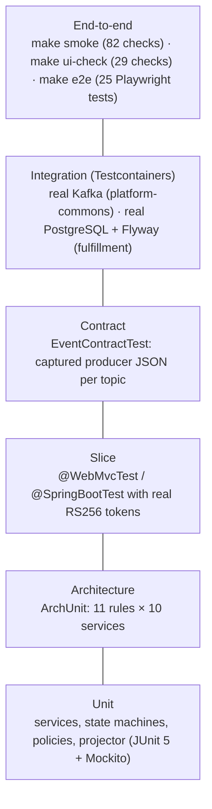

# 11 · Testing

## Test strategy



| Level | What it proves | Command |
|---|---|---|
| Unit | Business rules, state transitions, idempotency, compensation logic | `make test` |
| Architecture | Package boundaries; no cross-service imports | `make test` |
| Slice | Security rules with real tokens, error bodies, HTTP mapping | `make test` |
| Contract | A consumer can read exactly what the producer writes | `make test` |
| Integration | Real Kafka (DLT, legacy headers, typed consumption) and real Postgres (projection under concurrency) | `make test` (needs Docker; skipped without it) |
| End-to-end | The whole saga, compensation, security and UI on the running stack | `make smoke`, `make ui-check`, `make e2e` |

## Test inventory by module

| Module | Tests |
|---|---|
| `platform-commons` | `PlatformSecurityTest` (owner/foreign/admin via `AuthenticatedCaller`; 401 for missing, forged, expired, wrong-issuer, wrong-audience, non-numeric-subject, unknown-role tokens; shared `ApiError`), `OutboxRelayTest` (headers, mark published only on ack, failure recorded, batch stops), `KafkaPlatformIntegrationTest` (**real Kafka**: typed consumption without type headers, legacy `__TypeId__` ignored, poison message → `<topic>.DLT` while later messages continue, correlation header in MDC) |
| `gateway-service` | `GatewaySecurityTest` (random port, real tokens, real routes, stub backend echoing headers: 401 body, forged/expired tokens, JWT forwarded, untrusted headers stripped, internal token only on user routes, admin prefixes, `/internal/**` denied, CORS on 401), `CorsConfigTest` |
| `user-service` | `UserControllerTest` (internal token; `/me` from the token, identity headers ignored; admin-only administration), `TokenIssuerTest` (tokens pass the platform validator; other key rejected), `AuthServiceTest` (registration creates `USER`), `UserServiceTest` (last-admin guard), `SeedAccountPasswordTest` |
| `pet-catalog-service` | `PetServiceTest` (default `AVAILABLE`, archive → `RETIRED` + event, reserved pet not archivable, update cannot change availability) |
| `order-service` | `OrderCommandServiceTest`, `OrderQueryServiceTest` (owner access), `OrderSagaServiceTest` (confirm on `PetsSold`; fail on payment failure and sale conflict; cancel on expiry; late events ignored), `OrderStateMachineTest` (every legal/illegal transition), `OrderControllerTest` (real token, 401, 404 body, malformed JSON → 400), `PetCatalogClientTest` (local HTTP server: available, sold, 404, 500/400, read timeout, unreachable) |
| `inventory-service` | `InventoryServiceTest` (all-or-nothing reservation, duplicate ignored, unknown pet → `PET_NOT_FOUND`, sell only while reserved → `PetsSold` or `InventorySaleConflict`, release only this order's pets, archive → `RETIRED`), `InventoryControllerTest` |
| `payment-service` | `PaymentServiceTest` (charge total, decline, no double charge, closed order never charged, missing amount rejected, refund on closure), `PaymentServiceOwnershipTest`, `PaymentControllerTest` |
| `notification-service` | `NotificationServiceTest` (one typed notification per event, refund owner fallback or DLT, `IN_TRANSIT` sends nothing, duplicates ignored, `NotificationSentEvent` payload), `NotificationWordingTest`, `NotificationServiceOwnershipTest`, `NotificationControllerTest` |
| `shipping-service` | `ShippingServiceTest` (create `CREATED`, idempotency, mirror `SHIPPED → DELIVERED`, terminal never changes, unknown shipment skipped), `ShippingServiceOwnershipTest`, `ShippingControllerTest` (no mutation endpoint) |
| `delivery-tracking-service` | `DeliveryStatusTest` (transition table), `DeliveryTrackingServiceTest` (start `IN_TRANSIT` with timeline and saga correlation, idempotency, admin advance publishes `previousStatus`/`note`, illegal transition has no side effects, unknown order 404), `DeliveryTrackingServiceOwnershipTest`, `DeliveryTrackingControllerTest` (admin-only status change; 404/409/400) |
| `fulfillment-service` | `OrderTrackingTest` (monotonic statuses under any event order, refund wins, delivery failure escalates, stuck flag cleared), `OrderTrackingProjectorTest`, `OrderTrackingTextTest` (customer-facing wording), `EscalationServiceTest`, `OrderTrackingQueryServiceTest`, `FulfillmentControllerTest`, `OrderTrackingProjectionPostgresTest` (**real PostgreSQL 16 + Flyway**: out-of-order events, replay idempotency, 5 concurrent listeners on one new order, escalation query) |
| 8 consuming services | `messaging/consumer/EventContractTest` with fixtures in `src/test/resources/contracts/<topic>.json` (exact producer JSON captured from the running stack). Covered: `order-created`, `order-confirmed`, `order-cancelled`, `order-failed`, `pet-reserved`, `pet-reservation-failed`, `payment-succeeded`, `payment-failed`, `payment-refunded`, `inventory-status`, `pets-sold`, `inventory-sale-conflict`, `shipment-created`, `delivery-status-updated`, `notification-sent`. **Not covered:** `pet-reservation-expired`, `pet-catalog-events` |
| every service | `ArchitectureTest` (11 ArchUnit rules; [09](09-code-structure-and-patterns.md#the-11-enforced-rules)) |

`TestJwtIssuer` (throwaway RSA key, same claims as user-service) ships in the `platform-commons` test-jar. Controller tests use it with `@DynamicPropertySource` to set `jwt.public-key`.

## End-to-end smoke test (`make smoke`)

`scripts/smoke-test.sh` runs against the running stack, creates its own pets as admin, and checks:

| Scenario | What it verifies |
|---|---|
| 1 · Happy path + delivery | `CONFIRMED`, payment `SUCCEEDED`, pet `SOLD`, shipment created; delivery `IN_TRANSIT`, shipment `SHIPPED`; admin `OUT_FOR_DELIVERY` → `DELIVERED`; going back → 409; timeline has 3 entries; shipment `DELIVERED`; shipping has no mutation endpoint (403); notifications `ORDER_CONFIRMED, SHIPPED, OUT_FOR_DELIVERY, DELIVERED`; tracking view complete, not escalated |
| D · Delivery fails | `DELIVERY_FAILED` → shipment mirrors, tracking escalated, notification sent, admin search finds it, customer cannot search (403) but lists own |
| 2 · Archive rules | `RETIRED`, hidden, not orderable (409); archiving a sold pet → 409; malformed order JSON → 400 |
| 3 · Payment declined | Order `FAILED`, payment `FAILED`, pet `AVAILABLE`, `ORDER_FAILED` notification, tracking `FAILED FAILED` |
| 4 · Cancel during a slow charge | `CANCELLED`, payment `REFUNDED`, pet `AVAILABLE`, `ORDER_CANCELLED` + `PAYMENT_REFUNDED` notifications |
| 5 · Reservation expiry during a slow charge | `CANCELLED`, `REFUNDED`, pet `AVAILABLE`, expiry wording |
| 6 · Stuck order | With `FULFILLMENT_STUCK_AFTER=PT10S` and a 35 s charge, tracking escalates the `PAYMENT_PENDING` order, then clears the flag after confirmation |
| R · Reservation race | Two customers order the same new pet at once: exactly one `CONFIRMED`, the other `FAILED` with "no longer available", a `PetReservationFailed` timeline entry, and no payment (404) |
| S · Security | A second customer gets 403 on the first customer's order, payment, shipment, notification, delivery and tracking records; owner and admin get 200; 401 without a token; shared error bodies; user on `/users` and on the delivery action → 403; unknown order payment → 404; `/users/me` from the token |

Scenarios 3–6 restart payment, inventory and fulfillment with the [test knobs](10-infrastructure-and-operations.md#saga-test-knobs-used-by-make-smoke) and restore defaults on exit. Runtime: about 3 minutes on a fresh database, up to 7 on a long-running one.

## UI walkthrough (`make ui-check`)

`frontend/scripts/ui-check.mjs` drives a locally installed Chrome headlessly (`puppeteer-core`, no browser download; set `CHROME_PATH` if needed) through every customer and admin page: 29 checks covering guest redirects, login with return to the requested page, role-aware navigation, "Admins only", profile, cart → checkout → live order page until `Confirmed` with shipment and notification, a forged token → `/login?expired=1`, an expired token dropped on load, every admin page, and an admin "Delivered" action reflected on the order page. It fails on any browser console error.

It logs in through the real form and then continues in a fresh tab, because headless Chrome's password prompt swallows later input in the tab where a password was typed. It also waits briefly before clicking data-loaded buttons, because React StrictMode re-renders them once in development.

## Playwright browser tests (`make e2e`)

`frontend/e2e/` holds 25 Playwright tests (`@playwright/test` 1.65.1, its own Chromium) that run against the running stack. A `setup` project checks the stack is reachable and signs in once per role through the login form; the specs then reuse those sessions and run in parallel. Covered: guest pages and route guards, wrong password, 404 page, customer navigation/profile/orders/"Admins only"/logout, rejected and expired tokens, every admin page, and the full order journey (customer buys a new pet, order confirms and ships, admin marks it delivered in a second browser context, customer sees it delivered). Every test also fails on a browser console error. Failures keep a screenshot, video and trace under `frontend/e2e-results/`.

How to run, debug and extend them: **[13 Playwright end-to-end tests](13-playwright-e2e.md)**.

## Commands

```sh
make test                                # all backend tests (Docker needed for Testcontainers)
make verify                              # tests + packaging
./mvnw -pl order-service -am test        # one service (-am builds platform-commons)
./mvnw -pl order-service -am test -Dtest=OrderSagaServiceTest   # one test class
make smoke                               # stack must be up
make ui-check                            # stack must be up; Chrome required
make e2e                                 # stack must be up; Playwright tests (see chapter 13)
make frontend-check                      # npm run build + check:boundaries
```

## Latest results

| Date | Check | Result |
|---|---|---|
| 2026-11-15 | `./mvnw verify` (all 11 modules) | BUILD SUCCESS, 337 tests |
| 2026-11-15 | `make smoke` (long-running stack and a clean checkout) | 82/82 both |
| 2026-11-15 | Clean checkout → `make up` | 13 containers healthy in about 90 s (warm Maven cache) |
| 2026-11-22 | `make ui-check` after `make reset` + `make seed` | 29/29 |
| 2026-11-22 | `npm run build`, `npm run check:boundaries` | OK |
| 2026-11-22 | `make e2e` / `npm run e2e` (Playwright, running stack) | 25/25, three runs in a row |
| 2026-11-22 | `./mvnw -pl fulfillment-service,notification-service -am test` (after the timeline-wording change) | platform-commons 10, fulfillment 57, notification 35 tests: all passed |

The full `./mvnw verify` and `make smoke` were **not** re-run after the 2026-11-22 working-tree changes (UI cleanup, timeline wording).

## Known testing gaps

- Testcontainers tests exist only for platform-commons (Kafka) and fulfillment (PostgreSQL). The other services' consumer → producer hops are covered by unit tests, contract fixtures and `make smoke`.
- No contract fixtures for `pet-reservation-expired-events` and `pet-catalog-events`.
- No frontend unit tests; only the `make ui-check` walkthrough and the `make e2e` Playwright tests.
- None of the end-to-end checks runs in CI (there is no CI).
