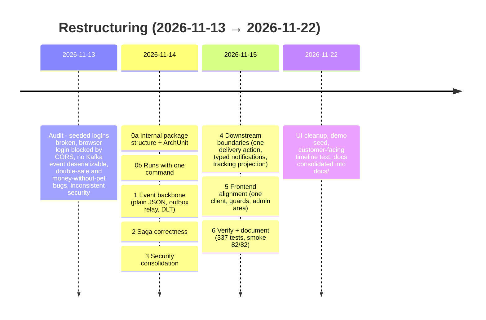

# 12 · Status, decisions and known issues

## Implementation status

"Verified" means a named, repeatable check demonstrates the behavior: a test in `./mvnw verify`, a scenario in `make smoke`, or a check in `make ui-check` or `make e2e` ([11 Testing](11-testing.md)).

| Feature | Status | Evidence |
|---|---|---|
| One-command local stack | Verified | `make up` starts 13 healthy containers; a fresh clone with no `.env` passed `make smoke` (2026-11-15) |
| Identity and tokens | Verified | `TokenIssuerTest`, `UserControllerTest`, `SeedAccountPasswordTest`; smoke logins and registration; profile and admin users pages |
| Gateway | Verified | `GatewaySecurityTest`; smoke scenario S |
| Service-level security and ownership | Verified | `*OwnershipTest`, `*ControllerTest`, `PlatformSecurityTest`; smoke scenario S |
| Pet catalog (browse, admin CRUD, archive) | Verified | `PetServiceTest`; smoke scenario 2; admin pets page |
| Checkout saga with compensation | Verified | Smoke scenarios 1, 3, 4, 5, R; `OrderSagaServiceTest`, `OrderStateMachineTest` |
| Inventory (all-or-nothing, expiry, sale only while reserved) | Verified | `InventoryServiceTest`, `InventoryControllerTest`; smoke 1–5, R |
| Payment (simulated) with refunds | Verified | `PaymentServiceTest`; smoke 3–5. No real payment provider |
| Shipping and delivery | Verified | `DeliveryStatusTest`, `DeliveryTrackingServiceTest`, `ShippingServiceTest`; smoke 1, D; admin deliveries page |
| Typed notifications (simulated sending) | Verified | `NotificationServiceTest`; smoke 1, 3, 4, 5, D, R. No e-mail |
| Order-tracking projection + escalation | Verified | `OrderTrackingTest`, `OrderTrackingProjectorTest`, `EscalationServiceTest`, `OrderTrackingProjectionPostgresTest`; smoke 1, D, 6 |
| Event backbone (outbox, DLT, idempotency, contracts) | Verified | `OutboxRelayTest`, `KafkaPlatformIntegrationTest`, `EventContractTest`s |
| Storefront with admin area | Verified | `make ui-check` 29/29 (2026-11-22); `make e2e` 25/25 Playwright tests (2026-11-22) |
| Code structure | Verified | ArchUnit (11 rules × 10 services), `npm run check:boundaries` |

### Uncommitted work as of 2026-11-22

On top of `main` (`38dfebc`), the working tree contains:

- **UI cleanup** (frontend): role-aware hero button, grid layout fixes, responsive header drawer with Cart, per-breed pet photos, status chips, 404 page, favicon, customer names on admin orders and deliveries (`useUserNames`). Verified by `npm run build`, `check:boundaries`, screenshots at 1400/1024/390 px, and `make ui-check` 29/29.
- **Customer-facing timeline text** (fulfillment `OrderTrackingProjector`) and notification wording tweaks. Verified by the fulfillment (57) and notification (35) module tests. Full `./mvnw verify` and `make smoke` **not re-run** since.
- `scripts/seed-demo.sh` + `make seed`.
- **Playwright E2E tests** (`frontend/e2e/`, `make e2e`, [13](13-playwright-e2e.md)): 25 tests, passed 3 runs in a row against the running stack. The Postman collection (`postman/`, `.postman/`) was removed; API-level end-to-end coverage remains in `make smoke`.

## Architecture decisions

### Owner-confirmed (2026-11-14)

| ID | Decision | Why |
|---|---|---|
| DEC-1 | **user-service issues RS256 JWTs** (only holder of the private key); the **gateway only validates**, routes and applies coarse role rules | The edge holds no business logic or secrets |
| DEC-2 | **fulfillment-service is the order-tracking read model** (CQRS projection) | Keep every service, but give each a distinct job (it used to duplicate shipping/delivery state) |
| DEC-3 | **`platform-commons`** holds infrastructure only: Kafka conventions, outbox relay, later security and error body. No domain or event classes | Removes copy-paste (7× outbox code, 9× security config) without coupling domains |
| DEC-4 | Payment stays **simulated and automatic** on reservation, but compensatable (refunds) | Learning project; a real payment step can come later via `PaymentGateway` |
| DEC-6 | **All 10 services stay at the repository root**; structure is enforced *inside* each service and by a feature-based frontend | Every service visible at a glance; owner rejected a `services/` folder |
| — | Keep all existing capabilities; standard, explainable patterns; runs with one command | Project goals |

### Decisions made during implementation

| Area | Decision | Reason |
|---|---|---|
| Saga | Inventory completes the sale on `PaymentSucceeded` (only if still reserved); order confirms on `PetsSold` | `CONFIRMED` stays terminal; shipping only sees truly sold orders; no double sale after expiry |
| Saga | Payment serializes charge vs close with a per-order advisory lock + `closed_orders` | Closes the cancel-during-charge race |
| Events | Plain JSON strings + listener-type inference; no type headers; each service owns its records | Producer and consumer classes differ by package; avoids shared classes |
| Events | DLT named explicitly `<topic>.DLT`; 3 retries | Library defaults differ by version |
| Events | Outbox `event_id` = payload `eventId`; no fallback values (`101L` customer, `1000.00` amount removed) | Missing data must fail loudly (→ DLT) |
| Events | Payment outcome events carry `customerId` (additive) | Notification and fulfillment need the owner |
| Code | Application services return response DTOs (mapped inside the transaction) | Lazy collections with `open-in-view` off |
| Code | ArchUnit as plain JUnit tests | The JUnit 5 engine artifact was not discovered by Surefire |
| Security | Shared security and error body in `platform-commons` (extends DEC-3) | One claim mapping and one error shape by construction |
| Security | Token `sub` = user ID (was email); Nimbus `JwtEncoder` (JJWT removed) | Integer IDs everywhere; standard Spring Security stack |
| Security | Foreign records → 403 (not 404) | Consistent with order-service; revealing ID existence accepted |
| Security | Gateway CORS inside the security chain | 401/403 responses carry CORS headers |
| Security | `generate-dev-keys.sh` keeps existing values unless `--force` | `make up` never invalidates sessions |
| Catalog | Archive = status `RETIRED` (no separate column); inventory unknown pet → 404 | One availability vocabulary; no made-up records |
| Delivery | `OUT_FOR_DELIVERY` and `DELIVERY_FAILED` notification types added; delivery may skip `OUT_FOR_DELIVERY` | Delivery-tracking can report these statuses |
| Fulfillment | Projection rebuilt by replay (new group + `earliest`); idempotency via timeline `event_id`; row lock per order; emits nothing | Derived data; monotonic under any event order |
| Fulfillment | Topics `fulfillment-updated-events`, `pet-reservation-released-events` retired | Nothing consumed them |
| Frontend | API functions take no token; `AuthProvider` inside `BrowserRouter` | One client injects tokens and redirects on 401 |
| Frontend | Admin inventory uses new `GET /inventory/pets?status=`; admin deliveries uses the tracking projection | No N+1 requests; no extra "all deliveries" endpoint |
| Ops | Gateway DNS cache capped at 5 s; Hikari pool 5 per service | Fixed 500s after restarts; fits Postgres's 100 connections |
| Ops | UI walkthrough committed with pinned `puppeteer-core`, using local Chrome | Repeatable UI verification without a browser download |
| Data | Never edit an applied Flyway migration | Early edits forced a one-time `make reset` |

## Known issues and limitations

| Item | Status |
|---|---|
| Full event envelope (`causationId`, `producer`, `aggregateId` = order ID) not implemented; `aggregateId` is often random | Open |
| order-service starts a new saga `correlationId` instead of reusing the HTTP request's correlation ID | Open |
| Testcontainers tests only for platform-commons (Kafka) and fulfillment (Postgres) | Open (partly done) |
| No contract fixtures for `pet-reservation-expired-events`, `pet-catalog-events` | Open |
| No frontend unit tests (only the `make ui-check` and `make e2e` browser checks) | Open |
| `make ui-check` (puppeteer) and `make e2e` (Playwright) overlap; decide whether to retire `ui-check` | Open |
| No Postman/API collection (removed 2026-11-22; to be revisited later) | Open |
| Admin deliveries page filters a 50-row tracking page client-side to shipped orders | Accepted |
| Tokens cannot be revoked before expiry (deactivation blocks new logins only) | Accepted |
| Old development RSA key pair still in git history (removed from the tree) | Accepted; rotate with `generate-dev-keys.sh --force` |
| Payments created before payment `V4` have no `customer_id` → admin-only | Accepted (old local data only) |
| Retired topics still exist in old Kafka volumes | Accepted |
| Catalog has no image field; the storefront maps breed/species to stock photos | Accepted |
| Timeline rows written before 2026-11-22 keep the old, more technical wording | Accepted (new rows use the plain text) |
| No TLS, mTLS, rate limiting, secrets manager, production frontend stage or CI | Out of scope (learning project) |

## Environment gotchas

- Services need `JWT_PUBLIC_KEY` at startup (no default). For IDE runs, export it from `.env`. `@WebMvcTest`s get it via `TestJwtIssuer` + `@DynamicPropertySource`.
- `@AutoConfigureWebTestClient` with `RANDOM_PORT` gives relative URIs → CORS "origin is malformed". Use the auto-provided real-port `WebTestClient`.
- Testcontainers 1.21 needs `platform-commons/src/test/resources/docker-java.properties` (`api.version=1.44`) for Docker Engine 29. `KafkaPlatformIntegrationTest` waits until the broker's starter script is executable (fixes an exit-126 race).
- Single-module builds need `-am`.
- The shell on the development machine is **zsh**: an unquoted `$VAR` holding a list is not word-split. Use arrays or functions in scripts.
- Spring needs `@Autowired` on one constructor when a bean has two.
- Headless Chrome swallows input in a tab where a password was typed; UI scripts continue in a new tab.
- React StrictMode runs effects twice in development; UI scripts wait briefly before clicking data-loaded buttons.
- Container names are fixed, so only one stack can run at a time. To test a clean clone: `make down`, copy `git ls-files -co --exclude-standard` to another folder, `make up` / `make smoke` there, then `docker compose down -v --rmi local` there.

## Project history

The restructuring started from an audit that found the system could not run end to end: the seeded passwords did not match, browser login failed on CORS, every cross-service Kafka event failed to deserialize because of producer class-name headers, inventory could sell a pet twice after an expiry, a payment could succeed with no pet and no refund, the outbox marked failed sends as published, and security was implemented in only 4 of 10 services. Each phase fixed one group of findings and was verified before the next began. All phases were merged to `main` in PR #1 (`38dfebc`).
