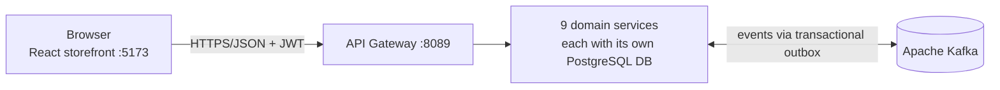

# Pet Planet documentation

This folder holds all of Pet Planet's documentation. Start with **[01 Overview](01-overview.md)**, then open whichever chapter you need.

Pet Planet is an event-driven pet shop built to learn microservices. It has ten Spring Boot services, Apache Kafka, one PostgreSQL database per service, and a React storefront. Every pet is unique, so buying one is a small distributed transaction (a **saga**) across inventory, payment and order, with compensation when a step fails.

## Chapters

| # | Chapter | Read it to understand |
|---|---|---|
| 01 | [Overview and tech stack](01-overview.md) | What the system does, the services, every technology and version, the repository layout, quickstart |
| 02 | [Architecture](02-architecture.md) | System and deployment diagrams, service responsibilities, how a request travels end to end |
| 03 | [Events and the checkout saga](03-events-and-saga.md) | Kafka conventions, transactional outbox, retries and dead-letter topics, idempotency, the saga with compensation, state machines, topic and payload catalog |
| 04 | [Backend services](04-backend-services.md) | Each of the 10 services: what it owns, what it consumes and produces, its endpoints and rules |
| 05 | [API reference](05-api-reference.md) | Every HTTP endpoint through the gateway, request/response bodies, access rules, error format |
| 06 | [Database](06-database.md) | Database-per-service layout, ER diagrams, every table, Flyway migrations, seed data |
| 07 | [Frontend](07-frontend.md) | React app structure, routes and guards, API client and session handling, pages |
| 08 | [Security](08-security.md) | RS256 JWTs, gateway rules, service-level ownership checks, internal token, CORS, secrets |
| 09 | [Code structure and design patterns](09-code-structure-and-patterns.md) | Package layout, enforced boundary rules, and the design patterns used (with where to find them) |
| 10 | [Infrastructure and operations](10-infrastructure-and-operations.md) | Docker Compose topology, Make targets, environment variables, memory sizing, running from an IDE, troubleshooting |
| 11 | [Testing](11-testing.md) | Test pyramid, test inventory per module, smoke test, UI walkthrough, Playwright, latest results |
| 12 | [Status, decisions and known issues](12-status-decisions-and-known-issues.md) | What is verified, architecture decisions and why, open issues, environment gotchas, project history |
| 13 | [Playwright end-to-end tests](13-playwright-e2e.md) | What Playwright is, how to run the browser tests (`make e2e`, npm scripts, UI mode), reading failures, writing new tests |

## Diagrams

All diagrams are written in [Mermaid](https://mermaid.js.org/). They render on GitHub and in VS Code's Markdown preview (install the *Markdown Preview Mermaid Support* extension if your preview shows code instead of a diagram).

## Keeping these docs accurate

- The source code and the Flyway migrations are the primary evidence. When code changes behavior, update the chapter that describes it in the same change.
- Never describe planned or partly implemented functionality as done. Use [chapter 12](12-status-decisions-and-known-issues.md) for open items.
- This folder is the only place for project documentation. AI-assistant instructions live in [`CLAUDE.md`](../CLAUDE.md) at the repository root.
