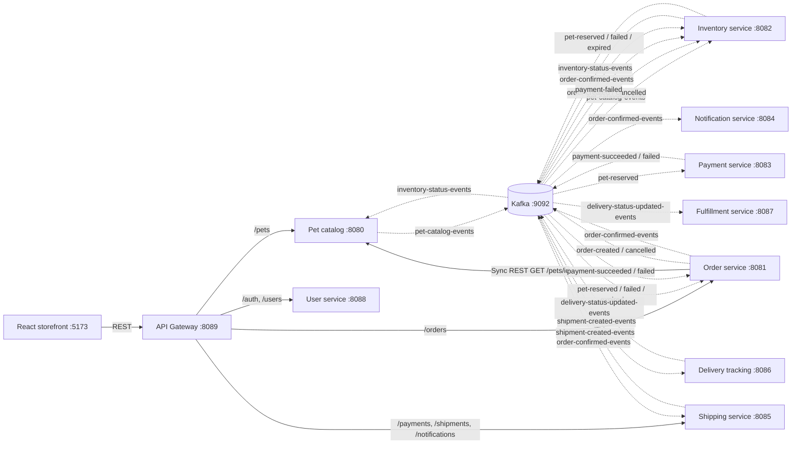

# Architecture

## System overview

Pet Planet consists of ten Spring Boot services (`gateway-service` plus nine domain services), nine service-specific PostgreSQL databases hosted in a shared local PostgreSQL 16 container, Apache Kafka 4.0.1 (KRaft), and a React 18 SPA. The frontend communicates exclusively through `gateway-service` (`:8089`), which routes requests to the underlying services. `order-service` also calls `pet-catalog-service` synchronously via Spring `RestClient` to validate and snapshot pet metadata and pricing at checkout.

## Components and communication

| Component | Port | Responsibility and communication |
|---|---:|---|
| React storefront (`frontend`) | 5173 | Catalog browsing, species filtering, login/registration, browser-local cart, checkout, and order/shipment tracking (`/orders`). Calls `gateway-service` (`:8089`). |
| API Gateway (`gateway-service`) | 8089 | Spring Cloud Gateway routing `/api/v1/auth/**`, `/users/**`, `/pets/**`, `/orders/**`, `/inventory/**`, `/payments/**`, `/notifications/**`, `/shipments/**`, `/deliveries/**`, and `/fulfillment/**`. |
| Pet catalog (`pet-catalog-service`) | 8080 | Pet CRUD/search REST API; emits `PetCreatedEvent` (`pet-catalog-events`); consumes `inventory-status-events` to keep `availabilityStatus` (`AVAILABLE`, `RESERVED`, `SOLD`) synchronized. |
| Order (`order-service`) | 8081 | Persists order and item snapshots; reads catalog over REST; emits `order-created-events`, `order-cancelled-events`, and `order-confirmed-events`; consumes reservation and payment result events. |
| Inventory (`inventory-service`) | 8082 | Unique pet availability, atomic multi-pet reservation, 5-minute expiry scheduler, and sold-state tracking. Consumes `order-created-events`, `order-confirmed-events`, `order-cancelled-events`, `payment-failed-events`, and `pet-catalog-events`. Emits reservation outcomes and `inventory-status-events`. |
| Payment (`payment-service`) | 8083 | Consumes `pet-reserved-events`, charges the actual order `totalAmount`, emits `payment-succeeded-events` or `payment-failed-events`, and exposes `GET /api/v1/payments/order/{orderId}`. |
| Notification (`notification-service`) | 8084 | Consumes `order-confirmed-events`, stores notification records with the order's `customerId`, emits `notification-sent-events`, and exposes lookup endpoints. |
| Shipping (`shipping-service`) | 8085 | Consumes `order-confirmed-events`, creates shipment and tracking number with the order's `customerId`, emits `shipment-created-events`, and exposes lookup and manual delivered endpoints. |
| Delivery tracking (`delivery-tracking-service`) | 8086 | Consumes `shipment-created-events`, creates `IN_TRANSIT` delivery record, emits `delivery-status-updated-events`, and supports `PUT /api/v1/deliveries/order/{orderId}/delivered`. |
| Fulfillment (`fulfillment-service`) | 8087 | Consumes `delivery-status-updated-events`, creates or updates `FulfillmentRecord` (`SHIPPED`, `DELIVERED`, `ESCALATED`), and emits `fulfillment-updated-events`. |
| User (`user-service`) | 8088 | Registration/login, RS256 JWT issuance (`JWT_PRIVATE_KEY`), current-user lookup, and `ADMIN` user lookup. |

## Mermaid system diagram

## End-to-End Business Workflows

### 1. Happy-path checkout saga
1. Authenticated customer submits cart items to `POST /api/v1/orders` via `gateway-service`.
2. `order-service` derives the deterministic numeric `customerId` from the authenticated principal, validates each pet via `pet-catalog-service`, saves the `Order` (`status = CREATED`), and writes `OrderCreatedEvent` (with `orderId`, `customerId`, `petIds`, and `totalAmount`) to `order_outbox`.
3. `inventory-service` consumes `OrderCreatedEvent`, verifies all pets in the order are `AVAILABLE`, reserves them (`status = RESERVED`, `orderId` recorded, 5-minute TTL), emits `InventoryStatusChangedEvent` (`RESERVED`) to update `pet-catalog-service`, and emits `PetReservedEvent` carrying `totalAmount`.
4. `order-service` consumes `PetReservedEvent` and updates the order status to `PAYMENT_PENDING`.
5. `payment-service` consumes `PetReservedEvent`, charges the order's actual `totalAmount`, persists the `Payment` (`SUCCEEDED`), and emits `PaymentSucceededEvent`.
6. `order-service` consumes `PaymentSucceededEvent`, marks the order `PAID`, and emits `OrderConfirmedEvent` (including `customerId`).
7. `inventory-service` marks the pets `SOLD` and syncs `pet-catalog-service` to `SOLD`; `notification-service` creates a confirmation notification for `customerId`; `shipping-service` generates a tracking number (`PET-{orderId}-...`) and emits `ShipmentCreatedEvent`, which flows through `delivery-tracking-service` (`IN_TRANSIT` -> `DELIVERED`) and updates `fulfillment-service` (`SHIPPED` -> `DELIVERED`).

### 2. Compensating rollback workflows
- **Reservation failure**: If any requested pet in an order is already `RESERVED` or `SOLD`, `inventory-service` aborts the reservation and emits `PetReservationFailedEvent`; `order-service` consumes it and marks the order `FAILED`.
- **Reservation timeout (5 minutes)**: `inventory-service`'s `@Scheduled` task (`expireReservations()`) releases expired reservations back to `AVAILABLE`, syncs `pet-catalog-service`, and emits `PetReservationExpiredEvent` with the associated `orderId`; `order-service` marks the order `CANCELLED`.
- **Payment failure**: `payment-service` emits `PaymentFailedEvent`; `order-service` marks the order `FAILED`, and `inventory-service` consumes `PaymentFailedEvent` to immediately release all reserved pets for that order back to `AVAILABLE` and sync `pet-catalog-service`.
- **Customer cancellation**: Calling `PATCH /api/v1/orders/{orderId}/cancel` marks the order `CANCELLED` and emits `OrderCancelledEvent`; `inventory-service` consumes it and releases any reserved pets back to `AVAILABLE`.

### 3. Transactional Outbox Relay
All seven event-producing services (`order`, `inventory`, `payment`, `notification`, `shipping`, `delivery-tracking`, `fulfillment`) persist `*OutboxEvent` records inside the business `@Transactional` method. After transaction commit, an asynchronous callback sends the event to Kafka and sets `published_at = Instant.now()`. If a send fails or the process restarts before acknowledgment, a `@Scheduled` outbox poller (`relayOutboxEvents()`) queries `findTop50ByPublishedAtIsNullOrderByCreatedAtAsc()`, publishes the pending payloads, and updates `published_at`.
