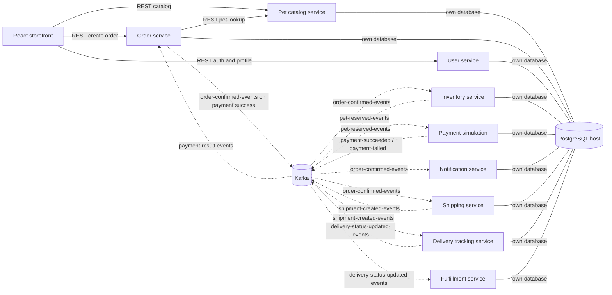

# Architecture

## System overview

Pet Planet is a learning project with nine independently built Spring Boot services, service-specific PostgreSQL databases, Kafka domain events, and a React SPA. Database-per-service ownership is expressed through separate database names and credentials, but all local databases run in one PostgreSQL container. The frontend calls catalog, order, and user APIs. Order-service also calls catalog synchronously to validate and snapshot pets.

The source contains event-driven downstream handlers, but they are not currently connected into a complete checkout workflow. Most notably, order creation does not publish `order-created-events`; inventory consumes that topic and emits `pet-reserved-events`, which payment consumes. The diagrams show actual producer/consumer code and intentionally do not invent the missing event producer.

## Components and communication

| Component | Responsibility and communication |
|---|---|
| React storefront | Catalog browsing, login/registration, browser-local cart, checkout. Uses Axios to catalog, order, and user services. |
| Pet catalog | Pet CRUD/search REST API; PostgreSQL catalog database. Called by frontend and synchronously by order-service. |
| Order | Persists order and item snapshots; reads catalog over REST; consumes payment result events and emits order-confirmed on payment success. |
| Inventory | Unique pet availability, reservation/expiry, sold state. Consumes order-created/order-confirmed events; emits reservation results. Also exposes inventory REST endpoints. |
| Payment | Simulated payment handler for pet-reserved event; stores payment and emits success/failure. No payment-provider integration or REST controller. |
| Notification | Consumes order-confirmed, stores notification records, exposes lookup API; no actual email/SMS/push provider. |
| Shipping | Consumes order-confirmed, creates tracking record and emits shipment-created; no carrier integration. |
| Delivery tracking | Consumes shipment-created, creates delivery record and status event; supports lookup and manual delivered transition. |
| Fulfillment | Consumes delivery-status events and stores an operational projection; exposes record lookups. |
| User | Registration/login, JWT issuance, current-user lookup, ADMIN user lookup. Its authentication is not enforced by the other services. |
| PostgreSQL | One shared local database server, separate database/role per service, plus a default/bootstrap database. |
| Kafka | Single-broker local KRaft setup; topic declarations observed in source use one partition and replication factor one. |

No file upload/storage, image service, object store, external payment gateway, email provider, carrier integration, or external identity provider was found.

## Mermaid system diagram

Solid arrows denote synchronous REST calls; dotted arrows denote Kafka events. Event arcs describe observed code, not a fully functioning end-to-end purchase flow.

The missing producer-to-`order-created-events` edge is intentional: no producer for this topic was found, while inventory consumes it.

## Business workflows: observed behavior

### Browse and create an order

1. The browser requests catalog listings/details.
2. Checkout posts numeric `customerId` and pet IDs with quantity one to order-service.
3. Order-service fetches each pet synchronously from catalog, checks catalog availability, copies descriptive fields/prices into order-item snapshots, totals them, and persists the order.
4. The order is returned with `CREATED` status. No order-created event is emitted here, so reservation/payment do not follow from the checkout request in the current code.

### Downstream event path present in source

Inventory consumes `order-created-events`, reserves available pets, and emits reservation success/failure. Payment consumes reservation success, simulates a fixed-amount outcome, and emits payment success/failure. Order-service consumes those results; success marks an order paid and emits `order-confirmed-events`, while failure marks it failed. Confirmed events are consumed by inventory, notification, and shipping; shipment-created is consumed by delivery tracking; delivery status is consumed by fulfillment.

Order cancellation, payment failure, reservation failure/expiry, and later delivery updates do not have a complete compensation/update path. Details and missing functionality are tracked in [implementation status](./implementation-status.md).

## Architectural patterns and decisions

- Database-per-service organization, without cross-service database foreign keys.
- Synchronous REST for catalog lookup and browser-facing APIs; Kafka for domain-event propagation.
- Order items persist pet metadata and price as an order-time snapshot.
- Inventory models each unique pet as one row, uses optimistic locking and expiring reservations.
- Several consumers store processed event IDs for idempotency.
- Event payloads include metadata such as event type/version and correlation IDs.
- Event-producing operations generally persist outbox rows and send through `KafkaTemplate` after transaction commit. No outbox relay/retry worker was found; therefore reliable publish after process failure is not established.
- User service is stateless with JWTs, but authorization is not propagated/enforced by other services.
- Application-level recommendations are not requirements: see observed gaps/open questions in [implementation status](./implementation-status.md).

