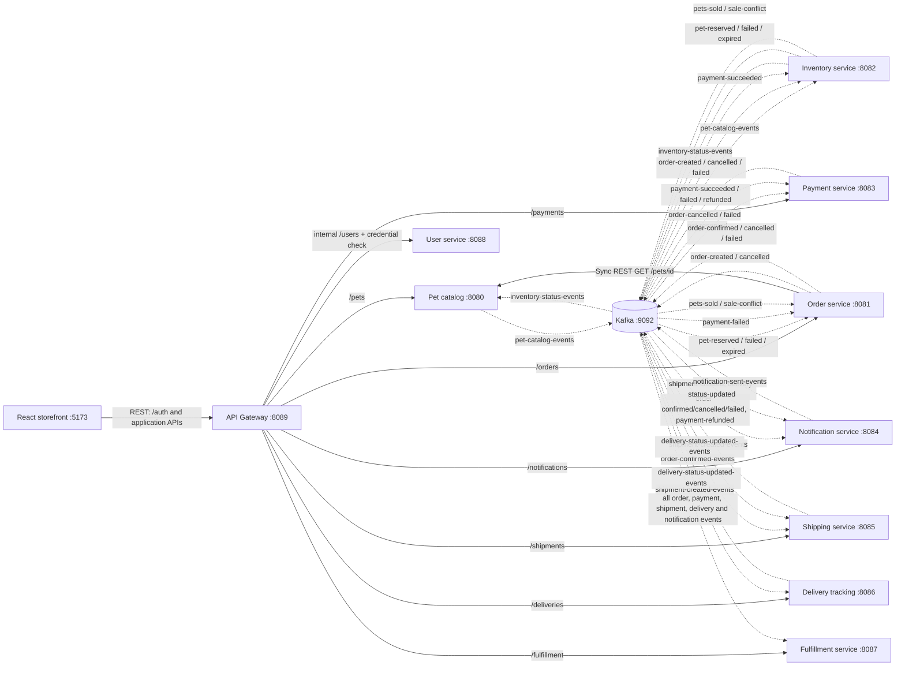

# Architecture

## System overview

Pet Planet consists of ten Spring Boot services (`gateway-service` plus nine domain services), nine service-specific PostgreSQL databases hosted in a shared local PostgreSQL 16 container, Apache Kafka 4.0.1 (KRaft), and a React 18 SPA. The frontend communicates exclusively through `gateway-service` (`:8089`), which routes requests to the underlying services. `order-service` also calls `pet-catalog-service` synchronously via Spring `RestClient` to validate and snapshot pet metadata and pricing at checkout.

## Components and communication

| Component | Port | Responsibility and communication |
|---|---:|---|
| React storefront (`frontend`) | 5173 | Catalog browsing, species filtering, login/registration, browser-local cart, checkout, and order/shipment tracking (`/orders`). Calls `gateway-service` (`:8089`). |
| API Gateway (`gateway-service`) | 8089 | Public application entrypoint; RS256 JWT validation (public key only), edge role authorization, routing, and CORS. Login/registration pass through to user-service. |
| Pet catalog (`pet-catalog-service`) | 8080 | Pet CRUD/search REST API; emits `PetCreatedEvent` (`pet-catalog-events`); consumes `inventory-status-events` to keep `availabilityStatus` (`AVAILABLE`, `RESERVED`, `SOLD`) synchronized. |
| Order (`order-service`) | 8081 | Persists order and item snapshots; reads catalog over REST; emits `order-created-events`, `order-confirmed-events`, `order-cancelled-events` and `order-failed-events`; consumes reservation results, `payment-failed-events`, `pets-sold-events` and `inventory-sale-conflict-events`. Order status changes only through `OrderStateMachine`. |
| Inventory (`inventory-service`) | 8082 | Source of truth for pet availability (`AVAILABLE`, `RESERVED`, `SOLD`, `RETIRED`): all-or-nothing reservation, expiry scheduler (`INVENTORY_RESERVATION_TIMEOUT`, default 5 minutes), and completing the sale on payment. Consumes `order-created-events`, `payment-succeeded-events`, `order-cancelled-events`, `order-failed-events` and `pet-catalog-events`. Emits reservation outcomes, `pets-sold-events`, `inventory-sale-conflict-events` and `inventory-status-events`. |
| Payment (`payment-service`) | 8083 | Consumes `pet-reserved-events` and charges the order `totalAmount` through a `PaymentGateway` (simulated). Consumes `order-cancelled-events` and `order-failed-events` to refund a successful charge or block a later one. Emits `payment-succeeded-events`, `payment-failed-events` and `payment-refunded-events`; exposes `GET /api/v1/payments/order/{orderId}`. |
| Notification (`notification-service`) | 8084 | Typed customer notifications (one per order and type) from order confirmed/cancelled/failed, payment refunded, shipment created and delivery status events; emits `notification-sent-events`; list endpoints per order, per customer and `/me`. |
| Shipping (`shipping-service`) | 8085 | Consumes `order-confirmed-events`, creates a `CREATED` shipment and tracking number, emits `shipment-created-events`; mirrors delivery status from `delivery-status-updated-events` (`SHIPPED`, `DELIVERED`, `DELIVERY_FAILED`). Read-only API. |
| Delivery tracking (`delivery-tracking-service`) | 8086 | Carrier progress: consumes `shipment-created-events`, starts `IN_TRANSIT`, keeps a timeline; the single admin action `PUT /api/v1/deliveries/order/{orderId}/status` advances to `OUT_FOR_DELIVERY` / `DELIVERED` / `DELIVERY_FAILED`; emits `delivery-status-updated-events`. |
| Fulfillment (`fulfillment-service`) | 8087 | **Order-tracking projection** (DEC-2, CQRS): consumes 12 order/inventory/payment/shipping/delivery/notification topics into one per-order view plus timeline; escalates delivery failures and orders stuck before confirmation; emits nothing. |
| User (`user-service`) | 8088 (internal) | Login/registration with RS256 token issuance (sole holder of the private key), user CRUD, BCrypt credential verification, profile/password management, and soft deactivation; reachable through an internal gateway credential, not a published host port. |

## Mermaid system diagram

## End-to-End Business Workflows

### 1. Happy-path checkout saga
1. An authenticated customer submits cart items to `POST /api/v1/orders` via `gateway-service`.
2. `order-service` stores the token's integer `userId` as `customerId`, validates each pet via `pet-catalog-service` (it must be `AVAILABLE`), saves the order (`CREATED`), and writes `OrderCreatedEvent` (`orderId`, `customerId`, `petIds`, `totalAmount`) to its outbox.
3. `inventory-service` reserves **all** pets or none. On success: pets `RESERVED` for the order with an expiry time, catalog synced, `PetReservedEvent` with `totalAmount`. Unknown, reserved, sold or retired pets produce `PetReservationFailedEvent`.
4. `order-service` moves the order to `PAYMENT_PENDING`. In parallel, `payment-service` charges `totalAmount` through its `PaymentGateway` and emits `PaymentSucceededEvent`.
5. `inventory-service` completes the sale: it marks the pets `SOLD` **only if they are still reserved for that order** and emits `PetsSoldEvent`; the catalog is synced to `SOLD`.
6. `order-service` confirms the order (`CONFIRMED`) on `PetsSoldEvent` and emits `OrderConfirmedEvent`. Notification and shipping react to it; shipping creates the shipment → delivery-tracking starts `IN_TRANSIT` → an admin advances it (`PUT /api/v1/deliveries/order/{id}/status`) → shipping mirrors the status and notification informs the customer. fulfillment projects every step into the tracking view (`GET /api/v1/fulfillment/orders/{id}`).

Confirmation happens only after the pets are sold. A pet whose reservation expired can therefore never be sold to two orders, and shipping never sees an order that could still fail.

### 2. Compensating workflows
Every unsuccessful ending publishes an event. Inventory releases the order's reservations (pets still `RESERVED` for that order become `AVAILABLE`). Payment marks the order closed, then refunds a `SUCCEEDED` charge (`REFUNDED` + `PaymentRefundedEvent`) or ensures a later charge never happens.

| Trigger | Order | Event | Inventory | Payment |
|---|---|---|---|---|
| Pet unknown / reserved / sold / retired | `FAILED` | `OrderFailedEvent` (`RESERVATION_FAILED:<reason>`) | nothing was reserved | marked closed; never charges |
| Payment declined | `FAILED` | `OrderFailedEvent` (`PAYMENT_FAILED:<reason>`) | releases | already `FAILED` |
| Customer cancels (`PATCH /api/v1/orders/{id}/cancel`, while `CREATED`/`PAYMENT_PENDING`) | `CANCELLED` | `OrderCancelledEvent` (`CUSTOMER_CANCELLED`) | releases | refunds if charged, otherwise blocks the charge |
| Reservation expires (scheduler) | `CANCELLED` | `OrderCancelledEvent` (`RESERVATION_EXPIRED`) | already released | refunds if charged, otherwise blocks the charge |
| Payment succeeded after the reservation was lost | `FAILED` (if still open) | `InventorySaleConflictEvent` → `OrderFailedEvent` (`SALE_CONFLICT:<reason>`) | sells nothing | refunds |

Payment serializes the charge and the closing of an order with a per-order PostgreSQL advisory lock: whichever runs second sees the other's result. All of these paths are verified end to end by `scripts/smoke-test.sh`.

### 3. Transactional Outbox Relay
All seven event-producing services (`pet-catalog`, `order`, `inventory`, `payment`, `notification`, `shipping`, `delivery-tracking`; fulfillment stopped producing in Phase 4) only **insert an outbox row** inside the business `@Transactional` method. A single shared relay in `platform-commons` (`OutboxRelay`, every 500 ms) locks unpublished rows (`FOR UPDATE SKIP LOCKED`), sends each one as a plain JSON string, waits for the broker acknowledgement, and then sets `published_at`. A failed send records `attempts`/`last_error` and is retried on the next run. Consumers retry failures and then dead-letter them to `<topic>.DLT`; idempotent consumers deduplicate with `processed_events` (fulfillment with its timeline table keyed by `eventId`). Full conventions: [Event catalog](./events.md).
