# Database design

## Overview and verification

- PostgreSQL container image: `postgres:16-alpine`; live server/database versions and schema were not inspected.
- Compose/init configuration provides one service-specific database and role for each of catalog, order, inventory, payment, notification, shipping, delivery, fulfillment, and user, hosted on the same local PostgreSQL container. The bootstrap/default database also exists.
- Flyway is enabled at `classpath:db/migration` for all services. Each service config uses Hibernate `ddl-auto: validate`.
- Migration SQL is the primary source for physical column types and declared constraints below. No database was connected to, no Flyway history was checked, and no Hibernate validation was run.
- No migration declares a cross-service foreign key. The only declared FK is `order_items.order_id -> orders.id`.
- Status/role enums are varchar columns without SQL check constraints. There are no soft-delete columns or database audit triggers in the inspected migrations.

Notation: `PK` primary key; `FK` foreign key; `UQ` unique; `NN` not null. A default is shown only when migration SQL declares it. Table names repeat in distinct service databases (for example `processed_events`).

## Catalog database (`pet-catalog-service`)

| Table | Columns and constraints | Additional constraints/indexes; purpose |
|---|---|---|
| `pets` | `id UUID PK`; `name VARCHAR(120) NN`; `species VARCHAR(20) NN`; `breed VARCHAR(120) NN`; `age INTEGER NN`; `gender VARCHAR(20) NN`; `price NUMERIC(12,2) NN`; `description VARCHAR(2000) NN`; `availability_status VARCHAR(20) NN`; `created_at TIMESTAMPTZ NN`; `updated_at TIMESTAMPTZ NN`; `version BIGINT NN DEFAULT 0` | Checks `age >= 0`, `price > 0`; indexes `species`, `LOWER(breed)`, `price`, `availability_status`. |

## Order database (`order-service`)

| Table | Columns and constraints | Additional constraints/indexes; purpose |
|---|---|---|
| `orders` | `id BIGSERIAL PK`; `customer_id BIGINT NN`; `status VARCHAR(32) NN`; `total_amount NUMERIC(19,2) NN`; `created_at TIMESTAMPTZ NN`; `updated_at TIMESTAMPTZ NN`; `version BIGINT NN DEFAULT 0` | Indexes `customer_id`, `status`, `created_at`; no user FK. |
| `order_items` | `id BIGSERIAL PK`; `order_id BIGINT NN FK -> orders.id`; `pet_id UUID NN`; `pet_name VARCHAR(255) NN`; `pet_species VARCHAR(32) NN`; `pet_breed VARCHAR(255) NN`; `unit_price NUMERIC(19,2) NN`; `quantity INTEGER NN`; `subtotal NUMERIC(19,2) NN` | Check `quantity = 1`; indexes `order_id`, `pet_id`; no catalog FK; descriptive data is snapshot. |
| `order_outbox` | `id UUID PK`; `event_id UUID NN UQ`; `topic VARCHAR(255) NN`; `event_type VARCHAR(255) NN`; `order_id BIGINT` nullable; `correlation_id UUID` nullable; `payload TEXT NN`; `created_at TIMESTAMPTZ NN`; `published_at TIMESTAMPTZ` nullable | Indexes `order_id`, `created_at`; no order FK. |

## Inventory database (`inventory-service`)

| Table | Columns and constraints | Additional constraints/indexes; purpose |
|---|---|---|
| `pet_inventory` | `id UUID PK`; `pet_id UUID NN UQ`; `status VARCHAR(20) NN`; `reservation_id UUID` nullable; `reserved_at TIMESTAMP` nullable; `reservation_expires_at TIMESTAMP` nullable; `sold_at TIMESTAMP` nullable; `version BIGINT NN DEFAULT 0`; `created_at TIMESTAMP NN`; `updated_at TIMESTAMP NN` | One row per pet; no catalog FK. |
| `processed_events` | `event_id UUID PK`; `processed_at TIMESTAMP NN` | Event idempotency. |
| `inventory_outbox` | `id UUID PK`; `event_id UUID NN UQ`; `topic VARCHAR(255) NN`; `event_type VARCHAR(255) NN`; `pet_id UUID` nullable; `order_id BIGINT` nullable; `correlation_id UUID` nullable; `payload TEXT NN`; `created_at TIMESTAMP NN`; `published_at TIMESTAMP` nullable | No migration indexes besides PK/UQ. |

## Payment database (`payment-service`)

| Table | Columns and constraints | Additional constraints/indexes; purpose |
|---|---|---|
| `payments` | `id BIGSERIAL PK`; `payment_id UUID NN UQ`; `order_id BIGINT NN UQ`; `amount NUMERIC(19,2) NN`; `currency VARCHAR(10) NN`; `status VARCHAR(20) NN`; `transaction_reference VARCHAR(255)` nullable; `created_at TIMESTAMP NN`; `updated_at TIMESTAMP NN`; `version BIGINT NN DEFAULT 0` | One payment per order; no order FK. |
| `processed_events` | `event_id UUID PK`; `processed_at TIMESTAMP NN` | Event idempotency. |
| `payment_outbox` | `id UUID PK`; `event_id UUID NN UQ`; `topic VARCHAR(255) NN`; `event_type VARCHAR(255) NN`; `order_id BIGINT` nullable; `payment_id UUID` nullable; `payload TEXT NN`; `created_at TIMESTAMP NN`; `published_at TIMESTAMP` nullable | Payment result outbox. |

## Notification database (`notification-service`)

| Table | Columns and constraints | Additional constraints/indexes; purpose |
|---|---|---|
| `notifications` | `id UUID PK`; `order_id BIGINT NN`; `customer_id BIGINT NN`; `message TEXT NN`; `status VARCHAR(32) NN`; `created_at TIMESTAMPTZ NN`; `sent_at TIMESTAMPTZ` nullable | Indexes `order_id`, `customer_id`; no order/user FK. |
| `processed_events` | `event_id UUID PK`; `processed_at TIMESTAMPTZ NN` | Event idempotency. |
| `notification_outbox` | `id UUID PK`; `event_id UUID NN UQ`; `topic VARCHAR(255) NN`; `event_type VARCHAR(255) NN`; `order_id BIGINT` nullable; `correlation_id UUID` nullable; `payload TEXT NN`; `created_at TIMESTAMPTZ NN`; `published_at TIMESTAMPTZ` nullable | Indexes `order_id`, `created_at`. |

## Shipping database (`shipping-service`)

| Table | Columns and constraints | Additional constraints/indexes; purpose |
|---|---|---|
| `shipments` | `id UUID PK`; `order_id BIGINT NN UQ`; `customer_id BIGINT NN`; `status VARCHAR(32) NN`; `tracking_number VARCHAR(64) NN UQ`; `created_at TIMESTAMPTZ NN`; `shipped_at TIMESTAMPTZ` nullable; `delivered_at TIMESTAMPTZ` nullable | Indexes `customer_id`, `status`; no order/customer FK. |
| `processed_events` | `event_id UUID PK`; `processed_at TIMESTAMPTZ NN` | Event idempotency. |
| `shipment_outbox` | `id UUID PK`; `event_id UUID NN UQ`; `topic VARCHAR(255) NN`; `event_type VARCHAR(255) NN`; `order_id BIGINT` nullable; `correlation_id UUID` nullable; `payload TEXT NN`; `created_at TIMESTAMPTZ NN`; `published_at TIMESTAMPTZ` nullable | Indexes `order_id`, `created_at`. |

## Delivery database (`delivery-tracking-service`)

| Table | Columns and constraints | Additional constraints/indexes; purpose |
|---|---|---|
| `delivery_records` | `id UUID PK`; `order_id BIGINT NN UQ`; `customer_id BIGINT NN`; `tracking_number VARCHAR(128) NN`; `status VARCHAR(32) NN`; `created_at TIMESTAMPTZ NN`; `updated_at TIMESTAMPTZ NN`; `delivered_at TIMESTAMPTZ` nullable | Indexes `customer_id`, `status`; no shipment/order FK. |
| `processed_events` | `event_id UUID PK`; `processed_at TIMESTAMP NN` | Event idempotency. |
| `delivery_outbox` | `id UUID PK`; `event_id UUID NN UQ`; `topic VARCHAR(255) NN`; `event_type VARCHAR(255) NN`; `order_id BIGINT` nullable; `correlation_id UUID` nullable; `payload TEXT NN`; `created_at TIMESTAMP NN`; `published_at TIMESTAMP` nullable | Indexes `order_id`, `created_at`. |

## Fulfillment database (`fulfillment-service`)

| Table | Columns and constraints | Additional constraints/indexes; purpose |
|---|---|---|
| `fulfillment_records` | `id UUID PK`; `order_id BIGINT NN UQ`; `customer_id BIGINT NN`; `tracking_number VARCHAR(128) NN`; `status VARCHAR(32) NN`; `last_updated_at TIMESTAMPTZ NN`; `notes TEXT NN` | Indexes `customer_id`, `status`; no delivery/order FK. |
| `processed_events` | `event_id UUID PK`; `processed_at TIMESTAMPTZ NN` | Event idempotency. |
| `fulfillment_outbox` | `id UUID PK`; `event_id UUID NN UQ`; `topic VARCHAR(255) NN`; `event_type VARCHAR(255) NN`; `order_id BIGINT` nullable; `correlation_id UUID` nullable; `payload TEXT NN`; `created_at TIMESTAMPTZ NN`; `published_at TIMESTAMPTZ` nullable | Indexes `order_id`, `created_at`. |

## User database (`user-service`)

| Table | Columns and constraints | Additional constraints/indexes; purpose |
|---|---|---|
| `users` | `id UUID PK`; `email VARCHAR(255) NN UQ`; `password_hash VARCHAR(255) NN`; `first_name VARCHAR(100) NN`; `last_name VARCHAR(100) NN`; `role VARCHAR(50) NN`; `created_at TIMESTAMP NN`; `updated_at TIMESTAMP NN` | User account/auth data; no order/customer FK. |

## Entity relationships and persistence behavior

- The physical `orders` to `order_items` relationship is one-to-many through `order_items.order_id`. The `Order` entity maps one-to-many with cascade all and orphan removal; `OrderItem.order` is lazy many-to-one.
- No other JPA relationships between service entities were found. Event-carried IDs are plain columns, not cross-database FKs.
- Pet and most projection IDs use UUIDs; order and payment internal IDs are identity-generated numeric values; user ID is UUID.
- Entity enums use string persistence where annotated. SQL migration columns are varchar and do not constrain values to enum members.
- Version columns exist for pets, orders, inventory, and payments. Inventory uses optimistic locking in reservation logic.
- Timestamp values are maintained by entity callbacks or explicit application logic, not database triggers. Migrations use a mix of `TIMESTAMPTZ` and timezone-less `TIMESTAMP`.
- Important operations use `@Transactional`; reads are often read-only. Outbox rows are stored in the local transaction and Kafka sends are generally attempted after commit.
- `published_at` exists on outbox tables, but no dispatcher/relay that retries and updates it was found.
- `spring.jpa.open-in-view` is false in service configs.

## Mermaid ER diagram

Only the actual physical foreign key is shown. `processed_events` names are represented with service prefixes because each exists in its own service database. Cross-service IDs are not relationships in this diagram.

```mermaid
erDiagram
  pets {
    UUID id PK
    VARCHAR name
    VARCHAR species
    VARCHAR breed
    INTEGER age
    VARCHAR gender
    NUMERIC price
    VARCHAR description
    VARCHAR availability_status
    TIMESTAMPTZ created_at
    TIMESTAMPTZ updated_at
    BIGINT version
  }
  orders {
    BIGSERIAL id PK
    BIGINT customer_id
    VARCHAR status
    NUMERIC total_amount
    TIMESTAMPTZ created_at
    TIMESTAMPTZ updated_at
    BIGINT version
  }
  order_items {
    BIGSERIAL id PK
    BIGINT order_id FK
    UUID pet_id
    VARCHAR pet_name
    VARCHAR pet_species
    VARCHAR pet_breed
    NUMERIC unit_price
    INTEGER quantity
    NUMERIC subtotal
  }
  order_outbox {
    UUID id PK
    UUID event_id UK
    VARCHAR topic
    VARCHAR event_type
    BIGINT order_id
    UUID correlation_id
    TEXT payload
  }
  orders ||--|{ order_items : "order_id"
  pet_inventory {
    UUID id PK
    UUID pet_id UK
    VARCHAR status
    UUID reservation_id
    TIMESTAMP reserved_at
    TIMESTAMP reservation_expires_at
    TIMESTAMP sold_at
    BIGINT version
  }
  inventory_processed_events {
    UUID event_id PK
    TIMESTAMP processed_at
  }
  inventory_outbox {
    UUID id PK
    UUID event_id UK
    VARCHAR topic
    TEXT payload
  }
  payments {
    BIGSERIAL id PK
    UUID payment_id UK
    BIGINT order_id UK
    NUMERIC amount
    VARCHAR currency
    VARCHAR status
  }
  payment_processed_events {
    UUID event_id PK
    TIMESTAMP processed_at
  }
  payment_outbox {
    UUID id PK
    UUID event_id UK
    VARCHAR topic
    TEXT payload
  }
  notifications {
    UUID id PK
    BIGINT order_id
    BIGINT customer_id
    TEXT message
    VARCHAR status
  }
  notification_processed_events {
    UUID event_id PK
    TIMESTAMPTZ processed_at
  }
  notification_outbox {
    UUID id PK
    UUID event_id UK
    VARCHAR topic
    TEXT payload
  }
  shipments {
    UUID id PK
    BIGINT order_id UK
    BIGINT customer_id
    VARCHAR status
    VARCHAR tracking_number UK
  }
  shipping_processed_events {
    UUID event_id PK
    TIMESTAMPTZ processed_at
  }
  shipment_outbox {
    UUID id PK
    UUID event_id UK
    VARCHAR topic
    TEXT payload
  }
  delivery_records {
    UUID id PK
    BIGINT order_id UK
    BIGINT customer_id
    VARCHAR tracking_number
    VARCHAR status
  }
  delivery_processed_events {
    UUID event_id PK
    TIMESTAMP processed_at
  }
  delivery_outbox {
    UUID id PK
    UUID event_id UK
    VARCHAR topic
    TEXT payload
  }
  fulfillment_records {
    UUID id PK
    BIGINT order_id UK
    BIGINT customer_id
    VARCHAR tracking_number
    VARCHAR status
    TIMESTAMPTZ last_updated_at
    TEXT notes
  }
  fulfillment_processed_events {
    UUID event_id PK
    TIMESTAMPTZ processed_at
  }
  fulfillment_outbox {
    UUID id PK
    UUID event_id UK
    VARCHAR topic
    TEXT payload
  }
  users {
    UUID id PK
    VARCHAR email UK
    VARCHAR password_hash
    VARCHAR first_name
    VARCHAR last_name
    VARCHAR role
    TIMESTAMP created_at
    TIMESTAMP updated_at
  }
```

## Entity-to-migration cross-check and gaps

The order/order-item FK and catalog/inventory/payment version columns align between the reviewed mappings and migrations. Entity relationships are otherwise service-local or absent. The catalog `Pet` entity relies on JPA naming/type conventions for columns such as `createdAt`/`availabilityStatus`; migration uses explicit snake-case columns. Other mappings use explicit column names in many cases, and some entities rely on conventions for straightforward names.

The migrations and ORM declarations have not been run together against PostgreSQL. Potential timestamp mapping discrepancies need particular verification: several entities use Java `Instant` while migrations declare timezone-less `TIMESTAMP` (including user, payment, and inventory columns), while other migrations use `TIMESTAMPTZ`. Hibernate's effective mapping and schema-validation result were not checked, so this is a verification gap rather than a confirmed runtime mismatch. Hibernate UUID generation, default SQL naming behavior, and every inferred physical column type also remain unverified at runtime. Use migration definitions—not assumptions from JPA annotations—for physical schema claims.
