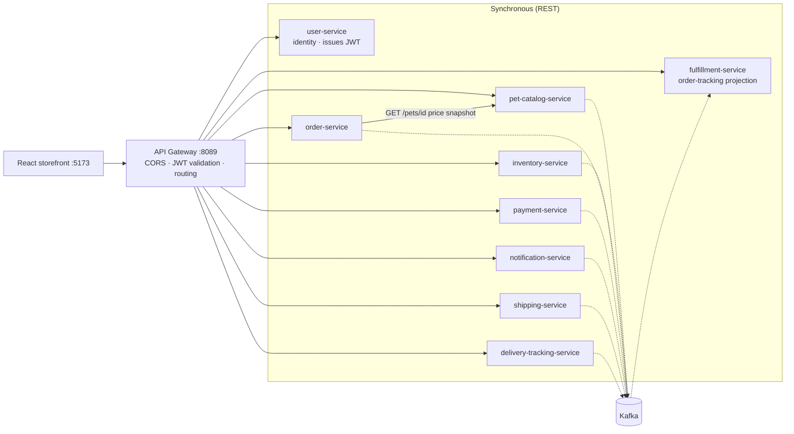

# Pet Planet — target architecture and restructuring requirements

Status: **approved plan, not implemented** (decisions confirmed by the owner on 2026-11-14). This is the reference for the restructuring work. Requirement IDs (`R-…`) are stable: commits, PRs and docs should cite them. Finding IDs (`F…`, `S…`, `A…`, `U…`, `D…`) refer to [01-audit-findings.md](./01-audit-findings.md).

Guiding constraints from the project owner:
1. **Keep every existing capability.** That covers all 10 services, the storefront, the saga, compensation, the outbox, idempotency, and user/admin management. Nothing gets dropped to make things easier. A service whose job overlaps another's gets a distinct responsibility instead of being deleted.
2. The project exists to **learn microservices and event-driven architecture**, so standard, explainable patterns win over clever shortcuts.
3. **It must run** from a clean clone with one command, and every endpoint the frontend uses must work.

---

## 1. Confirmed decisions

| ID | Decision | Outcome (confirmed 2026-11-14) |
|---|---|---|
| **DEC-1** | Who issues JWTs? | **user-service** issues RS256 tokens and is the only holder of the private key. **The gateway only validates** tokens (public key), applies coarse role rules, and routes. The gateway's `AuthController` and signing code are removed. |
| **DEC-2** | What is fulfillment-service for? | The **order-tracking read model** (CQRS projection). It consumes order, payment, shipment, delivery and notification events and serves one tracking view to the UI. |
| **DEC-3** | Shared code | A **`platform-commons`** Maven module holding *infrastructure only*: outbox relay, idempotent-consumer helper, Kafka error handling, API error model, resource-server security defaults. **No domain or event classes** in it. |
| **DEC-4** | Payment step | Keep **automatic simulated payment** on reservation, made explicit in UI and docs and compensatable (refunds). |
| **DEC-5** | Uncommitted work | The current WIP on `config-analysed` is committed as a checkpoint before Phase 0. |
| **DEC-6** | Folder structure | **All 10 services stay as top-level folders at the repo root** (no `services/` folder), so every service is visible at a glance. The restructuring is **inside** each service: a uniform package layout that separates HTTP, business logic, domain model, exceptions, security, messaging and persistence, with enforced boundaries. The frontend is grouped by feature ([§3.0](#30-r-str--folder-structure-and-boundaries)). Moves are done **mechanically and without behavior change** before any functional fix. |

## 2. Target system architecture



### 2.1 Service responsibilities (source of truth)

| Service | Owns (source of truth) | Does **not** own |
|---|---|---|
| gateway-service | Edge: CORS, JWT *validation*, coarse role rules, routing | Users, passwords, token issuance (DEC-1), per-order ownership |
| user-service | Accounts, BCrypt credentials, roles, active flag, **token issuance** (DEC-1: `POST /api/v1/auth/register`, `/login`) | — |
| pet-catalog-service | Pet descriptive data (name, breed, price, description), soft-delete/archive | **Availability**: it keeps a read-only copy fed by `inventory-status-events` |
| order-service | Order + item snapshots, **commercial order state machine** | Shipping or delivery progress |
| inventory-service | **Availability** of each unique pet: reservations, expiry, sold | Prices, descriptions |
| payment-service | Payment attempts, outcome, **refunds** | Order state |
| notification-service | Customer notifications (many per order, typed) | — |
| shipping-service | Shipment creation, tracking number, shipment status (mirrors delivery outcome) | The "delivered" action itself |
| delivery-tracking-service | **Carrier progress and timeline**: `IN_TRANSIT → OUT_FOR_DELIVERY → DELIVERED / DELIVERY_FAILED`. The single admin endpoint to advance delivery status lives here. | Shipment creation |
| fulfillment-service | **Order-tracking projection** (DEC-2): one denormalized per-order view plus timeline, built from events. Flags `ESCALATED` on delivery failure or stuck orders. | Writes to any other service's data |

### 2.2 Order state machine (order-service)

```
CREATED ──PetReserved──▶ PAYMENT_PENDING ──PaymentSucceeded──▶ CONFIRMED
   │                          │
   │ ReservationFailed        │ PaymentFailed / SaleConflict          → FAILED     (emits OrderFailedEvent)
   │ Customer cancel          │ Customer cancel / ReservationExpired  → CANCELLED  (emits OrderCancelledEvent)
```
- `PAID` is removed. Existing rows are migrated `PAID → CONFIRMED` in a **new** migration (R-DB-02).
- `FAILED` and `CANCELLED` are terminal, and **both emit an event** so inventory can release pets and payment can refund (fixes S2).
- Shipping and delivery progress is *not* order state. The UI gets it from the tracking projection.

### 2.3 Event catalog (target)

One topic per event type; existing topic names are kept. Every event uses the standard envelope (R-EVT-02). Key = `orderId` for order-scoped events and `petId` for pet-scoped ones.

| Topic | Producer | Consumers | Change vs today |
|---|---|---|---|
| `pet-catalog-events` (`PetCreated`, `PetArchived`) | catalog (**via outbox**) | inventory | add outbox; add `PetArchived` (S5) |
| `inventory-status-events` | inventory | catalog | unchanged |
| `order-created-events` | order | inventory, fulfillment | + fulfillment |
| `pet-reserved-events` | inventory | order, payment, fulfillment | + fulfillment |
| `pet-reservation-failed-events` | inventory | order, fulfillment | + fulfillment |
| `pet-reservation-expired-events` | inventory | order | order now emits `OrderCancelled` in response |
| `payment-succeeded-events` | payment | order, fulfillment | + fulfillment |
| `payment-failed-events` | payment | order, inventory, fulfillment | + fulfillment |
| **`payment-refunded-events`** (new) | payment | fulfillment, notification | new (S2) |
| `order-confirmed-events` | order | inventory, notification, shipping, fulfillment | + fulfillment |
| `order-cancelled-events` | order | inventory, payment, notification, fulfillment | + payment (refund), notification, fulfillment |
| **`order-failed-events`** (new) | order | inventory, payment, notification, fulfillment | new |
| **`inventory-sale-conflict-events`** (new) | inventory | order | new (S1) |
| `shipment-created-events` | shipping | delivery-tracking, notification, fulfillment | + notification, fulfillment |
| `delivery-status-updated-events` | delivery-tracking | shipping, notification, fulfillment | + shipping (mirror status), + notification |
| `notification-sent-events` | notification | fulfillment (timeline) | gains a consumer (S11) |
| `fulfillment-updated-events` | — | — | **retired** (the projection emits nothing) |
| `pet-reservation-released-events` | — | — | **retired** (covered by `inventory-status-events` and order events) |

Every consumed topic also gets a dead-letter topic `<topic>.DLT` (R-EVT-04).

### 2.4 Checkout saga (target), including compensation

1. `POST /orders` → order `CREATED`, `OrderCreated` written to the outbox.
2. inventory reserves **all** pets or none: emits `PetReserved` or `PetReservationFailed` (also for unknown pets, fixing S4).
3. order → `PAYMENT_PENDING`. In parallel, payment charges the `totalAmount` (simulated, DEC-4) and emits `PaymentSucceeded` or `PaymentFailed`.
4. On `PaymentSucceeded` with order still `PAYMENT_PENDING`/`CREATED` → `CONFIRMED`, emit `OrderConfirmed`.
5. inventory marks SOLD **only if** `status == RESERVED && orderId == event.orderId`. Otherwise it emits `InventorySaleConflict` → order `FAILED` → `OrderFailed` → payment refunds (fixes S1).
6. shipping creates the shipment → `ShipmentCreated` → delivery-tracking starts at `IN_TRANSIT` → an admin advances it to `DELIVERED` → shipping mirrors the status, and notification and fulfillment update.
7. Compensation paths:
   - customer cancel → `OrderCancelled` → inventory releases and payment refunds (if charged).
   - reservation expiry → `OrderCancelled` → the same releases and refunds.
   - late `PaymentSucceeded` on a closed order → no state change. Payment refunds because it has already seen, or will see, `OrderCancelled`/`OrderFailed`. Payment keeps a per-order tombstone so a later `PetReserved` for a closed order is never charged.

---

## 3. Requirements

### 3.0 R-STR — Folder structure and boundaries (DEC-6)

#### Repository layout: unchanged, services stay at the root

The 10 service folders stay exactly where they are, so every service is visible at a glance. The only root-level additions are build and tooling files, plus one shared library folder:

```
pet-planet/
├── pom.xml                         # NEW: root aggregator + shared parent (versions, plugins)
├── mvnw, mvnw.cmd, .mvn/           # NEW: Maven wrapper (no global Maven needed)
├── Makefile                        # NEW: up, down, reset, infra, logs, smoke
├── platform-commons/               # NEW: shared infrastructure-only library (DEC-3), not deployable
├── scripts/                        # NEW: generate-dev-keys.sh, smoke-test.sh
│
├── gateway-service/                # ┐
├── user-service/                   # │
├── pet-catalog-service/            # │
├── order-service/                  # │
├── inventory-service/              # │ unchanged locations
├── payment-service/                # │
├── notification-service/           # │
├── shipping-service/               # │
├── delivery-tracking-service/      # │
├── fulfillment-service/            # ┘
├── frontend/                       # internal layout becomes feature-based (see below)
├── infrastructure/                 # unchanged (postgres/init)
├── postman/                        # unchanged
├── docs/                           # unchanged
└── docker-compose.yml, .env.example, README.md, AGENTS.md, PROJECT_CONTEXT.md
```

#### Per-service internal layout (identical pattern in every service)

**Problem today:** each service has flat, layer-only packages (`controller/`, `entity/`, `service/`, `exception/`…), and single classes mix unrelated concerns. Examples:
- `OrderService` combines business rules, authorization/ownership checks, outbox writing, Kafka sending, scheduled relaying and DTO mapping.
- `InventoryService` and `PaymentService` mix business logic with Kafka plumbing.
- Domain exceptions, HTTP error mapping, security filters and JWT code sit side by side.
- Controllers return JPA entities.

**Target**, for base package `com.petcommerce.<svc>` (the folder each class lives in tells you its job):

```
<name>-service/src/main/java/com/petcommerce/<svc>/
├── <Svc>Application.java
│
├── api/                         # HTTP in/out ONLY: no business rules
│   ├── controller/              #   thin controllers: validate input → call application → map to DTO
│   ├── dto/                     #   request/response records (never entities)
│   ├── mapper/                  #   entity ↔ DTO mapping
│   └── error/                   #   ApiExceptionHandler + ErrorResponse (maps exceptions → HTTP status)
│
├── application/                 # BUSINESS LOGIC: use cases, one class per responsibility
│   └── *Service.java            #   e.g. order: OrderCommandService (create/cancel), OrderQueryService
│                                #   (get/list), OrderSagaService (reacts to saga events)
│
├── domain/                      # CORE MODEL: no Spring web, Kafka or HTTP imports
│   ├── model/                   #   entities, value objects, enums
│   ├── policy/                  #   rules/state machines (e.g. OrderStateMachine, ReservationPolicy)
│   └── exception/               #   business exceptions (OrderNotFoundException, InvalidOrderStateException…)
│
├── security/                    # AUTH CONCERNS ONLY: separate from business logic
│   ├── SecurityConfig.java      #   filter chain, route rules
│   ├── CurrentUser.java         #   read userId/role from the validated token
│   └── *AccessPolicy.java       #   ownership checks (e.g. OrderAccessPolicy), called by application
│
├── messaging/                   # KAFKA ONLY
│   ├── event/                   #   this service's own event payload records (in + out)
│   ├── consumer/                #   @KafkaListener adapters: deserialize → call application
│   └── publisher/               #   builds events and writes them to the outbox
│
├── persistence/                 # DATABASE ONLY
│   └── repository/              #   Spring Data repositories (outbox/processed-event via platform-commons)
│
├── client/                      # OUTBOUND HTTP to other services (only order → catalog today)
│
└── config/                      # non-security Spring wiring (Kafka topics, beans, properties)

<name>-service/src/main/resources/
├── application.yml              # localhost defaults; Docker overrides via env vars
└── db/migration/                # Flyway, immutable once applied

<name>-service/src/test/java/com/petcommerce/<svc>/
├── (mirrors main packages)      # unit tests
├── integration/                 # Testcontainers (Postgres + Kafka)
└── ArchitectureTest.java        # ArchUnit boundary rules (R-STR-03)
```

Service-specific notes:
- **user-service**: authentication is separated from user management.
  - `application/AuthService` handles register and login.
  - `application/UserService` handles profile and admin CRUD.
  - `security/token/` holds JWT creation (`TokenIssuer`, key loading).
  - `security/` also holds password hashing config and the internal-token filter.
- **gateway-service** has no database, domain or Kafka, so it has only `config/`, `routing/` (route definitions) and `security/` (token validation, role rules, CORS).
- **payment-service**: payment simulation lives in `application/PaymentProcessor` behind an interface, separate from the event handling in `application/PaymentSagaService`.
- Folders a service doesn't need are omitted, never left empty.

#### Frontend layout (target)

```
frontend/src/
├── main.jsx
├── app/            # App.jsx, routes.jsx, providers, ProtectedRoute, AdminRoute
├── api/            # client.js (one axios instance + interceptors) and one module per backend area:
│                   #   auth.js, pets.js, orders.js, tracking.js, users.js, inventory.js, deliveries.js
├── features/
│   ├── auth/       # LoginPage, RegisterPage, AuthContext
│   ├── catalog/    # PetsPage, PetDetailPage, pet components
│   ├── cart/       # CartContext, CartPage
│   ├── checkout/   # CheckoutPage, order-status polling
│   ├── orders/     # OrdersPage, OrderRow, TrackingTimeline
│   ├── profile/    # ProfilePage, ChangePassword
│   └── admin/      # pets/, inventory/, orders/, users/, deliveries/
├── components/     # shared, feature-agnostic UI (Layout, StatusChip, …)
└── theme/
```

#### Requirements

| ID | Requirement | Acceptance |
|---|---|---|
| R-STR-01 | **Service folders do not move.** Only add root-level `pom.xml`, Maven wrapper, `Makefile`, `platform-commons/` and `scripts/`. | All 10 services remain at `/<name>-service`. |
| R-STR-02 | Re-package every service into the internal layout above, in two steps per service. **Step A is a pure move** (`git mv`, package and import changes only, no logic change). **Step B splits mixed classes** along responsibility lines, still with no behavior change: e.g. `OrderService` → command, query, saga and access-policy classes plus `messaging/publisher`; DTO mapping moves into `api/mapper`; exception handlers move into `api/error`. Each service lands as its own commit(s), separate from functional fixes. | After each service: it compiles and its unit tests give the same results as the pre-move baseline. |
| R-STR-03 | **Dependency rules**, enforced by an ArchUnit `ArchitectureTest` in each service: `domain` depends on nothing in `api`, `messaging`, `persistence`, `client`, `security` or `config`; `api.controller` and `messaging.consumer` call only `application`; `application` must not import `api.dto`, `api.error` or Kafka/HTTP types; repositories are used only from `application`; business exceptions live only in `domain.exception`, and HTTP mapping lives only in `api.error`; services never import another service's classes; `platform-commons` contains no service domain types. | `./mvnw verify` fails if a rule is broken. |
| R-STR-04 | Naming conventions: `*Controller`, `*Request`/`*Response` (DTOs), `*Event` (Kafka payload), `*Consumer`, `*Publisher`, `*Service` (application use case), `*Repository`, `*Client`. One public top-level type per file. | Reviewed in each PR. |
| R-STR-05 | Restructure the frontend into the **feature-based** layout above. Each feature folder owns its pages, components, hooks and context; shared code goes in `components/` or `api/` only. A feature must not import another feature's internals; it imports shared code or a feature's `index.js` exports. Like R-STR-02 this is a pure move first (imports only), with the behavior changes from R-FE following separately. | `npm run build` succeeds and the app behaves identically after the move. |
| R-STR-06 | Remove clutter: root `node_modules/` and `.DS_Store` files. Extend `.gitignore` accordingly. | `git status` clean after a fresh build. |

### R-INF — Infrastructure and local developer experience (fixes F4–F7, A5)

| ID | Requirement | Acceptance |
|---|---|---|
| R-INF-01 | Root Maven **aggregator POM** listing all services (plus `platform-commons`, DEC-3), a shared parent for dependency versions (Spring Boot, Spring Cloud BOM, Testcontainers, springdoc), and a **Maven wrapper** at the root. | `./mvnw -q verify` builds and tests everything with no global Maven install. |
| R-INF-02 | Dockerfiles stay in each service folder but build from the repo root context (`./mvnw -pl <svc> -am package`), so they can use the root POM and `platform-commons`, with layered jars. | `docker compose build` succeeds from a clean clone. |
| R-INF-03 | Every Spring service has a Compose **healthcheck** on `/actuator/health/readiness`. `depends_on` uses `service_healthy` wherever there is a real dependency. | `docker compose ps` shows all services `healthy`. |
| R-INF-04 | JVM memory caps (e.g. `JAVA_TOOL_OPTIONS=-XX:MaxRAMPercentage=75` plus a Compose `mem_limit` around 384–512 MB per service). README documents a recommended Docker Desktop memory size. | The full stack starts on 8 GB Docker Desktop without OOM kills. |
| R-INF-05 | A `Makefile` (or `scripts/`) with: `up`, `down`, `reset` (`down -v` + rebuild), `infra` (Postgres + Kafka + Kafka UI only), `logs s=<svc>`, `smoke`. | Each target works and is listed in the README. |
| R-INF-06 | **Hybrid mode**: `make infra`, then run any service from the IDE with its `application.yml` localhost defaults. Kafka's host listener and the published Postgres port support this. | Documented. One service runs from the IDE against containerized infra. |
| R-INF-07 | Add **Kafka UI** (a Compose service) for inspecting topics, messages and DLTs. | Reachable on a documented port. |
| R-INF-08 | No secrets in git. `.env.example` holds placeholders, and `scripts/generate-dev-keys.sh` generates the RSA pair and internal token into `.env`. Remove hard-coded key defaults from `application.yml`. | `git grep "BEGIN PRIVATE\|MIIEv"` finds nothing. |
| R-INF-09 | Remove the stray root `node_modules/`. The Postgres init README describes what the script actually does. | — |

### R-DB — Database and migrations (fixes F1, F4, S3)

| ID | Requirement | Acceptance |
|---|---|---|
| R-DB-01 | **Migration immutability rule** (in AGENTS.md and the database doc): an applied migration is never edited, and changes go in a new `V{n}`. One-time baseline: the current files are accepted and every developer runs `make reset` once. | Documented. Flyway validation stays on. |
| R-DB-02 | New migrations: user-service `V4` re-seeds both demo accounts with a **verified** BCrypt hash of `password123` (verified by a test). order-service migrates `PAID → CONFIRMED`. Notifications gain a `type` column and multiple rows per order. Catalog gets an outbox plus processed-events tables and an `archived` flag. Inventory adds `RETIRED` status. Payment adds refund fields and the closed-order tombstone. Outbox tables gain `attempts` and `last_error`. | Fresh `make reset` → both seeded logins work. |

### R-EVT — Event backbone (fixes F3, S7, S8, S11)

| ID | Requirement | Acceptance |
|---|---|---|
| R-EVT-01 | **Serialization contract.** Producers send the stored outbox JSON **string** with no Java type headers. Consumers use `ErrorHandlingDeserializer(JsonDeserializer)` with `use.type.headers=false`, and each `@KafkaListener` declares its target type (`spring.json.value.default.type`). Services never share event classes. | A Testcontainers test per consumer publishes raw JSON produced by the *other* service's serializer and asserts it is handled. |
| R-EVT-02 | **Standard envelope** on every event: `eventId`, `eventType`, `eventVersion`, `occurredAt`, `correlationId`, `causationId`, `aggregateType`, `aggregateId`, `producer`, then payload fields. `correlationId` is minted once per order and propagated end-to-end. | Documented in `docs/project-context/events.md` with a JSON example per event. |
| R-EVT-03 | **One outbox relay** per service (from `platform-commons`). It reads `published_at IS NULL ... FOR UPDATE SKIP LOCKED LIMIT n` and does a blocking `send().get(timeout)`. It sets `published_at` only after the broker acks; on failure it increments `attempts` and records `last_error`. Remove the `afterCommit` direct-send path. | Stopping Kafka, creating an order, then restarting Kafka → the event arrives exactly once in the outbox table and at least once on the topic. |
| R-EVT-04 | `DefaultErrorHandler` with bounded retry/backoff and a `DeadLetterPublishingRecoverer` → `<topic>.DLT`. Poison messages are visible in Kafka UI. | A malformed message lands in the DLT and the consumer keeps going. |
| R-EVT-05 | **Idempotent consumer** helper: insert into `processed_events` in its *own* step with `ON CONFLICT DO NOTHING` and check the affected-row count. No exception-driven control flow inside the business transaction. | Replaying the same event twice changes state once, with no `UnexpectedRollbackException`. |
| R-EVT-06 | Topics are declared once per *producer* (`NewTopic` beans), and the producer owns its topic. Retire `fulfillment-updated-events` and `pet-reservation-released-events`. | Matches §2.3. |
| R-EVT-07 | Remove all `101L` fallbacks and secondary constructors. Missing required fields go to the DLT. | `git grep 101L` returns nothing. |
| R-EVT-08 | MDC logging of `correlationId`/`orderId` in every consumer and HTTP request. | One order's whole saga can be followed with `grep correlationId`. |

### R-SAGA — Business correctness (fixes S1–S6, S9, S13, S14)

| ID | Requirement |
|---|---|
| R-SAGA-01 | Order state machine exactly as in §2.2, enforced in one place (a transition method that rejects illegal transitions). |
| R-SAGA-02 | Reservation expiry → order `CANCELLED` **and** `OrderCancelled` emitted. Payment, reservation and sale-conflict failures → order `FAILED` **and** `OrderFailed` emitted. |
| R-SAGA-03 | inventory: reserving an unknown pet fails with `PET_NOT_FOUND`. Marking sold requires a reservation held by the same order; otherwise it emits `InventorySaleConflict`. Release only touches pets reserved by that order. |
| R-SAGA-04 | payment consumes `order-cancelled-events` and `order-failed-events`: refunds a `SUCCEEDED` payment (status `REFUNDED`, emits `PaymentRefunded`), or records a tombstone so a later `PetReserved` for that order is not charged. |
| R-SAGA-05 | catalog: `availabilityStatus` is read-only via the API (removed from `UpdatePetRequest`). Delete becomes **archive** (soft) and emits `PetArchived`. Inventory marks an `AVAILABLE` pet `RETIRED`; reserved or sold pets cannot be archived (409). `PetCreated` goes through the outbox. |
| R-SAGA-06 | A single "advance delivery" admin endpoint in delivery-tracking (`PUT /api/v1/deliveries/order/{orderId}/status` with `OUT_FOR_DELIVERY`/`DELIVERED`/`DELIVERY_FAILED`). Remove `PUT /shipments/.../delivered`; shipping mirrors delivery status from events. |
| R-SAGA-07 | Admin inventory endpoints become read-only (`GET`). Manual reserve/sold endpoints are removed or restricted to a documented "admin override" that emits proper events. |
| R-SAGA-08 | The reservation expiry setting is a `Duration` (e.g. `PT5M`), so tests and the smoke script can use seconds. |
| R-SAGA-09 | notification creates typed notifications (`ORDER_CONFIRMED`, `ORDER_CANCELLED`, `ORDER_FAILED`, `PAYMENT_REFUNDED`, `SHIPPED`, `DELIVERED`) with accurate wording. The API returns a list per order and per customer. |

### R-SEC — Identity, gateway and service security (fixes F2, A1–A6)

| ID | Requirement |
|---|---|
| R-SEC-01 | Per DEC-1, user-service exposes `POST /api/v1/auth/register` and `/login` and issues RS256 JWTs (`sub=userId`, `email`, `role`, `iss`, `aud`, `exp`) using Spring Security's `JwtEncoder` (Nimbus). The gateway routes `/api/v1/auth/**` there publicly. Delete gateway `AuthController`, its DTOs, its private-key config and its token-generation code. Only user-service receives `JWT_PRIVATE_KEY`. The user-service internal-token filter keeps protecting `/internal/**` and the self-service user endpoints. |
| R-SEC-02 | **Every** service exposing HTTP (gateway + 9) uses `spring-boot-starter-oauth2-resource-server` with the public key and the same claim mapping (principal = userId, authority = `ROLE_<role>`). Delete all hand-rolled `JwtService`/`JwtAuthenticationFilter` copies. Only user-service holds the private key. |
| R-SEC-03 | CORS **only at the gateway**, via a global `CorsWebFilter` (covering routed *and* local handlers), with the origin from `FRONTEND_ORIGIN`. Remove CORS config from all downstream services. |
| R-SEC-04 | **Ownership is enforced in the owning service** using the token's userId (every service already stores `customerId`). Remove `GatewayAuthFilter.forwardIfOrderOwned` and the gateway→order callout. The gateway keeps only coarse rules: public catalog reads, auth, admin-only path prefixes. |
| R-SEC-05 | Internal-only endpoints (e.g. user lookups) live under `/internal/**`. The gateway never routes `/internal/**`. |
| R-SEC-06 | Every controller returns DTOs, never entities. One shared error shape across services: `{ "status", "error", "message", "path", "timestamp", "correlationId" }`. Not-found returns 404 and invalid state returns 409, never 500. |

### R-SVC — Service-specific changes

| ID | Service | Requirement |
|---|---|---|
| R-SVC-01 | fulfillment | Rebuilt as the tracking projection (DEC-2). Table `order_tracking` holds `orderId`, `customerId`, `orderStatus`, `paymentStatus`, `shipmentStatus`, `trackingNumber`, `deliveryStatus`, `escalated` and `updatedAt`; table `order_tracking_events` holds the timeline. API: `GET /api/v1/fulfillment/orders/{orderId}` (owner/admin) and `GET /api/v1/fulfillment/orders?customerId=` (admin) / `/me`. Escalates on `DELIVERY_FAILED` or an order stuck in `PAYMENT_PENDING` longer than N minutes. |
| R-SVC-02 | delivery-tracking | Timeline table (`delivery_events`), status transitions per R-SAGA-06, `deliveredAt` set on delivery. |
| R-SVC-03 | shipping | Shipment statuses `CREATED → SHIPPED → DELIVERED / DELIVERY_FAILED`, mirrored from delivery events. No public mutation endpoint. |
| R-SVC-04 | order | Remove the dead overloads `create(request)`, `getOrder(id)` and `cancel(id)` that take no `Authentication`. `PetCatalogClient` gets timeouts and maps catalog 4xx/5xx correctly. |
| R-SVC-05 | user | Unchanged domain logic. Gains token issuance if DEC-1 is accepted. |

### R-FE — Frontend alignment (fixes U1–U6)

| ID | Requirement |
|---|---|
| R-FE-01 | One axios client with interceptors: attach the bearer token; on 401, clear auth and redirect to `/login?expired=1`. Remove the duplicate instances. |
| R-FE-02 | `ProtectedRoute` (logged in) and `AdminRoute` (`role === 'ADMIN'`). The nav adapts to role. |
| R-FE-03 | Customer pages: profile (view/edit, change password via `/users/me`) and orders list with **tracking from the fulfillment projection** (one call per order) plus a timeline. After checkout, poll order/tracking every ~2 s until a terminal or confirmed state (cap about 60 s). Show clearly that payment is simulated (DEC-4). |
| R-FE-04 | Admin pages: Pets (create, edit, archive; no availability edit), Inventory (read-only status), Orders (all customers, filter by status), Users (list, create, edit role/active, deactivate), Deliveries (advance status). |
| R-FE-05 | Surface API errors (no silent `catch(() => null)`). Show empty or not-yet-available states distinctly from errors. |
| R-FE-06 | Keep the dev-server container for learning. Optionally add a production-style `nginx` stage. |

### R-TEST — Verification (fixes §6 of the audit)

| ID | Requirement |
|---|---|
| R-TEST-01 | Per service: a Testcontainers (Postgres + Kafka) integration test of each consumer→producer hop, using raw JSON from the producing service's contract. |
| R-TEST-02 | Gateway: WebTestClient tests for CORS preflight on `/api/v1/auth/login`, public catalog read, 401 without a token, and 403 for a user on admin paths. |
| R-TEST-03 | user-service: a test proving the seeded hash matches `password123`. |
| R-TEST-04 | `make smoke` (`scripts/smoke-test.sh`, curl + jq) against a running stack covers: login (both seeded accounts), browse, happy-path checkout to `CONFIRMED` + shipment + admin delivers → tracking `DELIVERED`, cancel path, payment-failure path (`PAYMENT_SIMULATION_RESULT=FAILURE`), and expiry path (short expiry). |
| R-TEST-05 | Optional: a Postman collection in `postman/` mirroring the smoke flows. |

### R-DOC — Documentation (fixes D1–D4)

| ID | Requirement |
|---|---|
| R-DOC-01 | Rewrite `implementation-status.md` honestly after each phase. Until then it carries a warning that points to the audit. |
| R-DOC-02 | Add `docs/project-context/events.md` (event catalog + envelope + example payloads) and link it from the index. |
| R-DOC-03 | Update architecture, API, security, infrastructure, database, frontend, testing and service docs to match the final implementation (per AGENTS.md). |
| R-DOC-04 | README quickstart: prerequisites (Docker memory, JDK 17 for hybrid mode), `make up`, seeded logins, where Kafka UI is, how to run the smoke test, how to reset. |

---

## 4. Implementation phases (order matters)

Each phase ends with a working, runnable system and its own commit/PR. Phases 0–1 get the project **running end-to-end**; later phases make it **correct and clean**.

| Phase | Goal | Requirements | Exit criteria |
|---|---|---|---|
| **0a. Baseline and structure** (no behavior change) | Buildable, well-organized codebase before any fix | DEC-5 checkpoint commit; R-INF-01 (root POM + wrapper) → record a **test baseline**; R-STR-01, R-STR-02, R-STR-03, R-STR-04, R-STR-06; R-INF-02 | Service folders unchanged at the root; every service compiles; unit-test results equal the baseline; ArchUnit rules pass; `docker compose build` works. |
| **0b. Make it run** | Clean clone → stack up → browser login works | R-INF-03…06, R-INF-09, R-DB-01, R-DB-02 (user seed only), **R-SEC-01 (token issuance moves to user-service)**, R-SEC-03, R-TEST-02, R-TEST-03 | `make reset && make up` → all healthy; both seeded users log in from the browser via user-service tokens; the gateway validates them; catalog browses. |
| **1. Event backbone** | Events actually flow; failures are visible | R-EVT-01…08, R-INF-07, R-TEST-01 (existing hops) | A checkout reaches `PAID`/`CONFIRMED` and a shipment exists; a malformed message lands in the DLT. |
| **2. Saga correctness** | Compensation and consistency | R-SAGA-01…05, R-SAGA-07, R-SAGA-08, R-DB-02 (order/catalog/inventory/payment) | Smoke: happy, cancel, payment-failure and expiry paths all end consistent (no orphan reservations, refunds issued). |
| **3. Security consolidation** | One auth model, ownership in services | R-SEC-02, R-SEC-04…06, R-INF-08 | Gateway has no order callout; every service rejects foreign-owner access; no private key in git. |
| **4. Downstream boundaries** | Shipping, delivery, fulfillment and notification each have a distinct job | DEC-2, R-SAGA-06, R-SAGA-09, R-SVC-01…05 | One delivered endpoint; the tracking projection shows the full timeline. |
| **5. Frontend alignment** | UI covers every backend capability | R-STR-05 (pure move first), then R-FE-01…06 | Every customer and admin capability is reachable from the UI; expired tokens handled. |
| **6. Verify and document** | Proof and accurate docs | R-TEST-04, R-TEST-05, R-DOC-01…04 | `./mvnw verify` green, `make smoke` green, docs match code. |

## 5. Definition of done (whole restructuring)

1. From a clean clone: `scripts/generate-dev-keys.sh && make up` → every container healthy.
2. In the browser: register, log in as either seeded account, browse, add to cart, check out, and watch the order progress live to `CONFIRMED`. An admin advances delivery to `DELIVERED`, and the customer sees the full timeline and notifications.
3. Cancel, payment-failure and expiry paths leave inventory, catalog, payment and order consistent.
4. `./mvnw verify` and `make smoke` pass.
5. Every doc under `docs/project-context/` matches the code, and `implementation-status.md` claims only what the tests demonstrate.
